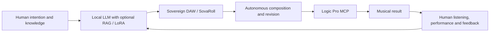

# Sovereign DAW: music remains in human hands

[한국어](PHILOSOPHY.ko.md) · [Project](README.md)

**Human knowledge. Local intelligence. Human performance.**

Sovereign DAW, published as **SovaRoll**, is Sovereign Music Lab's project to build a professional-grade open-source digital audio workstation. Its purpose is to give musicians durable control over their tools, musical decisions, and work. Professional quality is the standard we are working toward; the current release is a developing MIDI and audio workstation with documented limits.

## The creative cycle

Music begins with people: their study, experience, intention, listening, and performance. A local language model can help turn that knowledge into proposals. A musician must be able to inspect those proposals, change individual notes, reject an arrangement, play a phrase differently, and carry the work forward.

Our intended integrated workflow is:

This is the direction of the wider system, not a claim that every connection or autonomous step already ships in this repository. The human chooses the purpose, accepts or rejects changes, and decides when the result is finished. Repetition should improve the work through explicit feedback rather than hide decisions behind a final audio file.

## Three tools with distinct responsibilities

| Project | Responsibility | Independence |
|---|---|---|
| **Sovereign DAW / SovaRoll** | A professional-grade open-source DAW: editable MIDI and audio, arrangement, playback, saving, and export | Runs on its own; no other Sovereign Music Lab repository or LLM is required |
| **DeepChord** | Use a local LLM to compose while working with Logic Pro; connect musical knowledge and the composition process | A separate application with its own setup and documented capabilities |
| **Sovereign Flow / SovaFlow** | Integrate the two tools and coordinate the human–LLM–DAW–composition–MCP–result–feedback cycle | An optional orchestration project; integration must not become a hidden installation dependency |

These are product roles and architectural commitments. Availability of an integration must be established by its own implementation and tests. Requiring one repository merely to supply another's essential functionality would undermine the independence we intend.

## Editable music is a core deliverable

Notes, timing, velocity, controllers, phrasing, and arrangement must remain available for revision. Rendered audio is valuable, but it cannot substitute for the editable decisions that produced it. MIDI, project files, source audio, and exports have different jobs and should remain clearly identified.

The GUI and CLI therefore share one command engine. A person can work visually while an agent uses structured commands, with the same validation, revision checks, and undo history. Automation should make a musician's decisions easier to carry out and easier to inspect.

## Technical self-reliance should be practical

Tools should run on the musician's own computer, preserve local files, and support useful exchange formats. Using the DAW should not depend on a model subscription or another project's continued operation. Source access, readable documentation, backups, and reproducible checks are all part of ownership in practice.

We want access to technology to grow into the ability to understand, maintain, and adapt it. **Tech for all** means lowering barriers to both use and technical independence. English and Korean documentation are part of that work. Complete bilingual interface coverage remains a development goal.

## Knowledge and judgment deserve care

RAG and LoRA have different roles: retrieving relevant knowledge and adapting a model through training. They are optional parts of the wider composition workflow. Neither a large dataset nor a passing software test proves musical value. Sources, rights, interpretation, and a musician's evaluation still matter.

A loop that includes human performance and feedback respects what musicians contribute: phrasing, touch, breath, timing, taste, and the willingness to change direction. We evaluate music by listening and working with it, while using software checks to establish narrower technical facts.

## Gemma 4 is the next development chapter

From the 2026-11-08 handoff onward, the maintainer's planned AI coding workflow uses **Gemma 4 only**, running locally. The task queue, small edits, checkpoints, focused file reads, tests, and recorded evidence are designed to make that workflow manageable.

This is a forward-looking development decision. It does not relabel earlier work as Gemma-generated, claim an unperformed Gemma run, or make Gemma a requirement for running the DAW. The model should not be silently replaced when a task is difficult: preserve the work, record the failure, and let the human refine the task or change the policy explicitly.

## Open development, accountable claims

The source and project documentation are released under **Apache-2.0**. People may use, study, modify, and redistribute the work, including commercially, under that license. The maintainer's choice of development model adds no license restriction. Separate models, tools, and user materials retain their own terms.

We publish development notes, tests, implementation boundaries, and unfinished work. A functional prototype should not be presented as a finished professional workstation. A level measurement should not be presented as listening. Product inspiration or interoperability should not be turned into unsupported claims about copying another product's code.

The goal is a tool musicians can rely on, understand, and continue to shape: **knowledge from people, assistance from local intelligence, and music returned to human hands.**
