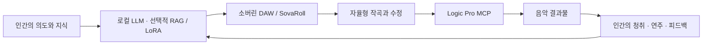

# Sovereign DAW: 음악의 주도권은 사람에게

[English](PHILOSOPHY.en.md) · [프로젝트](README.ko.md)

**인간의 지식에서, 로컬 AI를 거쳐, 다시 인간의 연주로.**

**Sovereign DAW(소버린 DAW)**는 **SovaRoll**이라는 이름으로 공개하는 Sovereign Music Lab의 프로급 오픈소스 DAW 개발 프로젝트입니다. 음악가가 자신의 도구, 음악적 판단, 작업물을 지속적으로 통제할 수 있도록 만드는 것이 목적입니다. 프로급 품질은 우리가 도달하려는 기준이며, 현재 버전은 지원 범위와 한계를 공개하며 개발 중인 MIDI·오디오 워크스테이션입니다.

## 창작의 순환

음악의 출발점은 사람의 공부, 경험, 의도, 청취와 연주입니다. 로컬 언어 모델은 그 지식을 음악적 제안으로 구체화하는 데 도움을 줄 수 있습니다. 음악가는 그 제안을 살펴보고, 음표 하나를 고치고, 편곡을 거절하고, 프레이즈를 다르게 연주하며 다음 작업으로 이어갈 수 있어야 합니다.

전체 시스템이 지향하는 흐름은 다음과 같습니다.

이는 전체 생태계의 개발 방향입니다. 모든 연결과 자율형 작업 단계가 이 저장소에 이미 구현됐다는 뜻은 아닙니다. 목적을 정하고, 변경을 받아들이거나 거절하고, 작품이 완성됐는지 판단하는 주체는 사람입니다. 반복 과정은 명시적인 피드백으로 음악을 개선하며, 최종 음원만으로는 드러나지 않는 판단 과정을 남겨야 합니다.

## 세 도구의 역할과 독립성

| 프로젝트 | 역할 | 독립성 |
|---|---|---|
| **Sovereign DAW / SovaRoll** | 프로급 오픈소스 DAW: 편집 가능한 MIDI·오디오, 편곡, 재생, 저장, 내보내기 | 다른 Sovereign Music Lab 저장소나 LLM 없이 단독 실행 |
| **DeepChord(딥코드)** | 로컬 LLM으로 Logic Pro를 사용하며 작곡하고 음악 지식과 작곡 과정을 연결 | 자체 설치 절차와 기능 범위를 가진 별도 애플리케이션 |
| **Sovereign Flow / SovaFlow(소버린 플로우)** | 두 도구를 통합하고 인간–LLM–DAW–작곡–MCP–결과–피드백 순환을 조율 | 선택적으로 사용하는 통합 워크플로; 연결이 필수 설치 의존성이 되어서는 안 됨 |

이는 제품별 역할과 설계 원칙입니다. 연동의 실제 지원 여부는 각각의 구현과 테스트로 확인해야 합니다. 한 저장소의 필수 기능을 쓰기 위해 다른 저장소를 반드시 설치하게 만드는 방식은 우리가 지향하는 독립성과 맞지 않습니다.

## 편집 가능한 음악을 남긴다

음표, 타이밍, 벨로시티, 컨트롤러, 프레이징과 편곡은 다시 수정할 수 있어야 합니다. 렌더된 오디오도 중요하지만, 그 결과를 만든 편집 가능한 선택을 대신할 수는 없습니다. MIDI, 프로젝트 파일, 원본 오디오와 내보낸 결과물은 용도가 다르며 명확히 구분해야 합니다.

그래서 GUI와 CLI는 하나의 명령 엔진을 공유합니다. 사람은 화면에서 작업하고 에이전트는 구조화된 명령을 사용하더라도 같은 검증, 리비전 충돌 검사, 실행 취소 이력을 거칩니다. 자동화는 음악가의 판단을 실행하고 확인하기 쉽게 만들어야 합니다.

## 기술 자립을 실제 사용 경험으로 만든다

도구는 음악가의 컴퓨터에서 실행되고, 로컬 파일을 보존하며, 활용할 수 있는 교환 형식을 지원해야 합니다. DAW 사용이 모델 구독이나 다른 프로젝트의 존속에 의존해서는 안 됩니다. 소스 접근, 읽을 수 있는 설명서, 백업, 재현 가능한 검증도 실질적인 통제권의 일부입니다.

기술을 접하는 기회가 기술을 이해하고 유지하며 바꾸는 능력으로 이어지기를 바랍니다. **Tech for all**은 사용의 장벽과 기술 자립의 장벽을 함께 낮추자는 뜻입니다. 영어·한국어 문서도 그 실천입니다. 화면도 대화상자까지 한국어·영어로 전환할 수 있으며, 접근성 개선은 앞으로의 과제입니다.

## 지식과 음악적 판단을 존중한다

RAG는 필요한 지식을 검색하고, LoRA는 학습을 통해 모델을 조정합니다. 두 방식은 전체 작곡 흐름에서 선택적으로 활용하는 서로 다른 역할입니다. 데이터의 양이나 소프트웨어 테스트 통과만으로 음악적 가치를 증명할 수는 없습니다. 출처, 권리, 해석과 음악가의 평가가 계속 중요합니다.

인간의 연주와 피드백이 포함된 순환은 음악가가 더하는 프레이징, 터치, 호흡, 타이밍, 취향과 방향 전환을 존중합니다. 음악은 듣고 다루면서 평가하고, 소프트웨어 검사는 확인할 수 있는 기술적 사실을 검증하는 데 사용합니다.

## 앞으로의 개발은 Gemma 4로

2026-11-08 인계 이후 관리자가 계획한 AI 코딩 작업은 **로컬 Gemma 4만 사용**합니다. 작은 작업 카드, 최소 편집, 체크포인트, 필요한 부분만 읽는 도구, 테스트와 실제 근거 기록으로 이어갈 수 있도록 개발 절차를 구성합니다.

이는 앞으로의 개발 방침입니다. 이전 작업을 Gemma가 만든 것으로 바꾸어 기록하거나, 실행하지 않은 Gemma 작업을 수행했다고 주장하지 않습니다. DAW 실행에 Gemma가 필요한 것도 아닙니다. 어려운 작업에서 다른 모델로 몰래 전환하지 않고, 작업을 보존하고 실패를 기록한 뒤 사람이 범위를 줄이거나 방침을 명시적으로 바꿉니다.

## 공개 개발과 설명의 책임

소스와 프로젝트 문서는 **Apache-2.0**으로 공개합니다. 누구나 라이선스 조건에 따라 사용·학습·수정·재배포하고 상업적으로 활용할 수 있습니다. 관리자의 개발 모델 선택은 라이선스에 추가 제한을 만들지 않습니다. 별도로 사용하는 모델, 도구와 사용자 자료에는 각각의 조건이 적용됩니다.

개발 노트, 테스트, 구현 범위와 미완성 과제를 공개합니다. 동작하는 시제품을 완성된 프로급 워크스테이션으로 소개하지 않고, 레벨 측정을 청음으로 표현하지 않습니다. 제품에서 얻은 발상이나 상호운용성 이야기를 다른 제품의 코드를 복제했다는 근거 없는 주장으로 바꾸지 않습니다.

우리가 만들고 싶은 것은 음악가가 믿고 사용하며, 이해하고, 계속 바꿀 수 있는 도구입니다. **사람에게서 얻은 지식, 로컬 지능의 도움, 다시 사람의 손으로 돌아오는 음악.**
