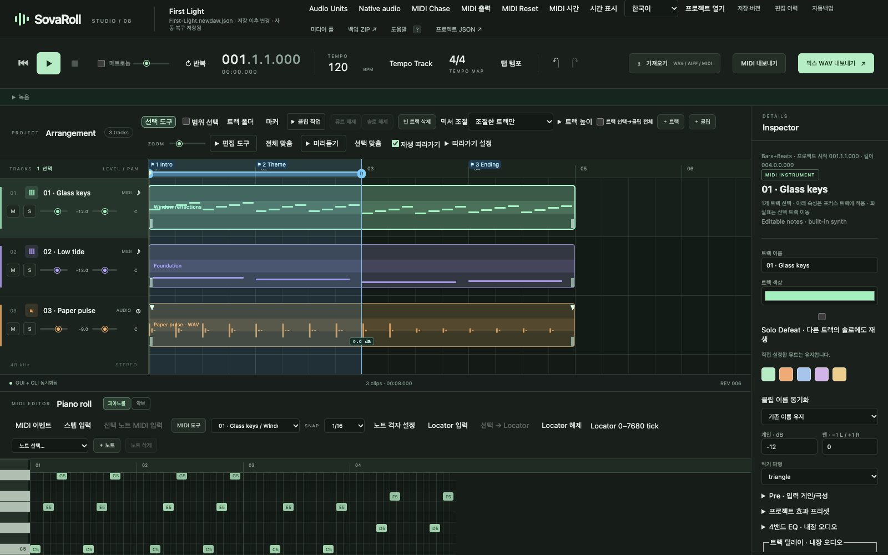

# Sovereign DAW / SovaRoll

**Authors / Project credits:** [Hee-sung Kang · 강희성](https://ikoffices.com/) · [Do-won Lee · 이도원](https://music.bugs.co.kr/artist/80353758?wl_ref=list_ar_02_search) · [Sungmo Park · 박성모](mailto:vividsaebom@gmail.com)

[Organization](https://github.com/Sovereign-Music-Lab) · [Website](https://sovereign-music-lab.github.io/) · [DeepChord](https://github.com/Sovereign-Music-Lab/DeepChord) · [Sovereign DAW](https://github.com/Sovereign-Music-Lab/sovaroll-DAW) · [Sovereign Flow](https://github.com/Sovereign-Music-Lab/SovaFlow)

## 초록
**The Sovereign MIDI Workstation · 프로급 오픈소스 DAW 개발 프로젝트**

[English](README.md) · **[SovaRoll 교본(사용 설명서)](docs/manual/ko/README.md)** · [The SovaRoll Book](docs/manual/en/README.md) · [CLI 가이드](docs/CLI-GUIDE.ko.md) · [철학](PHILOSOPHY.ko.md) · [Philosophy](PHILOSOPHY.en.md)

SovaRoll은 Sovereign Music Lab의 로컬 MIDI·오디오 워크스테이션, **소버린 DAW**입니다. 브라우저 화면과 CLI가 같은 프로젝트, 명령 엔진, 검증과 실행 취소 이력을 공유합니다. 음악을 편집 가능한 상태로 유지하고, 자신의 컴퓨터에서 작업하며, 선택한 제작 도구로 MIDI와 오디오를 이어갈 수 있게 만듭니다.

**0.129.0은 개발 중인 버전입니다.** 프로급 제작 환경을 목표로 합니다. 현재 재생은 렌더된 오디오 스냅샷을 사용하며, 저지연 네이티브 오디오와 플러그인 악기의 실시간 호스팅은 앞으로의 과제입니다. 화면은 대화상자까지 한국어·영어로 전환할 수 있으며(상단 **English / 한국어**), 그림이 들어간 사용 설명서를 두 언어로 제공합니다.



## 목차

- [설치 — 프로그래밍 몰라도 됩니다](#설치--프로그래밍-몰라도-됩니다)
- [매일의 사용 루틴](#매일의-사용-루틴)
- [업데이트와 삭제](#업데이트와-삭제)
- [사용 설명서](#사용-설명서)
- [CLI 사용법](#cli-사용법)
- [철학 1분 요약](#철학-1분-요약)
- [포함된 기능](#포함된-기능)
- [전체 작업 흐름](#전체-작업-흐름)
- [앞으로의 Gemma 4 개발](#앞으로의-gemma-4-개발)
- [라이선스](#라이선스)
- [개발 인계](#개발-인계)

## 설치 — 프로그래밍 몰라도 됩니다

1. **Node.js 22 이상**(<https://nodejs.org>의 LTS 설치 파일)과 Google Chrome을 설치합니다.
2. SovaRoll 내려받기: 위의 초록색 **Code** 버튼 → **Download ZIP**, 압축을 풀고 `sovaroll-DAW` 폴더를 고정된 곳(예: 문서)에 둡니다. Git 사용자는 `git clone https://github.com/Sovereign-Music-Lab/sovaroll-DAW.git`.
3. 시작:
   - **macOS**: **`Start SovaRoll.command`** 더블클릭(처음에는 오른쪽 클릭 → **열기** → **열기**).
   - **Windows**: **`Start SovaRoll.bat`** 더블클릭.
   - **터미널**: `npm start`(`sessions/`의 데모 곡을 엽니다).
4. 브라우저가 **http://127.0.0.1:4317**로 열립니다. 함께 뜬 터미널 창이 SovaRoll의 엔진이니 작업하는 동안 열어 두세요.

더블클릭 실행 파일은 처음에 **빈 곡**을 엽니다. 재생하려면 먼저 **가져오기 → 파일 선택**으로 MIDI를 가져오거나 MIDI 트랙과 클립을 만든 뒤 피아노롤에 음표를 넣으세요. 빈 곡에는 재생할 내용이 없습니다. [첫 곡 수업](docs/manual/ko/03-first-song.md)에서 화면을 따라 할 수 있습니다.

더블클릭 실행 파일은 곡을 **앱 밖**, 홈 폴더의 `Music/SovaRoll/My First Song`에 저장하므로 앱을 업데이트하거나 지워도 음악은 그대로입니다. `npm install`, 계정, 모델, 인터넷 서비스가 필요 없습니다. macOS 실행 파일은 검증했고, Windows 실행 파일은 제공하지만 검증이 적습니다.

## 매일의 사용 루틴

| 단계 | 할 일 |
|---|---|
| 1. 열기 | 실행 파일 더블클릭, 상단의 곡 이름 확인 |
| 2. 안전 지점 | 큰 변경 전 **Ctrl/Cmd+S**(또는 **저장·버전 → 새 버전 저장**) |
| 3. 음악 만들기 | **+ 트랙**, MIDI 클립을 만든 뒤 피아노롤을 클릭해 노트 추가, 또는 **가져오기**로 WAV/AIFF/MIDI. 녹음은 **녹음** 패널 |
| 4. 듣고 비교 | **Space**로 재생/정지, **Ctrl/Cmd+Z** / **Ctrl/Cmd+Shift+Z**로 비교 |
| 5. 믹스 | 트랙 게인, 팬, **M**(뮤트), **S**(솔로), 마스터 출력. 내보내기 전 **뮤트 해제/솔로 해제** |
| 6. 내보내기 | **믹스 WAV 내보내기**(오디오), **MIDI 내보내기**(편집 가능한 노트), 악보 보기의 **MusicXML** |
| 7. 백업 | **백업 ZIP**(프로젝트 + 오디오) |
| 8. 끝내기 | 재생을 멈추고 터미널 창 닫기(또는 그 창에서 Ctrl+C) |

편집할 때마다 자동 저장도 되며, **저장**은 되돌아갈 기준점을 표시합니다. 곡을 복사할 때는 **폴더 통째로**(`.json`과 `assets/`) 복사하세요.

## 업데이트와 삭제

**업데이트:** SovaRoll을 끝내고, 중요한 곡은 **백업 ZIP**을 만들고, 앱 폴더를 새로 받은 것으로 바꾼 뒤(Git: `git pull --ff-only`) 다시 시작합니다. `Music/SovaRoll`의 곡은 앱 폴더 안에 있지 않습니다.

**삭제:** 남길 것을 내보내고, SovaRoll을 끝내고, `sovaroll-DAW` 폴더를 휴지통으로 옮깁니다. 곡은 직접 지우기 전까지 `Music/SovaRoll`에 남습니다. SovaRoll은 서비스·드라이버·로그인 항목을 설치하지 않습니다. Node.js와 Chrome은 별개 프로그램이라 남겨도, 지워도 됩니다. 자세히: [설명서 1장](docs/manual/ko/01-install.md).

## 사용 설명서

**[SovaRoll 교본](docs/manual/ko/README.md)** — 실제 프로그램 화면을 담은 12장: 설치, 화면 둘러보기, 첫 곡 수업(화음·멜로디·베이스·셈여림·믹스·내보내기), 프로젝트와 안전장치, 편곡, MIDI 깊이 보기, 악보 보기와 MusicXML, 오디오와 녹음, 재생과 믹싱, 내보내기, CLI 전체, 참고 표(단축키, 음표 값, 셈여림, MIDI 번호, 빠르기말, 문제 해결, 용어집). 영어 화면을 쓰는 영어판: [The SovaRoll Book](docs/manual/en/README.md). 그림은 `node scripts/manual/capture-screens.mjs`로 다시 만들 수 있습니다.

## CLI 사용법

CLI는 브라우저와 같은 프로젝트를 같은 검증과 실행 취소 이력으로 편집합니다. 서버 없이 볼 수 있는 내장 가이드부터 시작하세요.

```sh
npm run cli -- guide            # 루틴과 주제 목록
npm run cli -- guide export     # 주제 하나 (start, projects, edit, time, import, export, save, media, native)
npm run cli -- --help           # 모든 명령과 옵션
```

루틴은 **확인 → 검증(dry-run) → 적용 → 저장**입니다.

```sh
npm run cli -- status                                              # ID와 리비전
npm run cli -- command track.add '{"type":"midi","name":"Piano"}' --dry-run
npm run cli -- command track.add '{"type":"midi","name":"Piano"}'
npm run cli -- save
npm run cli -- render sessions/mix.wav
```

전체 가이드: [CLI 가이드](docs/CLI-GUIDE.ko.md) · [CLI guide](docs/CLI-GUIDE.en.md). 모든 옵션 원문: [CLI 도움말](docs/CLI.md).

## 철학 1분 요약

전문은 [철학](PHILOSOPHY.ko.md) / [Philosophy](PHILOSOPHY.en.md)에 있습니다. 요약하면:

- **주도권은 음악가에게.** 지식, 의도, 청취는 사람에게서 나옵니다. 로컬 AI는 제안할 수 있고, 받아들이고 고치고 거절하는 것은 사람입니다.
- **편집 가능한 음악을 남긴다.** 음표, 타이밍, 벨로시티, 컨트롤러, 원본 오디오를 보존합니다. 렌더된 WAV가 그것을 만든 선택을 대신하지 않습니다.
- **사람과 에이전트가 하나의 엔진을.** 브라우저와 CLI가 검증, 리비전 검사, 실행 취소를 공유하므로 자동화도 클릭만큼 확인할 수 있습니다.
- **독립성.** 내 컴퓨터에서 실행하고, 로컬 파일과 열린 형식을 쓰며, 모델·계정·다른 프로젝트가 필요 없습니다. 연동은 선택입니다.
- **Tech for all.** 읽기 쉬운 두 언어 문서, 백업, 재현 가능한 검증도 실질적인 통제권입니다.
- **정직한 범위.** 구현·검증·부분 구현·계획을 구분해 공개합니다. 레벨 측정은 청음이 아니며, 동작하는 시제품은 완성된 프로급 워크스테이션이 아닙니다.

## 포함된 기능

- MIDI 피아노롤, MusicXML 내보내기가 되는 큰보표 악보 보기, 노트·컨트롤러 편집, 클립, 트랙 폴더, 시간·퀀타이즈·스텝 입력과 Undo/Redo.
- WAV/AIFF·MIDI 가져오기, 오디오 클립 편집, 브라우저 녹음, 믹서, WAV·MIDI·프로젝트 묶음 내보내기.
- 로컬 프로젝트, 명시 저장, 버전 저장, 자동 백업·복구와 미디어 무결성 확인.
- 사람과 에이전트가 함께 사용하는 명령 인터페이스: 검증, 미리 검사, 리비전 충돌 거부와 원자적 일괄 편집.
- 선택적 macOS CoreMIDI 출력. MIDI만 전송하며 네이티브 오디오와 동기 재생하지 않습니다.
- 제품 테스트, 브라우저 인수 테스트, 개발 노트, 작업 큐와 로컬 에이전트 하네스.

[개발 노트](docs/DEVELOPMENT.ko.md), [English development notes](docs/DEVELOPMENT.en.md), [요건표](docs/agent/REQUIREMENTS.md), [기능 인벤터리](docs/FEATURE_INVENTORY.ko.md), [검증 기록](docs/VALIDATION.md)에서 구현된 기능, 실제 검증한 범위와 남은 작업을 확인할 수 있습니다.

## 전체 작업 흐름

**인간 → 로컬 LLM(선택적 RAG·LoRA) → 소버린 DAW → 자율형 작곡 → Logic Pro MCP → 결과 → 인간 피드백 → 반복.**

소버린 DAW는 독립적인 편집 워크스테이션입니다. **DeepChord(딥코드)**는 로컬 LLM으로 Logic Pro를 사용하며 작곡하는 도구이고, **Sovereign Flow / SovaFlow(소버린 플로우)**는 두 도구를 연결하는 통합 워크플로입니다. [철학 문서](PHILOSOPHY.ko.md)에 역할을 정리했습니다. 전체 자율형 순환은 개발 방향이며 이번 버전에 모두 내장된 기능은 아닙니다. SovaRoll은 다른 두 프로젝트 없이 실행됩니다.

## 앞으로의 Gemma 4 개발

이번 인계 이후 관리자의 AI 코딩 작업은 **로컬 Gemma 4만 사용**합니다. 이는 개발 방침이며 실행 의존성이나 라이선스 제한이 아닙니다. 이전 작업을 Gemma의 작업으로 바꾸어 기록하지 않으며, 이번 공개에서 Gemma 실행을 검증했다고 주장하지 않습니다.

[AGENTS.md](AGENTS.md), [CONTINUE.md](CONTINUE.md), [Gemma 4 인계 문서](docs/agent/LOCAL_MODEL.md)를 읽고 이어갑니다.

```sh
npm run agent:task -- next
npm run agent:verify:full
npm run test:native
npm run agent:e2e
```

브라우저 테스트에는 외부 Playwright와 Chrome, 타임 스트레치 테스트에는 FFmpeg가 필요합니다. 설치 방법은 설명서에 있습니다. 이 도구들은 DAW의 npm 실행 의존성이 아닙니다.

## 라이선스

[Apache License 2.0](LICENSE) · [NOTICE](NOTICE). 사용·재배포에는 라이선스 전문이 적용됩니다. 별도로 설치하는 모델, 런타임, 외부 도구와 사용자 미디어에는 각자의 라이선스가 적용됩니다. Gemma 4 개발 방침은 Apache-2.0의 이용 권한에 추가 제한을 만들지 않습니다.

기존 파일과의 호환성을 위해 `.newdaw.json` 확장자, `NEWDAW_*` 환경 변수와 일부 내부 식별자를 유지합니다.

## 개발 인계

[CONTEXT.md](CONTEXT.md) · [Model operations / 모델 운영](docs/MODEL_OPERATIONS.ko.md) · [Reusable skill / 재사용 스킬](skills/model-tier-handoff/SKILL.md)

[첫 Gemma 4 인계 프롬프트](docs/agent/FIRST_GEMMA_PROMPT.md) — 2026-11-08
