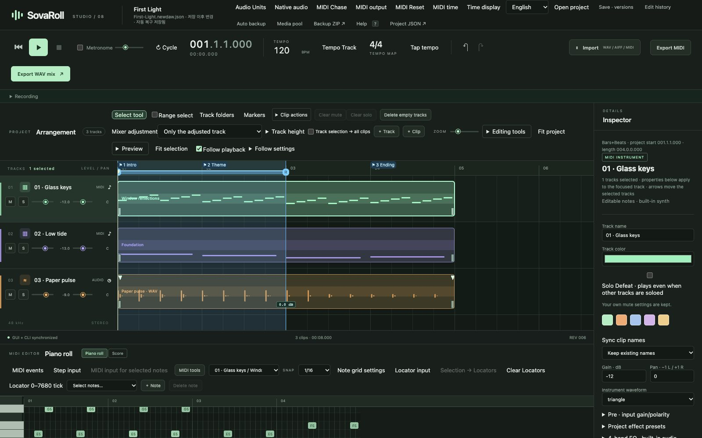

# Sovereign DAW / SovaRoll

**Authors / Project credits:** [Hee-sung Kang · 강희성](https://ikoffices.com/) · [Do-won Lee · 이도원](https://music.bugs.co.kr/artist/80353758?wl_ref=list_ar_02_search) · [Sungmo Park · 박성모](mailto:vividsaebom@gmail.com)

[Organization](https://github.com/Sovereign-Music-Lab) · [Website](https://sovereign-music-lab.github.io/) · [DeepChord](https://github.com/Sovereign-Music-Lab/DeepChord) · [Sovereign DAW](https://github.com/Sovereign-Music-Lab/sovaroll-DAW) · [Sovereign Flow](https://github.com/Sovereign-Music-Lab/SovaFlow)

## Abstract
**The Sovereign MIDI Workstation · A professional-grade open-source DAW in development**

[한국어](README.ko.md) · **[The SovaRoll Book (user manual)](docs/manual/en/README.md)** · [SovaRoll 교본](docs/manual/ko/README.md) · [CLI guide](docs/CLI-GUIDE.en.md) · [Philosophy](PHILOSOPHY.en.md) · [철학](PHILOSOPHY.ko.md)

SovaRoll is Sovereign Music Lab's local MIDI and audio workstation. Its browser interface and CLI share the same project, command engine, validation, and undo history. Keep music editable, work on your own computer, and carry MIDI and audio into the production tools you choose.

**Version 0.129.0 is a development release.** Professional-grade production is the goal. Playback currently uses a rendered audio snapshot; low-latency native audio and real-time plugin instrument hosting are still future work. The interface switches between Korean and English (**English / 한국어** in the top bar), including dialogs. The illustrated user manual exists in both languages.



## Contents

- [Install — no programming needed](#install--no-programming-needed)
- [Your daily routine](#your-daily-routine)
- [Update or uninstall](#update-or-uninstall)
- [The user manual](#the-user-manual)
- [Using the CLI](#using-the-cli)
- [Philosophy in one minute](#philosophy-in-one-minute)
- [What is here](#what-is-here)
- [The wider workflow](#the-wider-workflow)
- [Continue development with Gemma 4](#continue-development-with-gemma-4)
- [License](#license)
- [Development handoff](#development-handoff)

## Install — no programming needed

1. Install **Node.js 22 or newer** (the LTS installer from <https://nodejs.org>) and Google Chrome.
2. Download SovaRoll: green **Code** button above → **Download ZIP**, unpack it, and move the `sovaroll-DAW` folder somewhere permanent (for example Documents). Git users: `git clone https://github.com/Sovereign-Music-Lab/sovaroll-DAW.git`.
3. Start it:
   - **macOS**: double-click **`Start SovaRoll.command`** (first time: right-click → **Open** → **Open**).
   - **Windows**: double-click **`Start SovaRoll.bat`**.
   - **Terminal**: `npm start` (opens the demo song in `sessions/`).
4. Your browser opens **http://127.0.0.1:4317**. The terminal window that appeared is SovaRoll's engine — keep it open while you work.

The double-click starter initially opens an **empty song**. Before playback, use **Import → Choose files** to import MIDI, or create a MIDI track and clip and add notes in the piano roll. An empty song has nothing to play. Follow the pictures in [Your first song](docs/manual/en/03-first-song.md).

The double-click starters keep your songs **outside the app**, in `Music/SovaRoll/My First Song` in your home folder, so updating or deleting the app never touches your music. No `npm install`, account, model or internet service is needed. The macOS starter is tested; the Windows starter is provided but less tested.

## Your daily routine

| Step | What to do |
|---|---|
| 1. Open | Double-click the starter; confirm the song name at the top |
| 2. Safety point | **Ctrl/Cmd+S** before a big change (or **Save · versions → Save new version**) |
| 3. Make music | **+ Track**, create a MIDI clip, then click in the piano roll to add notes, or **Import** your WAV/AIFF/MIDI; record in the **Recording** panel |
| 4. Listen and compare | **Space** to play/stop; **Ctrl/Cmd+Z** / **Ctrl/Cmd+Shift+Z** to compare versions |
| 5. Mix | Track gain, pan, **M**ute, **S**olo, master output; **Clear mute/solo** before exporting |
| 6. Export | **Export WAV mix** (audio), **Export MIDI** (editable notes), **MusicXML** in the score view |
| 7. Back up | **Backup ZIP** (project + audio) |
| 8. Quit | Stop playback, then close the terminal window (or Ctrl+C in it) |

Everything is also saved automatically after each edit; **Save** marks the reference point you can revert to. Copy a song by copying its **whole folder** (the `.json` plus `assets/`).

## Update or uninstall

**Update:** quit SovaRoll, make a **Backup ZIP** of important songs, replace the app folder with the new download (Git: `git pull --ff-only`), start again. Your songs in `Music/SovaRoll` are not inside the app folder.

**Uninstall:** export what you want to keep, quit SovaRoll, and move the `sovaroll-DAW` folder to the Trash. Your songs stay in `Music/SovaRoll` until you delete that folder yourself. SovaRoll installs no services, drivers or login items. Node.js and Chrome are separate programs you may keep or remove. Details: [manual chapter 1](docs/manual/en/01-install.md).

## The user manual

**[The SovaRoll Book](docs/manual/en/README.md)** — 12 illustrated chapters with real screenshots of the program: install, a screen tour, a guided first-song lesson (chords, melody, bass, dynamics, mix, export), projects and safety, arrangement, MIDI in depth, score view and MusicXML, audio and recording, playback and mixing, export, the complete CLI, and reference tables (shortcuts, note values, dynamics, MIDI numbers, tempo terms, troubleshooting, glossary). Korean edition with the Korean interface: [SovaRoll 교본](docs/manual/ko/README.md). Screenshots are reproducible with `node scripts/manual/capture-screens.mjs`.

## Using the CLI

The CLI edits the same project as the browser, with the same validation and undo history. Start with the built-in guide, which works without a server:

```sh
npm run cli -- guide            # routine + topic list
npm run cli -- guide export     # one topic (start, projects, edit, time, import, export, save, media, native)
npm run cli -- --help           # every command and option
```

The routine is **look → dry-run → apply → save**:

```sh
npm run cli -- status                                              # IDs and revision
npm run cli -- command track.add '{"type":"midi","name":"Piano"}' --dry-run
npm run cli -- command track.add '{"type":"midi","name":"Piano"}'
npm run cli -- save
npm run cli -- render sessions/mix.wav
```

Full written guide: [CLI guide](docs/CLI-GUIDE.en.md) · [CLI 가이드](docs/CLI-GUIDE.ko.md). Complete option text: [CLI reference](docs/CLI.md).

## Philosophy in one minute

Read the full [philosophy](PHILOSOPHY.en.md) / [철학](PHILOSOPHY.ko.md). The short version:

- **The musician stays in charge.** Knowledge, intent and listening come from people. A local AI may propose; a person accepts, edits or rejects.
- **Keep music editable.** Notes, timing, velocity, controllers and source audio survive. A rendered WAV never replaces the choices that made it.
- **One engine for people and agents.** Browser and CLI share validation, revision checks and undo, so automation is as inspectable as a click.
- **Independence.** Runs on your computer, keeps local files, uses open formats, and needs no model, account, or sibling project. Integrations are optional.
- **Tech for all.** Readable bilingual docs, backups and reproducible checks are part of real control.
- **Honest scope.** We publish what is implemented, tested, partial or planned. A level meter is not a listening test, and a working prototype is not a finished professional workstation.

## What is here

- MIDI piano roll, grand-staff score view with MusicXML export, note and controller editing, clips, track folders, timing, quantization, step input, and undo/redo.
- WAV/AIFF and MIDI import, audio clip editing, browser recording, mixer controls, and WAV/MIDI/project bundle export.
- Local project files, explicit save, versions, automatic backup/recovery, and media integrity checks.
- One command interface for people and agents, with validation, dry runs, revision conflict checks, and atomic batches.
- Optional macOS CoreMIDI output. It sends MIDI only; it is not synchronized native audio playback.
- Product tests, browser acceptance scripts, development notes, a task queue, and a local-agent harness.

See [development notes](docs/DEVELOPMENT.en.md), [개발 노트](docs/DEVELOPMENT.ko.md), [requirements](docs/agent/REQUIREMENTS.md), [feature inventory](docs/FEATURE_INVENTORY.en.md), and [validation](docs/VALIDATION.md) for the distinction between implemented, tested, and unfinished work.

## The wider workflow

**Human → local LLM (optional RAG / LoRA) → Sovereign DAW → autonomous composition → Logic Pro MCP → result → human feedback → repeat.**

Sovereign DAW is the independent editing workstation. **DeepChord** uses a local LLM to compose while working with Logic Pro. **Sovereign Flow / SovaFlow** is the intended integration workflow connecting the two. These responsibilities are documented in the [philosophy](PHILOSOPHY.en.md); the complete autonomous loop is a development direction, not a bundled feature of this release. SovaRoll runs independently of both projects.

## Continue development with Gemma 4

The maintainer's AI coding workflow after this handoff uses **local Gemma 4 only**. This is a development policy, not a runtime dependency or license restriction. Existing work is not retrospectively attributed to Gemma. No Gemma session is claimed by this publication.

Read [AGENTS.md](AGENTS.md), [CONTINUE.md](CONTINUE.md), and the [Gemma 4 handoff](docs/agent/LOCAL_MODEL.md).

```sh
npm run agent:task -- next
npm run agent:verify:full
npm run test:native
npm run agent:e2e
```

Browser tests require an external Playwright installation and Chrome; time-stretch tests require FFmpeg. See the manuals for setup. Neither is an npm runtime dependency of the DAW.

## License

[Apache License 2.0](LICENSE) · [NOTICE](NOTICE). The full license governs use and redistribution. Separately installed models, runtimes, external tools, and user media keep their own licenses. The Gemma 4 policy adds no restriction to Apache-2.0 permissions.

The project file extension `.newdaw.json`, `NEWDAW_*` environment variables, and some internal identifiers are retained for compatibility.

## Development handoff

[CONTEXT.md](CONTEXT.md) · [Model operations / 모델 운영](docs/MODEL_OPERATIONS.en.md) · [Reusable skill / 재사용 스킬](skills/model-tier-handoff/SKILL.md)

[First Gemma 4 handoff prompt](docs/agent/FIRST_GEMMA_PROMPT.md) — 2026-11-08
