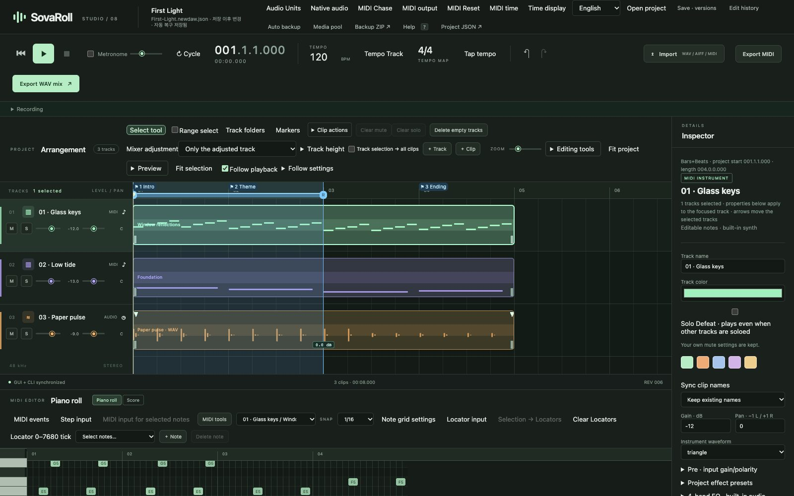
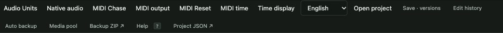

# 1. Install, start, update, remove

[← Contents](README.md) · [한국어](../ko/01-install.md)

Installing SovaRoll means two things: installing **Node.js** (the engine SovaRoll runs on) and putting the **SovaRoll folder** somewhere on your computer. Nothing else is installed system-wide, there is no account, and nothing runs in the background after you close it.

## 1.1 What you need

| Item | Why | Where |
|---|---|---|
| A Mac (macOS) or Windows/Linux computer | SovaRoll is tested on macOS with Chrome | — |
| Google Chrome (recommended) | The interface runs in the browser | <https://www.google.com/chrome/> |
| Node.js **22 or newer** (LTS) | Runs SovaRoll | <https://nodejs.org> |
| About 50 MB of disk space | App folder | — |
| Headphones (for recording) | Avoid feedback when monitoring | — |

## 1.2 Install Node.js (once)

1. Open <https://nodejs.org> and download the **LTS** installer for your system.
2. Run the installer and accept the defaults.
3. (Optional check) Open **Terminal** (Mac: Spotlight → "Terminal") and type `node --version`. You should see `v22` or higher.

## 1.3 Download SovaRoll

**Without Git (easiest):** open <https://github.com/Sovereign-Music-Lab/sovaroll-DAW>, click the green **Code** button → **Download ZIP**. Double-click the ZIP to unpack it, and move the `sovaroll-DAW` folder somewhere permanent, for example your **Applications** or **Documents** folder.

**With Git (for updates by command):**

```sh
git clone https://github.com/Sovereign-Music-Lab/sovaroll-DAW.git
```

## 1.4 Start SovaRoll

| System | Do this |
|---|---|
| macOS | Double-click **`Start SovaRoll.command`** in the folder. The first time, macOS may say it cannot verify the file: right-click it → **Open** → **Open**. |
| Windows | Double-click **`Start SovaRoll.bat`**. If SmartScreen appears, choose **More info → Run anyway**. |
| Linux / any terminal | In the folder: `npm start` |

A terminal window opens and stays open — that window *is* SovaRoll's engine. After a moment your browser opens at **http://127.0.0.1:4317**. The address `127.0.0.1` means "this computer": nothing is sent to the internet.

The double-click starters create your first project at:

- macOS: `~/Music/SovaRoll/My First Song/My First Song.newdaw.json`
- Windows: `%USERPROFILE%\Music\SovaRoll\My First Song\My First Song.newdaw.json`

The next time, the same project opens again. (`npm start` instead opens a demo song stored inside the app folder at `sessions/First-Light.newdaw.json`.)



> **If the browser does not open**, type `http://127.0.0.1:4317` into Chrome yourself. **If the port is busy** (another program uses 4317), the starter opens the running SovaRoll. With the terminal you can choose another port: `npm start -- --port 4318`.

## 1.5 Choose your language

Use the **English / 한국어** menu in the top bar. The choice is remembered in this browser. It changes only the interface — never your project, track names or files.



## 1.6 Quit

1. Stop playback (**Space** or ■).
2. Your work is already saved automatically. If you want a named safe point, press **Ctrl/Cmd+S** first.
3. Close the terminal window, or click in it and press **Ctrl+C**.

Closing only the browser tab does **not** stop SovaRoll; the terminal window does.

## 1.7 Where your music is stored

A SovaRoll project is a **folder**, not a single file:

```
My First Song/
  My First Song.newdaw.json         ← the song (tracks, notes, clips, mix)
  assets/                           ← your imported and recorded audio (never altered)
  My First Song.newdaw.json.history.json   ← undo history
  My First Song.newdaw.json.saved.json     ← your last explicit Save
  *.bak, autobackups                ← recovery copies
```

**Always copy or move the whole folder.** Copying only the `.json` file leaves your audio behind.

## 1.8 Update SovaRoll

1. Quit SovaRoll. Make a **Backup ZIP** of important songs (chapter 10).
2. ZIP users: download the new ZIP, unpack it, and replace the old app folder. Your songs in `Music/SovaRoll` are not inside it, so they are untouched. (If you used the demo in `sessions/` and edited it, copy that folder out first.)
3. Git users: in the app folder run `git pull --ff-only`. If Git refuses because you changed files, keep your changes and ask for help rather than deleting them.
4. Start SovaRoll and open your song. Make a small edit, undo it, and export a short mix to confirm.

## 1.9 Remove SovaRoll completely (without losing music)

1. Export what you want to keep: **Export WAV mix**, **Export MIDI** and **Backup ZIP** (chapter 10).
2. Quit SovaRoll (1.6).
3. Move the `sovaroll-DAW` app folder to the Trash / Recycle Bin.
4. Your songs remain in `Music/SovaRoll`. Delete that folder only if you really want to delete your music.
5. Optional: Chrome stores the language choice and some recovery data for `127.0.0.1:4317`. Chrome → Settings → Privacy → Site settings → View permissions and data stored across sites → search `127.0.0.1` → Delete data. Export any recovery takes first.
6. Node.js and Chrome are separate programs; uninstall them only if nothing else uses them (Mac: delete Node from Applications or with its uninstaller; Windows: Settings → Apps).

SovaRoll installs no services, login items or drivers, so there is nothing else to remove.

---
[← Contents](README.md) · Next: [2. A tour of the screen →](02-tour.md)
