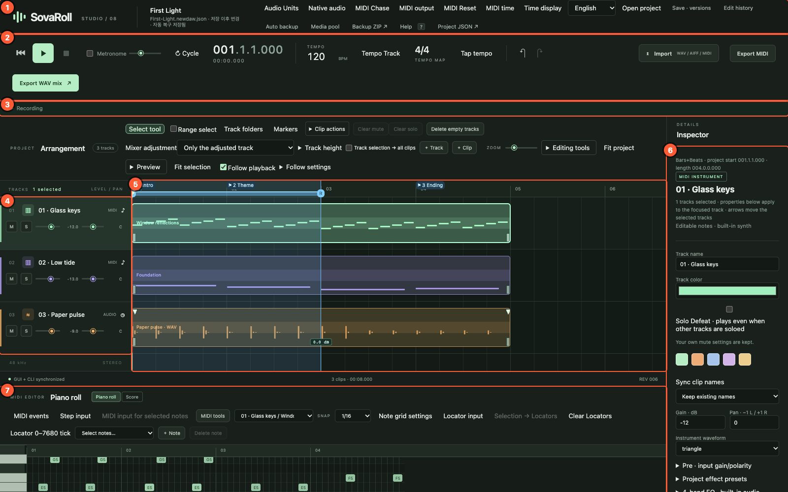
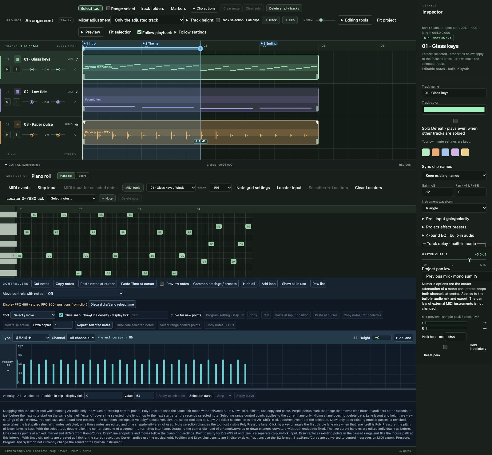
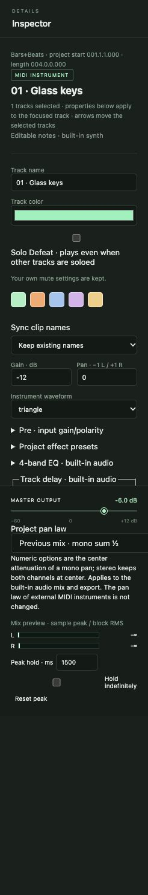
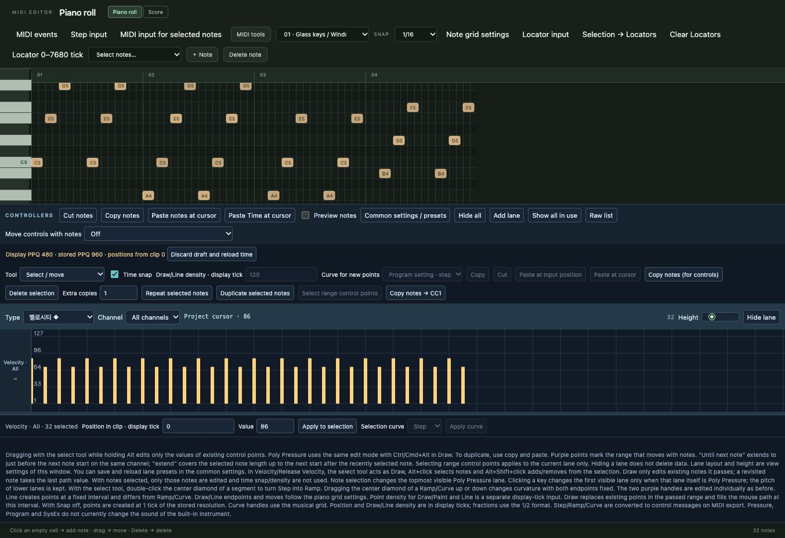
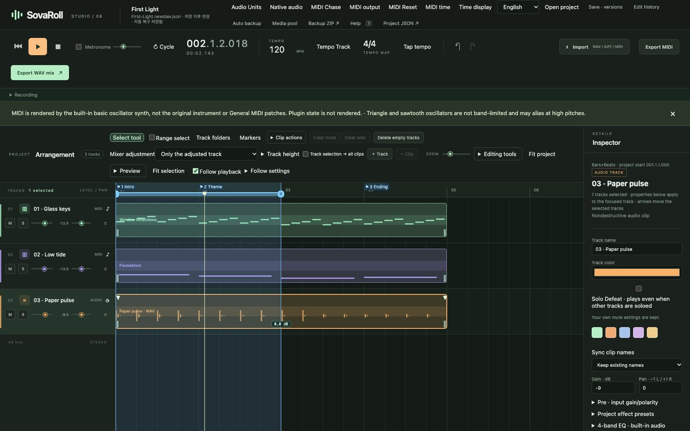

# 2. A tour of the screen

[← Contents](README.md) · [한국어](../ko/02-tour.md)

SovaRoll fits a whole studio into one window. Learn the seven areas once and every later chapter will feel familiar.

| # | Area | What it is for |
|---|---|---|
| 1 | **Top bar** | Project name and file, language, project windows (Open project, Save · versions, Edit history, Auto backup, Media pool, Backup ZIP, Help) and engine settings (MIDI output, Chase, Reset, MIDI time, Time display, Audio Units, Native audio) |
| 2 | **Transport bar** | Rewind, Play, Stop, Metronome, Cycle, the position counter, tempo, meter, Undo/Redo, Import, Export MIDI, Export WAV mix |
| 3 | **Recording panel** | Microphone and MIDI keyboard recording; folded until you open it (chapter 8) |
| 4 | **Track headers** | One row per track: number, name, type, **M**ute, **S**olo, gain and pan sliders |
| 5 | **Arrangement** | The timeline: ruler with bars, markers and locators; clips on each track's lane |
| 6 | **Inspector** | Properties of whatever is selected (track, clip, note), plus master output and meters |
| 7 | **Editor** | The **Piano roll** or **Score** of the selected MIDI clip, and controller lanes under it |

## 2.1 Top bar

The left side shows the project name (**First Light** in the demo) and the file name with its save state, for example "changed since save · auto-recovery saved". The right side opens project windows and engine settings. Each window is covered in the chapter that uses it.

## 2.2 Transport bar

From left to right:

- **⏮ Rewind**, **▶ Play** and **■ Stop**. **Space** plays and stops when you are not typing in a field.
- **Metronome** check box and its volume. The click is heard during playback and count-in but never written into exports.
- **Cycle** repeats the range between the two locators (chapter 9).
- The **position counter**: bars.beats.sixteenths.ticks on top (`001.1.1.000` = bar 1, beat 1), clock time underneath. The format can be changed in **Time display**.
- **Tempo** (BPM) and **Tempo Track** / **Fixed tempo** mode; the **meter** (4/4) which opens the tempo map; **Tap tempo**.
- **↶ Undo** and **↷ Redo**.
- **Import** (WAV / AIFF / MIDI), **Export MIDI**, **Export WAV mix**.

## 2.3 Arrangement and track headers

The ruler counts bars (01, 02, 03 …). Flags such as **1 Intro**, **2 Theme** and **3 Ending** are **markers**. The blue band with **L** and **R** handles is the **locator range**, used for cycle playback and range export. The vertical line is the **playhead**.

Each track row has:

- the track number (drag it to reorder), a type icon, the name (click to select) and the type (**MIDI** or **AUDIO**);
- **M** (mute) and **S** (solo; Shift+click to solo only this track);
- a **gain** slider (dB) and a **pan** slider (L … C … R).

Clips are the coloured blocks. MIDI clips show their notes as small dashes; audio clips show their waveform. Click a clip to select it, drag to move it, drag its edges to change its length.

The toolbar above the arrangement holds the **Select tool** and **Range select**, **Track folders**, **Markers**, **Clip actions**, **Clear mute/solo**, **Delete empty tracks**, **Mixer adjustment** mode, **Track height**, **+ Track**, **+ Clip**, **Zoom**, **Editing tools**, **Fit project**, **Preview**, **Fit selection** and **Follow playback**.

## 2.4 Inspector

The Inspector always edits the **focused** object. With a track selected you can rename it, choose its colour, set **Solo Defeat**, gain, pan and the built-in instrument waveform, and open sections such as **Pre**, **Project effect presets**, **4-band EQ** and **Track delay**. With a clip selected you get clip fields (start, length, gain, fades …); with a note selected, note fields (pitch, velocity, start, length). Type a value and press the **Apply** button of that section.

The bottom of the Inspector holds **Master output** (the final volume), the **Project pan law** and the **mix preview meters** with peak hold.

## 2.5 Editor: piano roll and score

The editor shows the clip that is selected in the arrangement. Switch between **Piano roll** and **Score** with the two buttons next to the title. The keyboard on the left names the pitches (C5 = MIDI 72, C4 = middle C = MIDI 60). Under the notes are the **Controllers** lanes for velocity, CC, pitch bend and more (chapter 6).

## 2.6 Status line

Under the arrangement you see the connection state (**GUI + CLI synchronized** means the browser is talking to the engine), the clip count and length, and the project **REV**ision number, which goes up by one with every edit.

## 2.7 While playing

Press Play: the browser first renders the current song (a short wait), then plays it while the playhead moves and the meters show the level. If you edit during playback, playback stops so you never mistake an old render for the current song.

---
[← 1. Install](01-install.md) · Next: [3. Your first song →](03-first-song.md)
