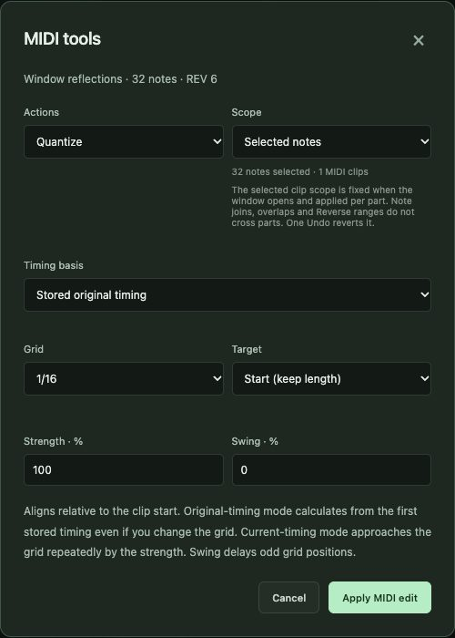

# 3. Your first song in 30 minutes

[← Contents](README.md) · [한국어](../ko/03-first-song.md)

This chapter is a lesson. You will write a short piece with three parts — **chords**, **melody** and **bass** — shape its dynamics, balance it and export it. Every step names the exact button. Do it once with this recipe; next time change everything.

**The piece:** 4 bars, 4/4 time, 96 BPM, in C major, using the most famous progression in popular music: **C – Am – F – G** (I – vi – IV – V).

| Bar | Chord | Notes in the chord | Bass note |
|---|---|---|---|
| 1 | C major (I) | C E G | C2 |
| 2 | A minor (vi) | A C E | A1 |
| 3 | F major (IV) | F A C | F1 |
| 4 | G major (V) | G B D | G1 |

## Step 1 — Start an empty song and set the tempo

1. Start SovaRoll (chapter 1). A new song is empty, with the message *Put your first idea down*.
2. Click the tempo number (**120**) in the transport bar, type `96`, press **Enter**.
3. Check the meter shows **4/4**.

> **Tempo words.** Composers describe speed with Italian terms. 96 BPM sits between *Andante* (walking, ~76–108) and *Moderato*. See the tempo table in [chapter 12](12-reference.md#music-tables).

## Step 2 — Create the chord track

1. Click **Create MIDI track** in the empty arrangement (or **+ Track** in the toolbar → type *MIDI*, name `Chords` → **Add**).
2. A track and an empty 4-bar part appear, and the part opens in the piano roll.
3. Rename it: select the track, type `Chords` in **Track name** in the Inspector, press **Apply**.

## Step 3 — Write the chords

A new note is as long as the **snap** value shown above the piano roll (default **1/16**). For chords choose **1/2** (a half note) in the snap menu, so every click makes a half note.

1. Scroll the piano roll so that C3–C5 is visible.
2. Bar 1: click **C4**, **E4** and **G4** at beat 1, and again at beat 3. You now hear the C chord twice per bar, a calm half-note pulse.
3. Bar 2: the same with **A3**, **C4**, **E4**.
4. Bar 3: **F3**, **A3**, **C4**. Bar 4: **G3**, **B3**, **D4**.
5. Press **Space** to listen. Press **Space** again to stop.

Prefer one long chord per bar? Enter the chords only at beat 1, select them all (**Ctrl/Cmd+A**) and use **MIDI tools → Legato**: each chord then lasts until the next one.

> **Voice leading.** Notice how few notes move between chords: C and E stay from C to Am, C stays from Am to F. Keeping common tones in place makes chords sound smooth — the first rule of good harmony.

## Step 4 — Select, copy and fix notes

- Click a note to select it; **Shift**+click to add more; **Ctrl/Cmd+A** selects all notes in the part.
- Drag a selected note up/down to change pitch, left/right to change time.
- **Delete** removes selected notes.
- **Ctrl/Cmd+C** copies; click the piano-roll ruler where you want them; **Ctrl/Cmd+V** pastes at that position.
- Made a mistake? **Ctrl/Cmd+Z** undoes, **Ctrl/Cmd+Shift+Z** redoes. Undo also works for edits made from the command line.

## Step 5 — Exact length and velocity in the Inspector

Select a note. In the Inspector:

- **Velocity** (1–127) is how hard the key is struck. Set the chords to about `70` (*mezzo-piano*).
- **Length** is in display ticks (480 per quarter note by default, so a 4/4 bar is `1920`).
- Press **Apply note**.

For many notes at once use **MIDI tools** → **Velocity** (see step 8).

## Step 6 — Add a melody

1. Add another MIDI track named `Melody` (**+ Track**).
2. Set the snap to **1/8** (eighth notes).
3. Write a simple tune above the chords using chord tones on strong beats, for example:
   - Bar 1: E5 G5 E5 D5 · C5 (half note)
   - Bar 2: C5 E5 C5 B4 · A4
   - Bar 3: A4 C5 F5 E5 · C5
   - Bar 4: D5 B4 G4 B4 · D5 (leave a breath at the end)
4. Give the melody a stronger velocity, around `90` (*mezzo-forte*), so it sings over the chords.

> **Melody tips.** Put chord tones on beats 1 and 3, use steps more than leaps, and end phrases on a longer note. A rest is part of the melody — it lets the line breathe.

## Step 7 — Add the bass

1. Add a MIDI track named `Bass`.
2. In the Inspector set **Instrument waveform** to **sawtooth** or **triangle** for a fuller low sound.
3. Write the root of each chord: C2, A1, F1, G1 — one per bar, or on beats 1 and 3.
4. Lower the bass track gain a little (−3 dB) so it supports rather than dominates.

## Step 8 — Make it feel human

Open **MIDI tools** (above the piano roll):

- **Quantize** lines notes up to the grid. *Strength* below 100 % moves them only part of the way; *Swing* delays every second grid position for a shuffle feel.
- **Velocity** sets, scales or randomizes velocity within a range — a few points of variation avoids a robotic sound.
- **Legato** joins notes so each lasts until the next one.
- **Transpose** moves the selection by semitones, optionally within a scale.

Every MIDI tool is one Undo step.

## Step 9 — Balance the mix

1. Press **Space** and listen to all three tracks.
2. Adjust the **gain** sliders: melody clearest, chords behind, bass solid.
3. Pan the chords slightly left (`-0.2`) and leave melody and bass in the center.
4. Use **S** to solo a track and **M** to mute it; **Clear mute/solo** before exporting.
5. Watch the **mix preview** meters at the bottom of the Inspector. If they reach the top, lower **Master output**.

## Step 10 — Save, export and back up

1. Press **Ctrl/Cmd+S** to mark this version as your saved reference.
2. Click **Export WAV mix** → keep the defaults → **Render WAV**. When it finishes, a **Rendered WAV** download link appears in the Inspector.
3. Click **Export MIDI** → **Export SMF file** for the editable notes (you can open this file in any DAW, including Logic Pro).
4. Click **Backup ZIP** in the top bar to keep the whole project with its audio.

Congratulations — you have written, arranged, mixed and exported a song. The rest of the book explains each tool in depth.

---
[← 2. Tour](02-tour.md) · Next: [4. Projects, saving and safety →](04-projects.md)
