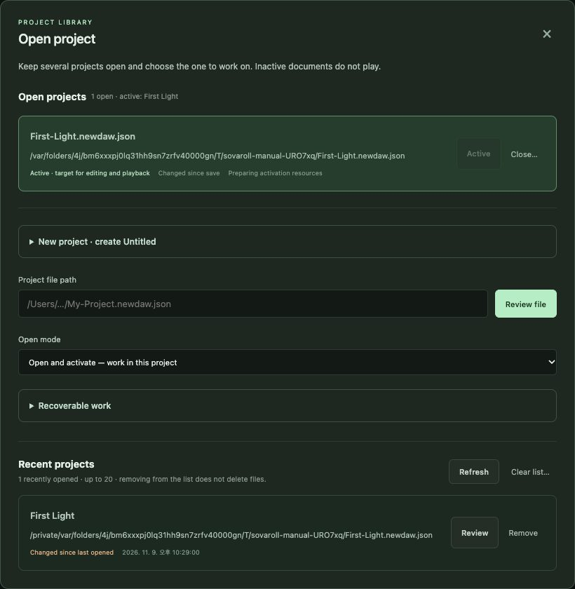
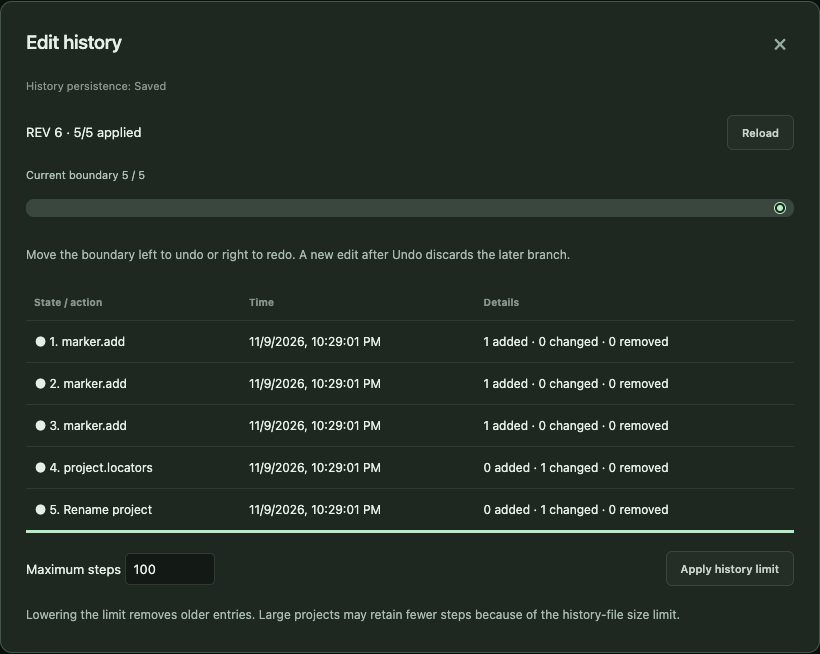
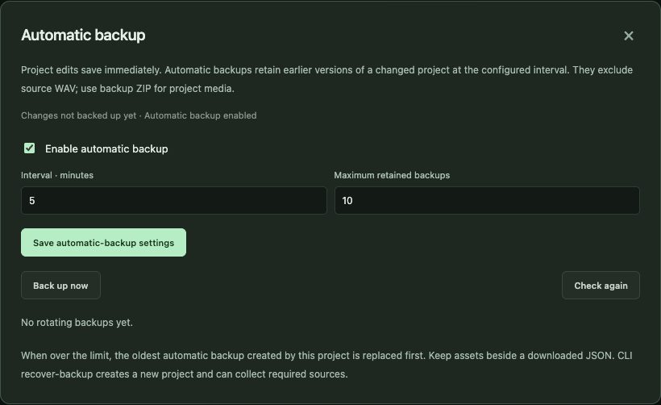
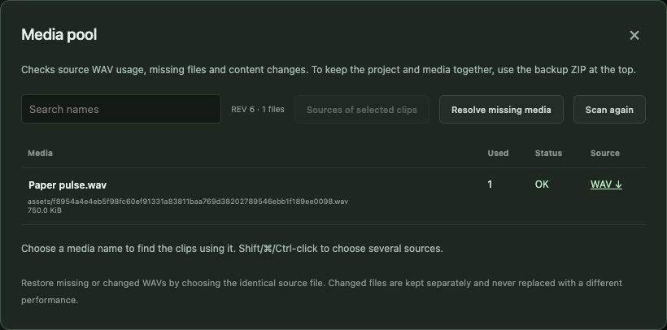

# 4. Projects, saving and safety

[← Contents](README.md) · [한국어](../ko/04-projects.md)

SovaRoll is built so that you do not lose work: every edit is stored immediately, every edit can be undone, and your original audio files are never changed. This chapter explains the safety tools so you can use them with confidence.

## 4.1 Three kinds of "saved"

| Kind | What happens | How |
|---|---|---|
| **Automatic** | Every edit is written to the project file at once (auto-recovery) | Nothing to do |
| **Explicit Save** | Marks the current state as your *reference point*. **Revert** returns to it | **Ctrl/Cmd+S** or **Save · versions → Save** |
| **Version** | Writes a numbered copy (`Song-02.newdaw.json`) and continues in it | **Save · versions → Save new version** |

The top bar shows the state, for example *changed since save · auto-recovery saved*.

## 4.2 Open project: one or several songs

**Open project** lists the songs that are open. Several can be open; only the **Active** one is edited and played. In this window you can:

- **New project · create Untitled** — choose a folder and start an empty song. The first Save asks for a file name.
- Paste a **Project file path** and **Review file**, then pick an **Open mode** (open and activate, or open in the background).
- **Recoverable work** — Untitled songs and crashed sessions you can continue.
- **Recent projects** — **Review** to open again; **Remove** only removes the entry, never the file.
- **Close…** a song (another song is never activated automatically).

## 4.3 Save · versions and Revert

- **Save** — new reference point.
- **Save as** — continue under a new name/folder; audio is copied along.
- **Save new version** — numbered copy, ideal before a big change.
- **Revert** — go back to the last Save. You are shown what will be discarded and choose whether newly recorded audio is kept or moved to the revert trash. Revert trash can be restored.

## 4.4 Edit history (Undo list)

**Edit history** shows every action with its description, for example *Add notes*, *Move clip*. Click an entry to jump there; you can rename descriptions and set the maximum number of kept steps. History survives restarting the app (it lives in `.history.json` next to the song). Edits from the command line appear here too.

## 4.5 Automatic backup

**Auto backup** keeps timed copies of changed projects. Set **Enabled**, the **interval** in minutes and how many to **keep**, or press **Back up now**. Any backup can be downloaded or recovered into a *new* project folder; the original is not overwritten.

## 4.6 Media pool: where your audio lives

Imported and recorded audio is stored in the song's `assets/` folder under a name derived from its content (SHA-256), so identical files are stored once and corruption can be detected. The **Media pool** lists each source, which clips use it, and whether it is present and intact. If a file is missing (for example you copied only the `.json`), the pool helps you search folders for the exact original, relink a replacement, or remove the missing source and its clips — each with Undo.

## 4.7 Backup ZIP and Project JSON

- **Backup ZIP** downloads the project *with* all its audio — the best way to archive or move a song.
- **Project JSON** downloads only the description; audio is referenced, not included.

## 4.8 Good habits

1. Keep each song in its own folder outside the app (the starters do this).
2. **Save new version** before experiments; **Backup ZIP** before updating SovaRoll.
3. Move or copy the **whole folder**, never just the `.json`.
4. Export MIDI and source audio alongside every mix you share.
5. If something looks wrong, do not delete files — open **Media pool** and **Edit history** first.

---
[← 3. First song](03-first-song.md) · Next: [5. Tracks, clips and arrangement →](05-arrangement.md)
