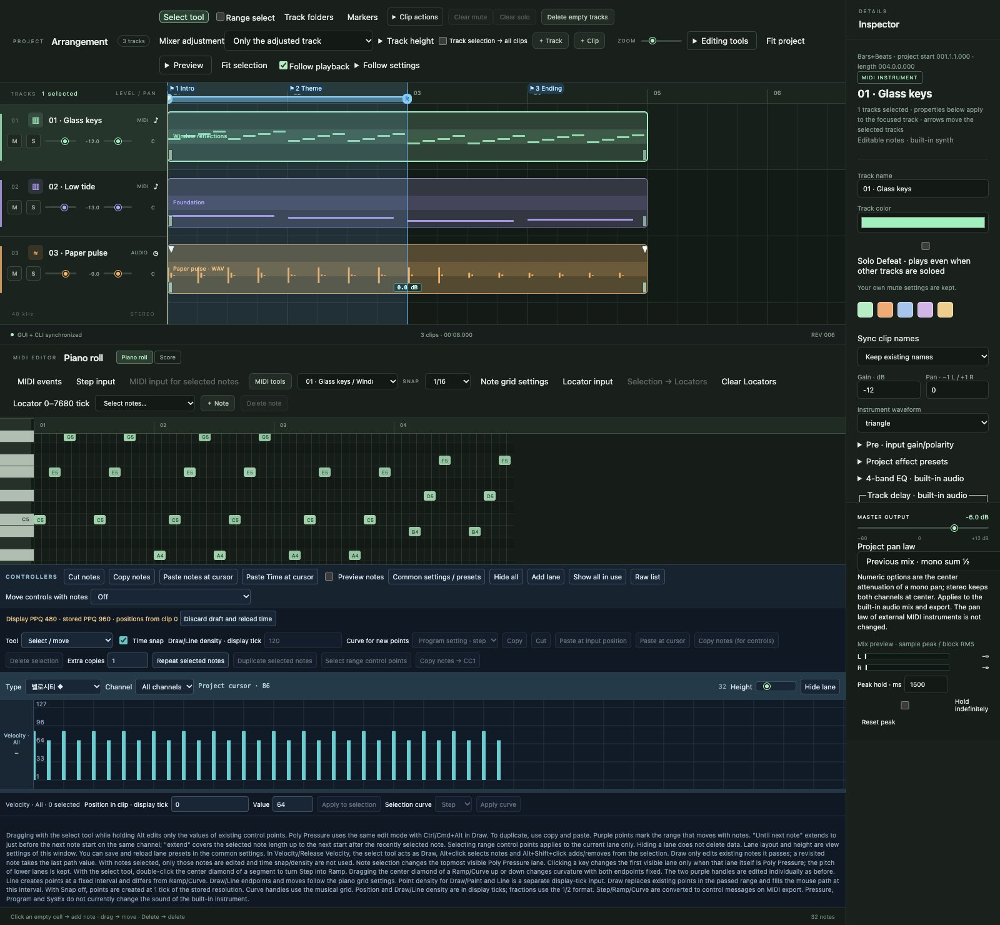
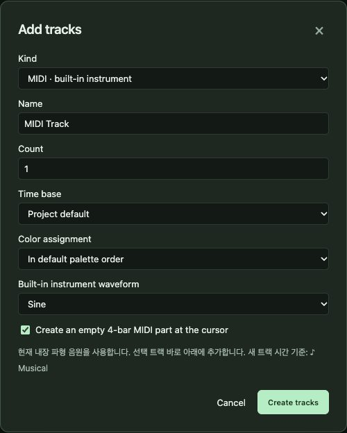
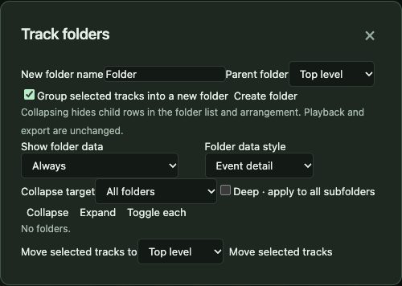
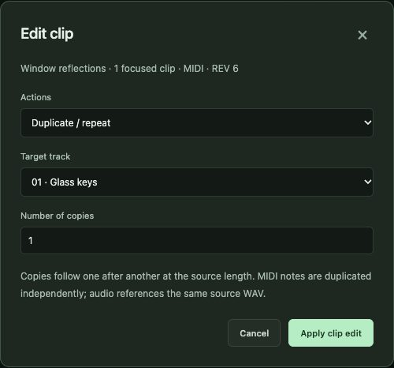
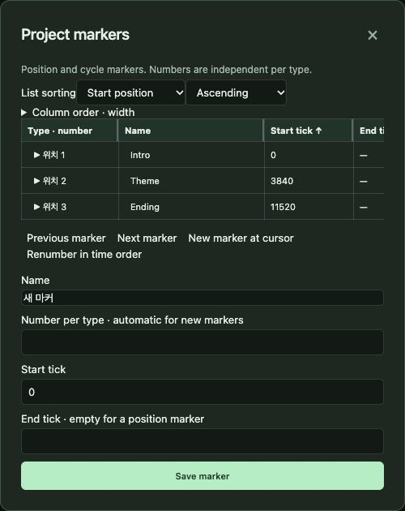
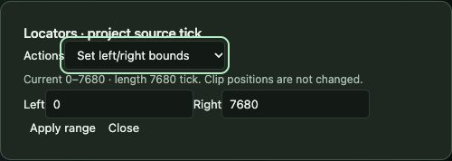

# 5. Tracks, clips and arrangement

[← Contents](README.md) · [한국어](../ko/05-arrangement.md)

Arranging is deciding *what plays when*. In SovaRoll a song is a set of **tracks** (instruments or audio lanes), each holding **clips** (MIDI parts or audio events) placed on a timeline measured in bars.

## 5.1 Tracks

**Add tracks** with **+ Track**:

Choose the type (**MIDI** or **Audio**), a name, how many, the colour, the time base (musical or linear), and for MIDI the built-in instrument and whether to create an empty part. Several tracks can be created in one step.

On each track header: drag the number to reorder (or use the arrow keys), click the name to select (Shift/Ctrl/Cmd for several), **M** mute, **S** solo (Shift+click = exclusive solo), gain and pan sliders. **Mixer adjustment** decides whether a slider change applies only to the adjusted track or to all selected tracks (relative or same value).

**Delete empty tracks** removes tracks without clips; **Clear mute** / **Clear solo** reset all states.

## 5.2 Track folders

Group tracks — for example *Drums*, *Strings* — into folders. Folders can be nested, renamed, coloured and collapsed (collapsing hides rows but never removes data). Folder **M/S** mute or solo every track inside. Drag tracks onto a folder header to move them in; drop at the top to move them out. **Release folder only** keeps the tracks.

## 5.3 Clips

- **Select**: click; Shift/Ctrl/Cmd+click adds; drag on empty space for a box selection; **Ctrl/Cmd+A** in the timeline selects all clips.
- **Move**: drag. Hold **Ctrl/Cmd** to drag an independent copy, **Alt/Option** to ignore snap, **Shift** to keep the track or time fixed. Arrow keys nudge selected clips (Shift = 10 steps).
- **Resize**: drag the left or right edge. MIDI parts keep their notes; audio clips change which part of the source is heard (or time-stretch, if chosen in **Editing tools → Audio resize mode**).
- **Delete**: **Delete/Backspace**.
- **Mute a clip**: **M** with the clip selected (timeline focused).
- **Split at the cursor**: **S** (Shift+S splits at both locators).
- **Copy/Cut/Paste clips**: **Ctrl/Cmd+C / X / V** with the timeline focused. Pasted clips go to the cursor; Shift+V pastes at the original position.

## 5.4 Clip actions and Editing tools menus

**Clip actions** holds split at cursor / at locators / repeating split, clipboard copy, cut and paste (with options for target track and creating missing tracks), clipboard export/import files, move to track, move to cursor, cut head/tail.

**Editing tools** holds audio resize mode, mute selected clips, MIDI glue tool, glue selected audio/MIDI clips, zero-crossing split, fill loop, **repeat selected clips**, locators/cycle from clips and fit-to-project.

## 5.5 Clip tools window

For exact operations, **Clip tools** lets you duplicate (with a count and target track), split at an exact position (with note/controller split policy), or move to an exact position — in bars/beats, seconds, samples or ticks.

## 5.6 Markers

Markers name places in the song (*Intro*, *Verse*, *Chorus*). Position markers mark one point; cycle markers mark a range. In **Markers** you can add, rename, renumber, sort by any column, resize columns, move between markers (◀ ▶) and press **Enter** on a row to jump there.

## 5.7 Locators and cycle

The two **locators** (L and R on the ruler) mark a working range used by **Cycle** playback, range export and split-at-locators. Drag the handles on the ruler, or use **Locator input** to type exact boundaries, move the range, or set its duration. **Selection → Locators** sets them around selected notes or clips.

## 5.8 Zoom and view

**Zoom** changes horizontal scale; **Track height** changes rows; **Fit project** and **Fit selection** frame the view; **Follow playback** keeps the playhead in view (with suspend/resume options).

---
[← 4. Projects](04-projects.md) · Next: [6. MIDI editing in depth →](06-midi.md)
