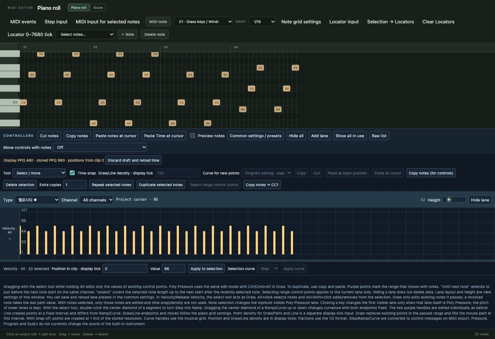
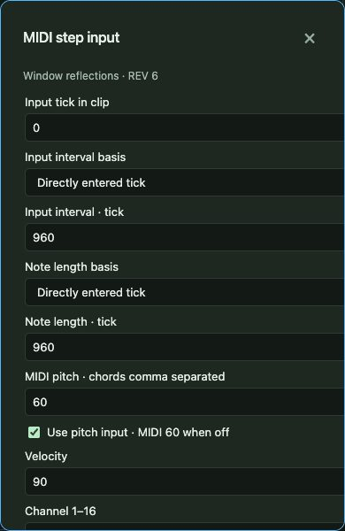
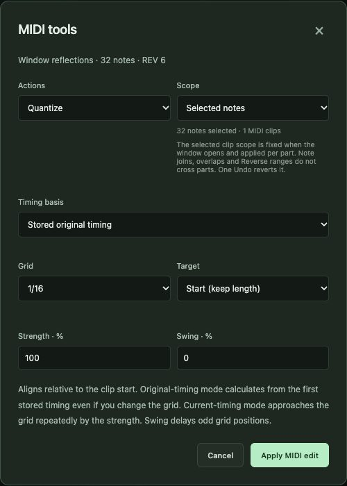
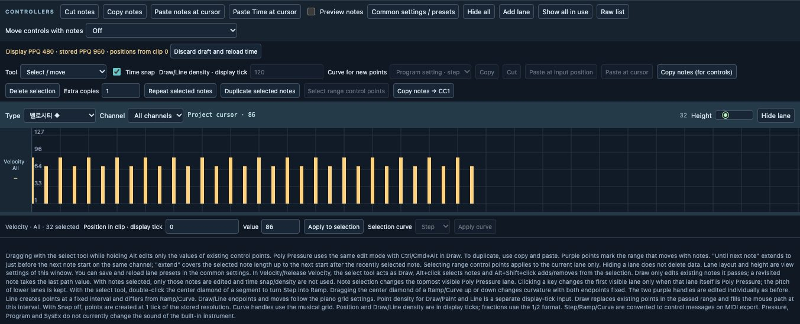
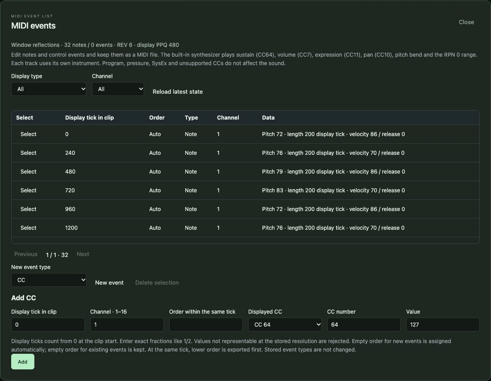
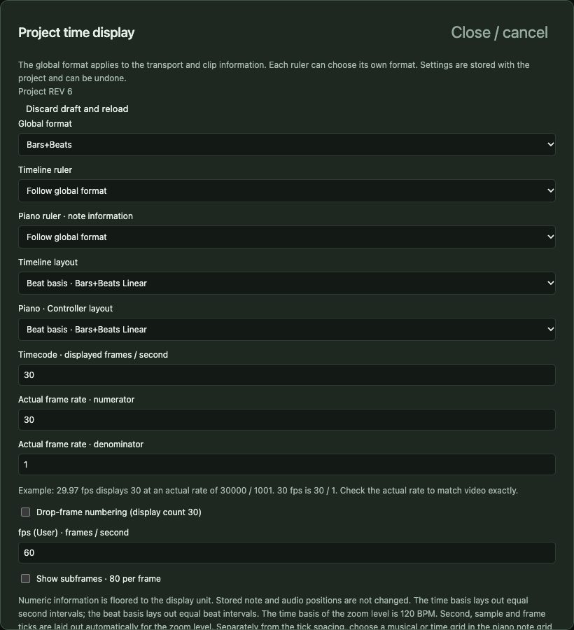
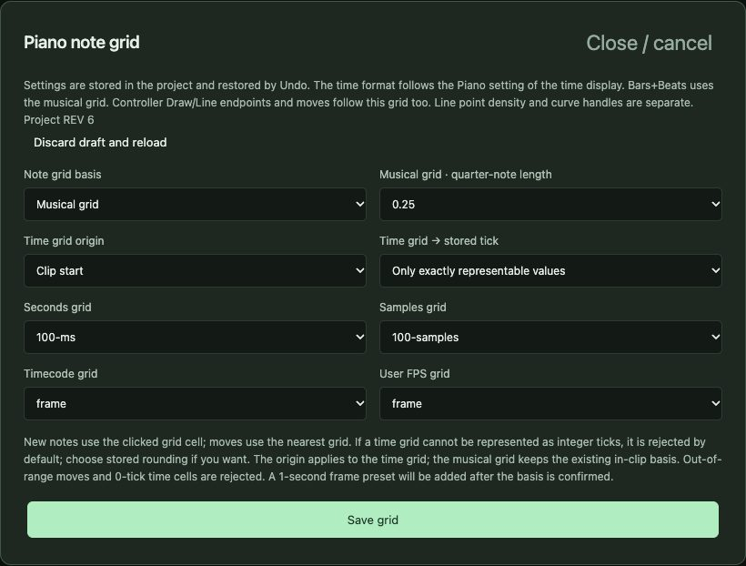

# 6. MIDI editing in depth

[← Contents](README.md) · [한국어](../ko/06-midi.md)

MIDI is music as *instructions*: which key, when, how long and how hard. Because it is instructions rather than sound, you can change every note at any time. SovaRoll keeps your MIDI fully editable, even after you export audio.

## 6.1 The piano roll

- **Vertical** = pitch. The keys on the left are named; middle C is **C4** = MIDI note 60. Clicking a key selects all notes of that pitch.
- **Horizontal** = time, with bar numbers on the ruler. Click the ruler to place the cursor.
- **Add** a note: click an empty cell. Its length equals the **Snap** value (1/16, 1/8, 1/4, 1/2).
- **Move**: drag (time and pitch together). **Resize**: in the Inspector, or MIDI tools → Length.
- **Select**: click, Shift/Ctrl/Cmd+click, **Ctrl/Cmd+A**; the **Select notes…** menu selects by pitch, range and other rules; arrow keys walk through notes.
- **Delete**: **Delete** or the **Delete note** button.
- **Copy/Paste**: **Ctrl/Cmd+C**, click the ruler, **Ctrl/Cmd+V** (Shift+V inserts time).
- **Note grid settings** choose musical grids or time grids (seconds, samples, frames) and their origin.
- **Locator input**, **Selection → Locators**, **Clear Locators** work on the locator range.

### Inspector for a note

**Pitch**, **Velocity** (1–127), **Start in clip** and **Length** in display ticks (480 per quarter note by default; set in **MIDI time**), and an optional formatted time input. **Apply note** commits; one Undo reverts.

## 6.2 Step input

Step input writes notes one after another without playing in real time — ideal for exact rhythms. Set the note value (with dotted/triplet modifiers), pitches, velocity and channel, press **Insert** to write and advance the step cursor, **Rest** to advance silently, and move the cursor with ◀ ▶. You can also arm a connected MIDI keyboard to enter pitches.

## 6.3 MIDI tools

Choose an **Action** and a **Scope** (selected notes or whole clips), then **Apply MIDI edit**. Every action is one Undo step.

| Action | What it does |
|---|---|
| Quantize | Move starts (and/or ends) toward a grid with strength and swing; original timing is kept so you can re-quantize or revert |
| Quantize revert / commit | Return notes to their original timing, or make the current timing the new original |
| Transpose | Shift by semitones, optionally from one scale to another, optionally limited to a pitch range |
| Velocity | Set, add, scale or randomize within a range |
| Legato | Extend each note to the next (with a gap) |
| Length | Set or scale note lengths |
| Reverse / Mirror | Reverse note start positions in time, or mirror pitches |
| Remove double notes | Delete identical notes stacked on the same pitch and time |
| Pedals to note length | Turn sustain-pedal (CC64) holds into real note lengths |
| Delete overlaps / Restrict polyphony | Clean up stacked notes |
| Note split / Dissolve | Split notes at a position; dissolve a part by channel or pitch into separate tracks |
| Repeat loop to part end | Repeat the material between two points until the part ends |
| Thin controllers / Delete controllers | Reduce or remove controller data |

## 6.4 Controller lanes

Under the notes are lanes for **Velocity**, **CC** (modulation, volume, pan, sustain pedal CC64 …), **Pitch bend**, **Channel pressure**, **Poly pressure** and **Release velocity**. Each lane has a **Type**, a **Channel** and a height.

- **Tools**: Select/move, Draw, Paint, Line and curve shapes (Line, Parabola, Sine, Triangle, Square) with **Time snap** and point density.
- **Alt**+drag edits only existing values. Drag the middle handle of a ramp to bend its curve.
- **Copy / Cut / Paste at cursor**, **Delete selection**, **Repeat / Duplicate selected notes**, and **Copy notes → CC1** turn note velocities into a controller.
- **Move controls with notes** decides whether controller data follows when you drag notes.
- **Common settings / presets** choose which CC lanes are shown and save lane layouts.

Controller curves stay editable in the project; MIDI export turns them into events.

## 6.5 MIDI event list

**MIDI events** lists every stored message of the part — pedal, CC, pitch bend, program change, pressure, SysEx — with exact position and values that you can edit. Same-tick order is preserved.

## 6.6 Time, grid and display

**Time display** chooses how positions are shown: Bars+Beats, Seconds, Samples, Timecode or custom frames per second, separately for the timeline and the piano roll, and whether layout is musical or time-linear.

**Note grid settings** choose the grid used when you click and drag. **MIDI time** sets the display resolution (PPQ) and Length Adjustment. Stored data always keeps full precision (960 ticks per quarter note).

## 6.7 Playback settings for a MIDI track

In the Inspector of a MIDI part or track, **MIDI playback settings / Freeze** apply transpose, velocity and length scaling, randomization, delay, program/bank and volume/pan without changing your notes. **Freeze** writes those effects into the notes. **Merge MIDI in Loop** combines parts within the locator range into a new part.

## 6.8 Sound of MIDI tracks

The built-in instrument is a simple oscillator — `sine`, `triangle` or `sawtooth` — chosen per track in the Inspector. It is a sketching sound, not a piano library. For finished sounds, export MIDI to another instrument, render selected parts through an Audio Unit instrument on macOS (chapter 8), or send MIDI to external instruments (chapter 9).

---
[← 5. Arrangement](05-arrangement.md) · Next: [7. Score view and MusicXML →](07-score.md)
