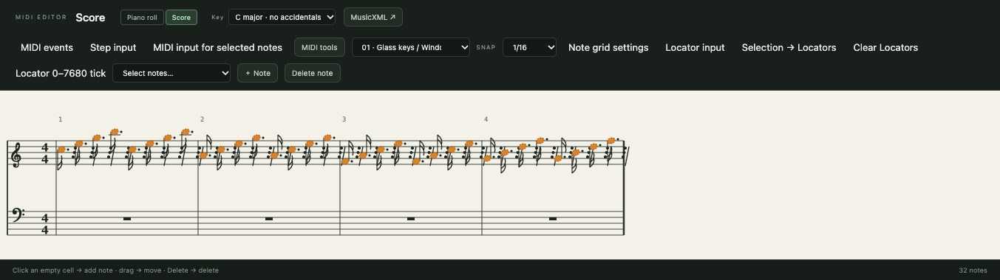

# 7. Score view and MusicXML

[← Contents](README.md) · [한국어](../ko/07-score.md)

The **Score** view shows the same MIDI part as traditional notation on a grand staff, and lets you write notes on it. Because it edits the very same notes as the piano roll, you can switch between the two at any moment.



## 7.1 Open the score

Select a MIDI clip and press **Score** next to the editor title. Press **Piano roll** to return; the browser remembers your choice.

- The **treble staff** holds notes from middle C (C4) upward; the **bass staff** holds notes below.
- Bar numbers run along the top; the meter (4/4) is shown at the start.
- Accidentals follow the **Key** menu and reset each bar; notes that cross a barline are written with ties.
- Rests fill silent beats.

## 7.2 Write and edit on the staff

| Action | How |
|---|---|
| Add a note | Click an empty staff position; the note snaps to the current grid and uses the scale note of that line/space |
| Select | Click a note (the selection is shared with the piano roll) |
| Delete | **Delete** |
| Move by a scale step | **Alt+↑ / Alt+↓** |
| Move by an octave | **Shift+Alt+↑ / ↓** |
| Change key spelling | **Key** menu (C major … 7 sharps / 7 flats) |

The **Key** menu changes only how notes are *spelled* (F♯ or G♭); it never changes the MIDI notes.

## 7.3 How to read the picture

The score is **time-proportional**: a note is placed where it sounds, like in the piano roll, so long notes take more space. It shows one rhythm layer per staff and does not draw beams or tuplets yet. If a length cannot be written exactly with a single note value, its notehead is drawn dashed — a reminder that the MIDI timing is more detailed than the notation.

> **Reading tip.** Score and piano roll are two views of one truth. Use the score to check harmony and voice leading at a glance (stacked notes = chords), and the piano roll to fine-tune timing and velocity.

## 7.4 Export MusicXML for notation programs

**MusicXML ↗** (score toolbar) exports the selected part's track with the displayed key as a MusicXML 4.0 file you can open in MuseScore, Dorico, Sibelius, Finale or Logic's score editor.

From the command line:

```sh
npm run cli -- export-musicxml score.musicxml                 # every MIDI track
npm run cli -- export-musicxml lead.musicxml --track-id TRACK_ID --key-fifths -1   # one track, F major
```

What is written: notes, ties, chords, rests, key, meter, tempo, and velocity as dynamics; overlapping rhythms become extra voices; muted clips are skipped. Not written: instrument sounds, controllers, sustain pedal, beams and tuplets. The file is checked to be well-formed XML; it has not yet been validated against the MusicXML schema or opened in every notation program, so check the result in yours.

---
[← 6. MIDI](06-midi.md) · Next: [8. Audio →](08-audio.md)
