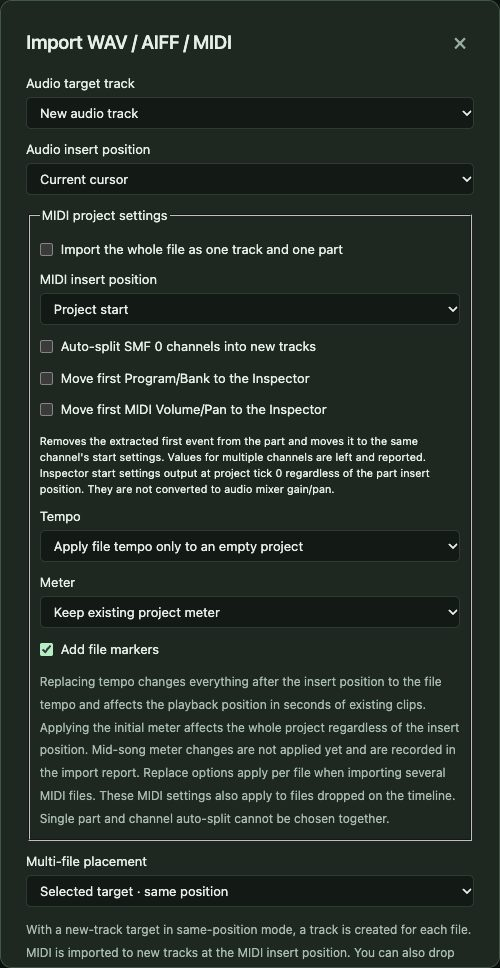
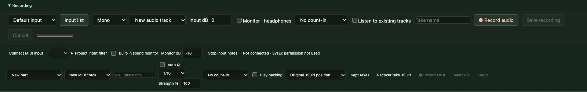
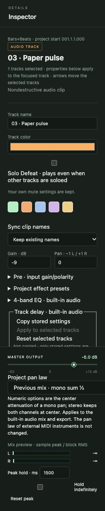

# 8. Audio: import, record, edit

[← Contents](README.md) · [한국어](../ko/08-audio.md)

Audio is recorded sound — a voice, a guitar, a drum loop. SovaRoll keeps every original audio file untouched and edits only *how* it is played (which part, where, how loud). You can always go back.

## 8.1 Import WAV, AIFF or MIDI

Click **Import** in the transport bar.

- **Audio target**: a new audio track, or an existing one.
- **Position**: at the cursor, or at the project start. Click the ruler first to place the cursor.
- **Placement** for several files: in parallel (one track each) or in series (one after another).
- **MIDI options**: combine into a single part, insert at the left locator, split format-0 channels into tracks, move the first patch/volume/pan into the Inspector, and how to treat the file's tempo, meter and markers.
- **Choose file…** opens the file dialog. Up to 32 files at once; each is checked and reported (imported, warnings, failed).

Supported: WAV (integer PCM 16/24/32-bit or 32-bit float, up to eight channels, up to 32 MiB per file), AIFF, Standard MIDI Files (format 0/1).

## 8.2 Record from a microphone

Open the **Recording** panel under the transport bar.

1. Choose the **input** (press **Input list** to refresh and allow microphone access in Chrome), **Mono/Stereo**, and the **target** (new audio track or an existing one).
2. Set **Input dB** gain. Tick **Monitor · headphones** only when wearing headphones (otherwise you get feedback).
3. Optional: **count-in** of 1 or 2 bars, **Listen to existing tracks** (play the song while you record), a **take name**.
4. Place the cursor where the recording should start, press **● Record audio**. The level meter shows the input; a warning appears if it clips.
5. **Save recording** stops and places the clip at the cursor in one step (one Undo). **Cancel** discards it.

If the project changes while you record, SovaRoll does not insert the take automatically; it keeps a downloadable WAV so nothing is lost.

> Real microphones have latency and quality differences that automated tests cannot judge. Record a short test take and listen before a long session.

## 8.3 Record from a MIDI keyboard

The lower half of the Recording panel records **MIDI**: **Connect MIDI input**, choose the target (new part / new MIDI track), take name, optional **Auto Q**(uantize) with grid and strength, count-in, **Play backing**, then **● Record MIDI** and **Save take**. Takes are kept and can be recovered from JSON if saving fails. Chrome asks for MIDI permission; SysEx permission is not used.

## 8.4 Edit audio clips

Select an audio clip. The Inspector shows the track section and, below it, the clip section:

| Field | Meaning |
|---|---|
| Start (seconds) | Where the clip begins in the song |
| Source start / Length (frames) | Which part of the original file is heard (trimming) |
| Clip gain (dB) | Volume of this clip only |
| Fade in / Fade out (seconds) | Gradual start/end; fade shapes linear, equal-power, S-curve |
| Clip mute, Invert polarity, Reverse | Silence, flip waveform sign, play backwards |
| Normalize (dBFS) → **Normalize clip** | Sets clip gain so the clip's peak reaches the target; the file is not changed |

Other audio operations: split at the cursor (**S**) or at zero crossings, glue clips, slip the contents inside a clip (Ctrl/Cmd+Alt drag), time-stretch (needs the optional FFmpeg program), remove DC offset, statistics (peak, RMS), crossfades between overlapping clips, take selection among overlapping takes, and audio scrubbing.

## 8.5 Audio Units (macOS, optional)

**Audio Units** in the top bar lists the effects and instruments installed on your Mac. You can apply an effect to a selected clip offline (the result is a new audio clip; the original stays), preview it, and render selected MIDI parts through an Audio Unit instrument into an editable new audio clip with Undo. This is tested only with components available on the test machine; third-party plug-ins may behave differently, and real-time instrument hosting is not available yet.

**Native audio** (macOS) can play the rendered preview through a native helper instead of the browser. Low-latency quality is not claimed.

---
[← 7. Score](07-score.md) · Next: [9. Playback, tempo and mixing →](09-playback-mixing.md)
