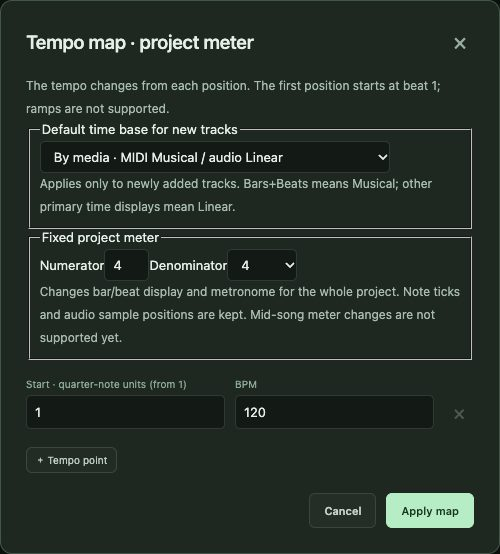
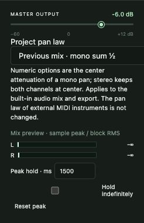

# 9. Playback, tempo and mixing

[← Contents](README.md) · [한국어](../ko/09-playback-mixing.md)

## 9.1 How playback works

When you press **Play**, SovaRoll renders the current song offline and plays the result in the browser. This guarantees that what you hear is exactly what you would export. The cost is a short preparation time before sound starts, and editing stops playback (so an outdated render is never mistaken for the current song).

| Control | Action |
|---|---|
| **Space** | Play / Stop (when not typing in a field) |
| ⏮ | Return to the start |
| Ruler click | Move the playhead |
| **Cycle** | Loop between the locators |
| **Preview** menu | Audition selected clips, play the selected range, audition level, effect bypass, scrub tool |
| **Follow playback** | Keep the playhead visible |

## 9.2 Tempo and meter

- Click the tempo number to type a BPM.
- **Tempo Track / Fixed tempo** switches between a tempo map with changes and one fixed tempo.
- Click the meter (4/4) to open the tempo map: add tempo points by bar and beat, set the project time signature and the default time base for new tracks.
- **Tap tempo** finds a BPM from your taps.
- Audio tracks can follow tempo changes (musical time base) or stay at fixed seconds (linear).

## 9.3 Metronome and count-in

Tick **Metronome** and set its volume. The click follows the tempo map and accents the first beat of each bar. It plays during playback and recording count-in, and is never written into exports.

## 9.4 Mixing

The mixer lives in the track headers and the Inspector:

1. **Gain** (−60 … +12 dB) and **pan** per track; **M**/**S** per track; **Solo Defeat** keeps a track audible when others are soloed.
2. Track Inspector sections: **Pre** (input gain/polarity), **4-band EQ**, **Track delay**, **Project effect presets** (save and apply settings to several tracks).
3. **Master output** sets the final level. **Project pan law** chooses how mono pans are attenuated.
4. **Mix preview** meters show sample peak and RMS for L/R with peak hold; reset the peak hold when you change levels.

> **Mixing order that works.** Balance with faders first, pan second, EQ third. Check that the melody is clear, that bass and kick are not fighting, and that the mix does not clip (the master meter never reaches full scale). Then take a break and listen again at a low volume.

## 9.5 External MIDI (macOS, optional)

To play MIDI tracks on hardware synths or other apps:

1. Build the helper once (needs Apple's Swift toolchain): `node scripts/build-native-midi.mjs`.
2. **MIDI output**: choose the destination port and channel for each track and the playback mode.
3. **MIDI Chase**: which controller types are restored when you start in the middle of a song.
4. **MIDI Reset**: send All Notes Off / Reset All Controllers manually or on stop.

Native MIDI mode sends **MIDI only** and is not synchronized with audio clips.

---
[← 8. Audio](08-audio.md) · Next: [10. Export and sharing →](10-export.md)
