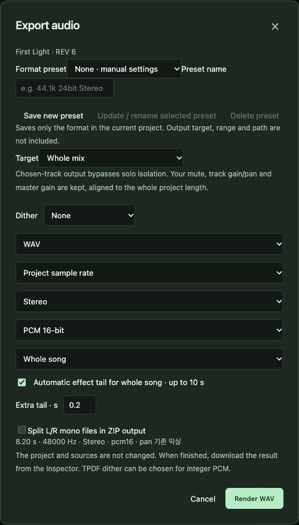
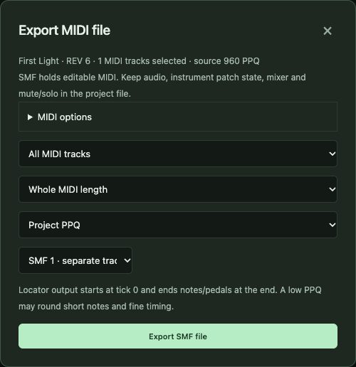

# 10. Export and sharing

[← Contents](README.md) · [한국어](../ko/10-export.md)

Export turns your project into files other people and programs can use. Always keep the project itself too: an exported WAV is a photograph, the project is the living song.

| You want | Use | Contains |
|---|---|---|
| An audio file to listen to or publish | **Export WAV mix** | The mixed sound (WAV or AIFF) |
| Separate tracks for another studio | **Export WAV mix** → target *one WAV per track · ZIP* | One aligned file per track |
| Editable notes for another DAW | **Export MIDI** | Notes, tempo, meter, track names, markers |
| Sheet music | **MusicXML ↗** in the score view | Notation (chapter 7) |
| A complete archive of the song | **Backup ZIP** | Project + all audio |

## 10.1 Export WAV mix



1. **Format preset**: keep *None · manual*, or save your favourite settings as a preset.
2. **Target**: the full mix, a mix of selected tracks, **one WAV per track (ZIP)** for stems, or one full mix per cycle marker (ZIP). Track targets bypass solo; your mute and gain settings stay.
3. **Dither** (TPDF) for integer formats, **WAV/AIFF**, **sample rate** (project or a converted rate), **Stereo/Mono**, **PCM 16-bit / 24-bit / 32-bit float**.
4. **Range**: whole song or locator range; automatic effect tail (up to 10 s) and extra tail seconds.
5. **Split L/R into mono files** for stem ZIPs.
6. Press **Render WAV**. When done, download it from the Inspector.

The summary line under the options tells you the exact length, rate and format before you render. Renders are limited to 10 minutes including the tail.

## 10.2 Export MIDI



Choose what to include (patch, volume/pan, MIDI modifiers, markers, track delay), scope (all tracks or selected), range (whole song or locators), resolution (PPQ) and **format 0 or 1**, then **Export SMF file**. MIDI carries notes and controllers — not audio, mixer settings or the built-in instrument's sound.

## 10.3 Backup ZIP

**Backup ZIP** (top bar) collects the project and every audio file it uses into one ZIP after verifying their content. Use it to archive, to move a song to another computer, or before updating SovaRoll. To restore, unpack the ZIP into a new folder and open the `.newdaw.json` file with **Open project**.

## 10.4 Taking a song to Logic Pro or another DAW

1. **Export MIDI** (format 1) — opens as editable MIDI regions.
2. **Export WAV mix** → stems — one aligned audio file per track, all starting at bar 1.
3. Send both, plus the tempo. In the other DAW, set the same tempo, import the MIDI and the stems at the start.

## 10.5 Exporting from the command line

```sh
npm run cli -- render mix.wav
npm run cli -- render mix24.wav --sample-format pcm24 --dither tpdf
npm run cli -- render loop.wav --locators
npm run cli -- render-stems stems.zip
npm run cli -- export-midi song.mid --midi-format 1
npm run cli -- export-musicxml score.musicxml
npm run cli -- export-bundle backup.zip
```

Existing files are never overwritten unless you add `--force`. See chapter 11.

---
[← 9. Playback and mixing](09-playback-mixing.md) · Next: [11. The command line →](11-cli.md)
