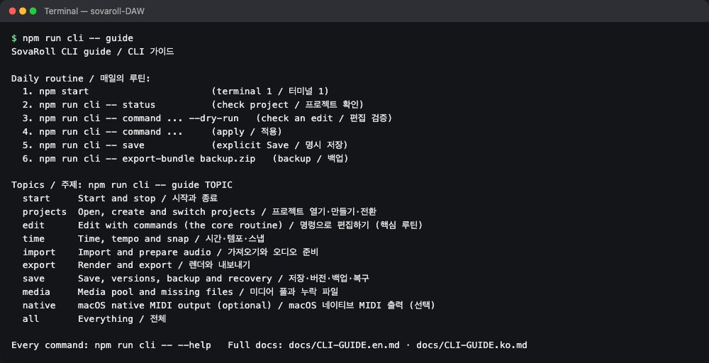
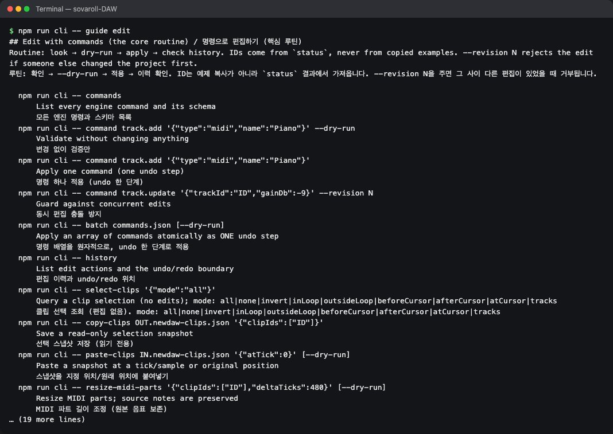
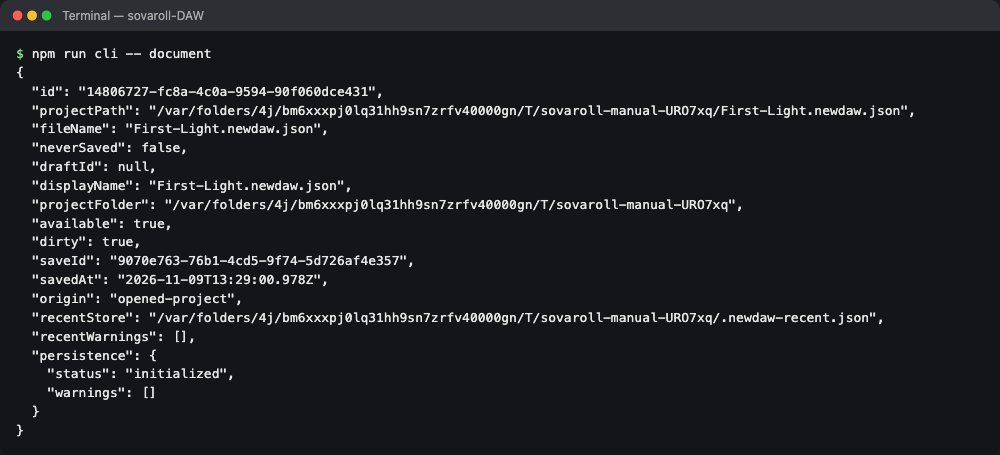
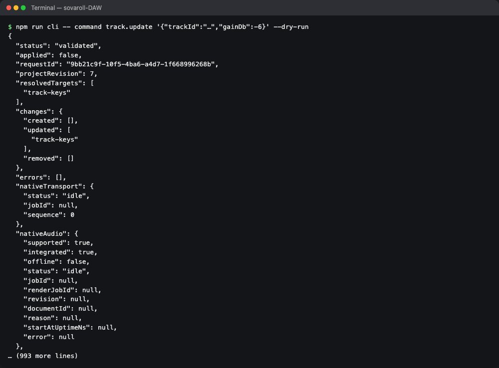
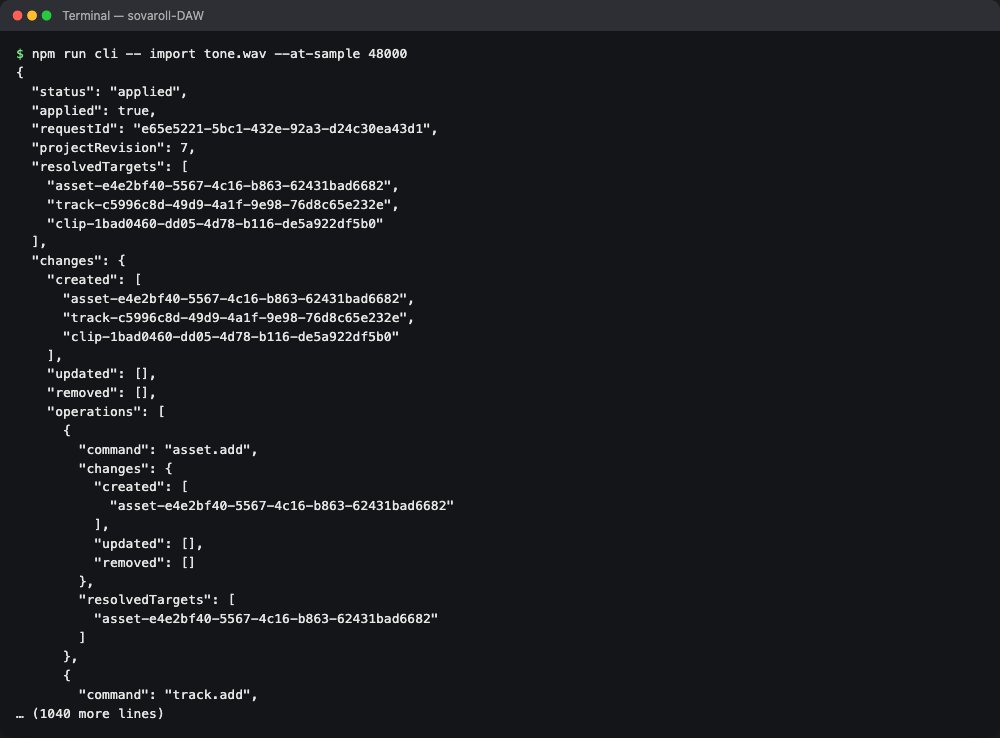
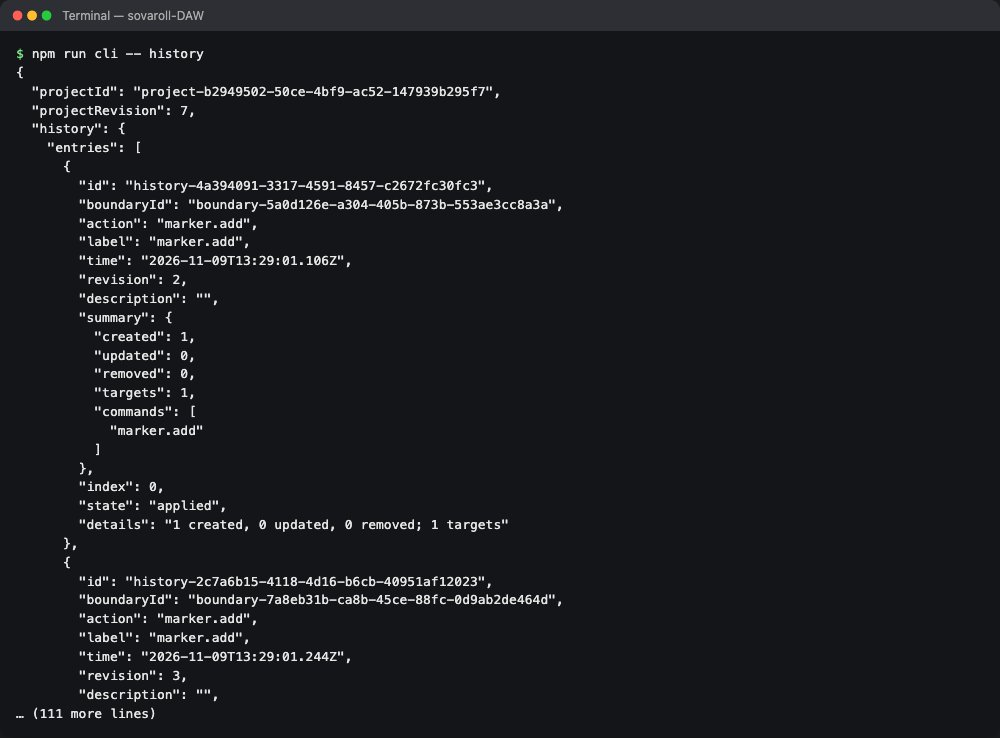
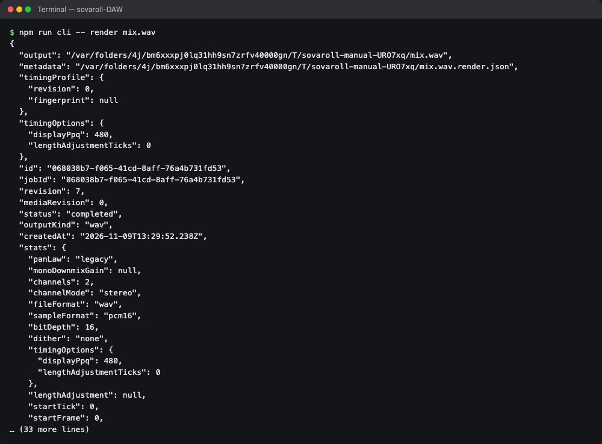
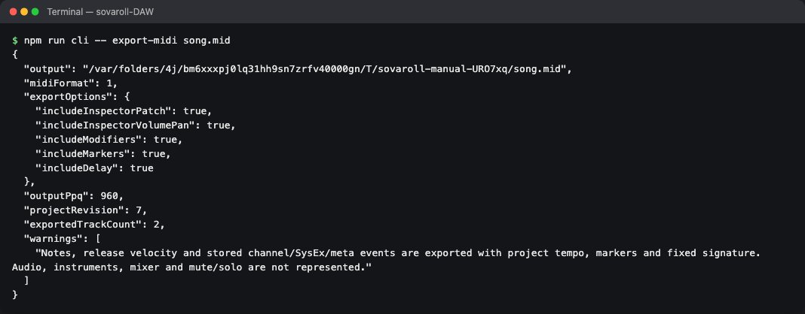
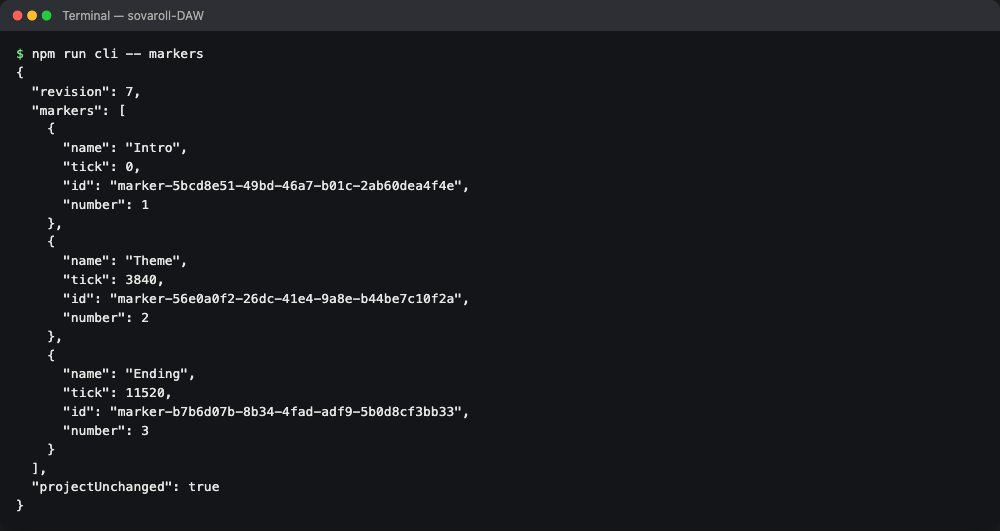
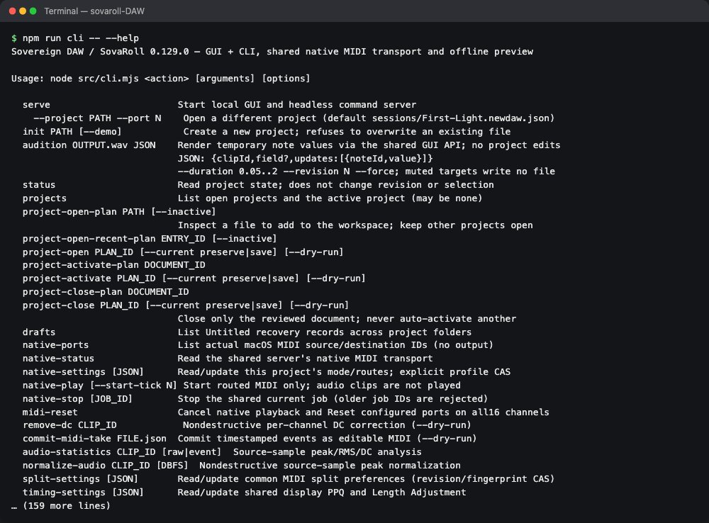

# 11. The command line (CLI)

[← Contents](README.md) · [한국어](../ko/11-cli.md)

Everything you do with the mouse can also be done by typing commands. The command line edits **the same open project** as the browser, with the same checks and the same Undo history — an edit typed in the terminal appears on screen instantly, and the browser's Undo button can undo it. This is how scripts, batch jobs and local AI assistants (such as SovaFlow) work with SovaRoll.

You never *need* the CLI. If you are curious, this chapter takes you from the first command to safe automation.

## 11.1 Opening a terminal in the SovaRoll folder

- **macOS**: open Terminal, type `cd ` (with a space), drag the `sovaroll-DAW` folder onto the window, press Enter.
- **Windows**: open the folder in Explorer, click the address bar, type `cmd`, press Enter.

SovaRoll must be running (chapter 1) for commands that edit the open project. Commands talk to `http://127.0.0.1:4317` unless you add `--url http://127.0.0.1:PORT`.

## 11.2 The built-in guide (works without a server)



```sh
npm run cli -- guide          # the daily routine and topics
npm run cli -- guide edit     # one topic: start, projects, edit, time, import, export, save, media, native, all
npm run cli -- --help         # every command
```



## 11.3 The daily routine

| Step | Command |
|---|---|
| Start | `npm start` (or the double-click starter) |
| Which song is open? | `npm run cli -- document` |
| Check an edit without applying | `npm run cli -- command NAME 'JSON' --dry-run` |
| Apply it | `npm run cli -- command NAME 'JSON'` |
| Save a reference point | `npm run cli -- save` |
| Export | `npm run cli -- render mix.wav` · `npm run cli -- export-midi song.mid` |
| Back up | `npm run cli -- export-bundle backup.zip` |



## 11.4 Edit commands, safely

Every edit is a named **command** with JSON arguments. List them with their argument rules:

```sh
npm run cli -- commands
```

Then try a command with `--dry-run` first. SovaRoll checks it completely and reports what *would* change, without changing anything:



```sh
npm run cli -- command track.add '{"type":"midi","name":"Strings"}' --dry-run
npm run cli -- command track.add '{"type":"midi","name":"Strings"}'
npm run cli -- command track.update '{"trackId":"TRACK_ID","gainDb":-6}'
npm run cli -- command midi.notes.transpose '{"clipId":"CLIP_ID","semitones":2}'
```

Rules that keep you safe:

- Use real IDs from your project: `npm run cli -- status` prints the whole project; track IDs are under `project.tracks`, clip IDs under `project.clips`. Never copy IDs from examples.
- `--revision N` refuses the edit if anything else changed the project first.
- `npm run cli -- batch edits.json` applies a list of commands as **one** step: all succeed or nothing changes, and one Undo reverts all.
- `npm run cli -- command history.undo '{}'` and `history.redo` undo and redo — the same history as the browser.
- Windows `cmd` needs double quotes inside JSON escaped: `"{\"type\":\"midi\"}"`. PowerShell accepts single quotes like macOS.

## 11.5 Import and history



```sh
npm run cli -- import voice.wav --at-sample 48000      # at 1 second (48 kHz project)
npm run cli -- import song.mid --midi-tempo preserve
npm run cli -- import-many a.wav b.wav --placement serial
npm run cli -- history
```



## 11.6 Export





```sh
npm run cli -- render mix.wav                       # whole song + tail
npm run cli -- render part.wav --locators           # locator range
npm run cli -- render mix.aiff --file-format aiff --sample-format pcm24
npm run cli -- render-stems stems.zip
npm run cli -- export-midi song.mid --midi-format 1 --midi-ppq 480
npm run cli -- export-musicxml score.musicxml
npm run cli -- export-bundle backup.zip
node src/cli.mjs offline-render /path/Song.newdaw.json /path/mix.wav   # without a running server
```

## 11.7 Projects, saving and recovery

```sh
npm run cli -- init "$HOME/Music/SovaRoll/New Song/New Song.newdaw.json"
npm run cli -- serve --project "$HOME/Music/SovaRoll/New Song/New Song.newdaw.json" --port 4318
npm run cli -- projects
npm run cli -- save-new-version
npm run cli -- revert-plan            # then: revert PLAN_ID --confirm --media keep
npm run cli -- backups                # list automatic backups
npm run cli -- assets                 # verify media files
```

## 11.8 Markers, time and more



```sh
npm run cli -- markers '{"sortBy":"name"}'
npm run cli -- time-convert '{"tick":3840}'
npm run cli -- tap-tempo '{"tapTimesMs":[0,625,1250,1875]}' --dry-run
```

The complete reference with every option is in [CLI guide](../../CLI-GUIDE.en.md) and [CLI reference](../../CLI.md), and always in `npm run cli -- --help`:



---
[← 10. Export](10-export.md) · Next: [12. Reference →](12-reference.md)
