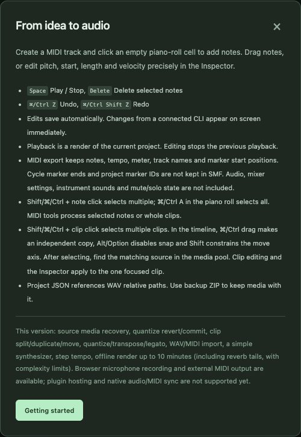

# 12. Reference

[← Contents](README.md) · [한국어](../ko/12-reference.md)

## Keyboard shortcuts

| Keys | Where | Action |
|---|---|---|
| **Space** | anywhere except text fields | Play / Stop |
| **Ctrl/Cmd+Z** · **Ctrl/Cmd+Shift+Z** | anywhere | Undo · Redo (includes CLI edits) |
| **Ctrl/Cmd+S** | anywhere | Explicit Save |
| **?** | anywhere | Help |
| **Ctrl/Cmd+A / C / X / V** | piano roll | Select all / copy / cut / paste notes at cursor (Shift+V inserts time) |
| **Delete** | piano roll / score | Delete selected notes |
| **← →** | piano roll | Move the note selection (Shift extends) |
| **Alt+↑↓**, **Shift+Alt+↑↓** | score | Move by a scale step / an octave |
| **Ctrl/Cmd+A / C / X / V** | timeline | Select all / copy / cut / paste clips (Shift+V = original position) |
| **S** · **Shift+S** | timeline | Split selected clips at cursor · at locators |
| **M** | timeline | Mute/unmute selected clips |
| **← →** (Shift = ×10) | timeline | Nudge selected clips |
| **Delete** | timeline | Delete selected clips |
| **Esc** | anywhere | Clear selection / cancel a drag |
| **Ctrl/Cmd**+drag · **Alt**+drag · **Shift**+drag | clips | Copy · ignore snap · constrain axis |
| **Shift**+click **S** | track header | Solo only this track |

## Music tables

### Note values and snap

| Snap | Note value | Ticks (display PPQ 480) | Ticks (stored PPQ 960) |
|---|---|---:|---:|
| 1/2 | half note 𝅗𝅥 | 960 | 1920 |
| 1/4 | quarter note ♩ | 480 | 960 |
| 1/8 | eighth note ♪ | 240 | 480 |
| 1/16 | sixteenth note 𝅘𝅥𝅯 | 120 | 240 |

A 4/4 bar = 4 quarter notes = 1920 display ticks. A dotted note is 1.5×; a triplet is ⅔×.

### Velocity and dynamics (a common convention)

| Dynamic | Meaning | Velocity |
|---|---|---:|
| *pp* | pianissimo, very soft | 20–35 |
| *p* | piano, soft | 36–50 |
| *mp* | mezzo-piano | 51–65 |
| *mf* | mezzo-forte | 66–80 |
| *f* | forte, loud | 81–100 |
| *ff* | fortissimo, very loud | 101–127 |

### MIDI note numbers

| Note | C1 | C2 | C3 | **C4 (middle C)** | A4 (440 Hz) | C5 | C6 |
|---|---:|---:|---:|---:|---:|---:|---:|
| MIDI | 24 | 36 | 48 | **60** | 69 | 72 | 84 |

A semitone is +1; an octave is +12.

### Tempo terms (approximate)

| Term | BPM | Character |
|---|---|---|
| Largo | 40–60 | broad, very slow |
| Adagio | 60–76 | slow, at ease |
| Andante | 76–108 | walking pace |
| Moderato | 108–120 | moderate |
| Allegro | 120–156 | fast, bright |
| Presto | 168–200 | very fast |

### Useful controllers (CC)

| CC | Name | Typical use |
|---:|---|---|
| 1 | Modulation | vibrato, filter movement |
| 7 | Volume | channel level |
| 10 | Pan | stereo position |
| 11 | Expression | phrase swells within the volume |
| 64 | Sustain pedal | piano pedal (≥64 = down) |
| 66 | Sostenuto | holds only notes already down |

## Troubleshooting

| Problem | What to check |
|---|---|
| Browser shows "cannot connect" | Is the terminal window still open? Start again; use the address printed in the terminal |
| Port already in use | Another SovaRoll is running — the starter opens it. Or start with another port (`npm start -- --port 4318`) |
| No sound | Computer volume and output device; track/master gain; mute/solo (**Clear mute/solo**); wait for the render to finish; click once in the page (browsers block sound until you interact) |
| Sounds different from Logic/another DAW | The built-in instrument is a simple oscillator; export MIDI and use a real instrument there |
| "Missing media" warning | The `assets/` folder was not copied with the project. Copy the whole folder or use **Media pool** to find the original |
| "Revision conflict" / stale | Another window or CLI edited first. The screen refreshes; repeat your edit |
| Recording is silent | Chrome microphone permission (lock icon in the address bar), input choice, Input dB, cable |
| Feedback howl while recording | Turn off **Monitor** or use headphones |
| Time stretch unavailable | Install FFmpeg and put it on PATH, or set `NEWDAW_FFMPEG` |
| macOS says the starter cannot be opened | Right-click → **Open** → **Open** (once) |
| Something else | **Help** in the app; **Edit history** to step back; keep the project folder and ask with the steps you took |

## Glossary

| Term | Meaning |
|---|---|
| BPM | Beats per minute (tempo) |
| Clip / part / event | A block on a track: MIDI *part* or audio *event* |
| Cycle | Looping between the locators |
| dB, dBFS | Decibels; dBFS is relative to digital full scale (0 dBFS = maximum) |
| Locators | Left/right range markers on the ruler |
| MIDI | Music as instructions (note, time, velocity, controllers) |
| MusicXML | Standard file format for sheet music |
| Pan | Left–right position |
| PPQ / tick | Pulses per quarter note: the time resolution of MIDI |
| Quantize | Moving notes toward a rhythmic grid |
| Render | Calculating the final audio from the project |
| Snap | Grid that positions and lengths follow while you edit |
| Solo / Mute | Hear only soloed tracks / silence a track |
| Stem | One exported audio file per track |
| Velocity | How hard a note is played (1–127) |

## Current limits (0.129)

- Built-in instrument: simple oscillators; no sampled instruments.
- Playback is an offline render of the current song (short wait before sound); not a low-latency live engine.
- Render length up to 10 minutes including tail; WAV import up to 32 MiB per file.
- No real-time VST/AU instrument hosting; Audio Unit effects/instrument rendering are macOS-only and experimental.
- Score: no beams, tuplets or printing; key signature is display-only.
- Tested on macOS with Chrome. Windows/Linux starters are provided but less tested.
- Accessibility work is incomplete; translations have not been reviewed by a native editor.

---
[← 11. CLI](11-cli.md) · [Contents](README.md)
