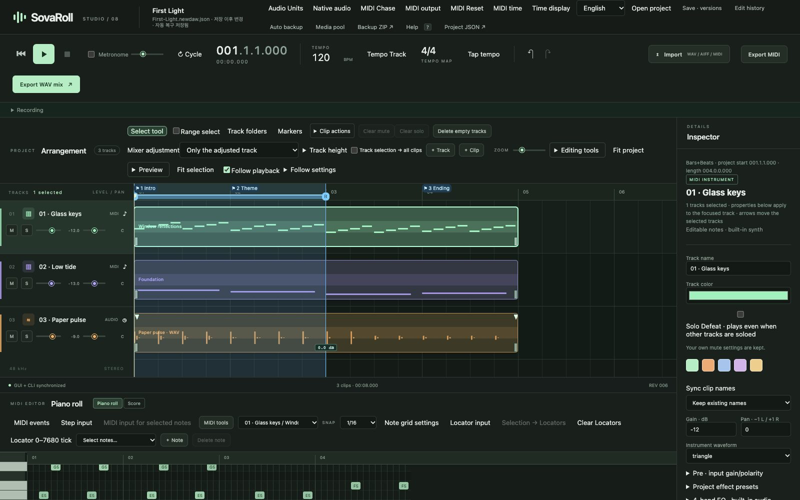

# The SovaRoll Book — User Manual

**Sovereign DAW / SovaRoll 0.129** · [한국어판](../ko/README.md) · [Project home](../../../README.md)

This book teaches you to make music with SovaRoll from the first double-click to a finished mix, the way a good music textbook teaches an instrument: one idea at a time, with a picture of the real program on almost every page. You do not need to know programming. Chapters 1–3 are enough to make and export your first song; the rest is a reference you can open when you need it.

## How to read this book

- **Bold words** are labels you will see on screen, for example **Export WAV mix**.
- `Code-style text` is something you type, or a file name.
- Every screenshot is a real capture of SovaRoll 0.129 (macOS, Chrome) made by `scripts/manual/capture-screens.mjs` with the built-in demo song. If your screen looks slightly different, your window is a different size.
- The interface can be switched between **English** and **한국어** at any time (top bar). The Korean edition of this book shows the Korean interface.
- "Verified" in this book means checked by automated tests with real program paths. Listening quality and physical microphones are always your own judgement.

## Contents

| Chapter | You will learn |
|---|---|
| [1. Install, start, update, remove](01-install.md) | Install Node.js, download SovaRoll, double-click to start, update and uninstall safely |
| [2. A tour of the screen](02-tour.md) | Every area of the window, with numbered pictures |
| [3. Your first song in 30 minutes](03-first-song.md) | A guided lesson: chords, melody, bass, dynamics, mix and export |
| [4. Projects, saving and safety](04-projects.md) | Save, versions, edit history, automatic backup, recovery, media pool |
| [5. Tracks, clips and arrangement](05-arrangement.md) | Tracks, folders, markers, locators, split/repeat/move, clip tools |
| [6. MIDI editing in depth](06-midi.md) | Piano roll, step input, MIDI tools, controller lanes, event list, grid and time |
| [7. Score view and MusicXML](07-score.md) | Reading and writing notes on the grand staff; exporting to notation programs |
| [8. Audio: import, record, edit](08-audio.md) | WAV/AIFF/MIDI import, microphone and MIDI recording, clip editing, Audio Units |
| [9. Playback, tempo and mixing](09-playback-mixing.md) | Transport, tempo and meter, metronome, cycle, mixer, meters, MIDI output |
| [10. Export and sharing](10-export.md) | WAV/AIFF mix, stems, MIDI, MusicXML, backup ZIP |
| [11. The command line (CLI)](11-cli.md) | Doing everything from a terminal, with the same undo history |
| [12. Reference](12-reference.md) | Shortcuts, music tables, troubleshooting, glossary, limits |

## The one-page summary

1. **Start**: double-click `Start SovaRoll.command` (Mac) or `Start SovaRoll.bat` (Windows). The browser opens at `http://127.0.0.1:4317`.
2. **Write**: click **+ Track** or the big **+**, click in the piano roll to add notes, drag to move them.
3. **Listen**: press **Space**. Edit, listen again, **Ctrl/Cmd+Z** to compare.
4. **Save a safe point**: **Ctrl/Cmd+S**. Everything is also saved automatically.
5. **Export**: **Export WAV mix** for audio, **Export MIDI** for notes, **Backup ZIP** to keep everything.
6. **Quit**: stop playback, then close the terminal window (or press Ctrl+C in it).

Your songs live in `Music/SovaRoll` in your home folder, outside the app. Updating or deleting the app never deletes them.

## What SovaRoll is (and is not yet)

SovaRoll is an independent, open-source MIDI and audio workstation that runs on your own computer. The browser window and the command line edit **the same project with the same undo history**. It is under active development toward a professional-grade DAW. Today it has a built-in simple synthesizer (not a sampled instrument library), offline rendering of up to 10 minutes, browser microphone recording, optional macOS MIDI output and experimental Audio Unit effects. It does not yet host VST/AU instruments in real time or offer low-latency native recording. The book always tells you where these limits are.

---
Next: [1. Install, start, update, remove →](01-install.md)
