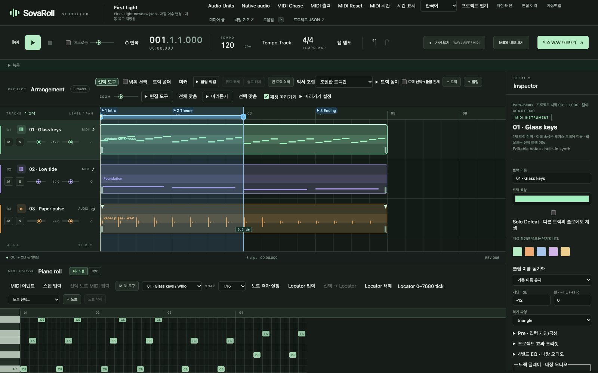
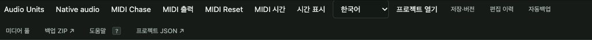

# 1. 설치·실행·업데이트·삭제

[← 차례](README.md) · [English](../en/01-install.md)

SovaRoll 설치는 두 가지뿐입니다. SovaRoll을 돌리는 엔진인 **Node.js**를 설치하고, **SovaRoll 폴더**를 컴퓨터 어딘가에 두는 것. 시스템 전체에 설치되는 다른 것은 없고, 계정도 없으며, 끄고 나면 뒤에서 돌아가는 것도 없습니다.

## 1.1 준비물

| 항목 | 이유 | 받는 곳 |
|---|---|---|
| Mac(macOS) 또는 Windows/Linux 컴퓨터 | macOS + Chrome에서 검증했습니다 | — |
| Google Chrome(권장) | 화면이 브라우저에서 열립니다 | <https://www.google.com/chrome/> |
| Node.js **22 이상**(LTS) | SovaRoll 실행 | <https://nodejs.org> |
| 약 50 MB 디스크 공간 | 앱 폴더 | — |
| 헤드폰(녹음 시) | 모니터링할 때 하울링 방지 | — |

## 1.2 Node.js 설치 (한 번만)

1. <https://nodejs.org>에서 내 컴퓨터용 **LTS** 설치 파일을 받습니다.
2. 설치 파일을 실행하고 기본값으로 진행합니다.
3. (선택 확인) **터미널**(Mac: Spotlight에서 "터미널")을 열고 `node --version`을 입력하면 `v22` 이상이 보여야 합니다.

## 1.3 SovaRoll 내려받기

**Git 없이 (가장 쉬움):** <https://github.com/Sovereign-Music-Lab/sovaroll-DAW>에서 초록색 **Code** 버튼 → **Download ZIP**. ZIP을 더블클릭해 풀고 `sovaroll-DAW` 폴더를 **응용 프로그램**이나 **문서** 같은 고정된 곳으로 옮깁니다.

**Git으로 (명령으로 업데이트하려면):**

```sh
git clone https://github.com/Sovereign-Music-Lab/sovaroll-DAW.git
```

## 1.4 SovaRoll 시작

| 시스템 | 방법 |
|---|---|
| macOS | 폴더의 **`Start SovaRoll.command`**를 더블클릭합니다. 처음에 "확인할 수 없는 개발자" 경고가 나오면 파일을 오른쪽 클릭 → **열기** → **열기**. |
| Windows | **`Start SovaRoll.bat`**를 더블클릭합니다. SmartScreen이 나오면 **추가 정보 → 실행**. |
| Linux / 터미널 | 폴더에서 `npm start` |

터미널 창이 열려서 계속 떠 있습니다. 그 창이 **SovaRoll의 엔진**입니다. 잠시 뒤 브라우저가 **http://127.0.0.1:4317**로 열립니다. `127.0.0.1`은 "이 컴퓨터"라는 뜻이라 인터넷으로 아무것도 보내지 않습니다.

더블클릭 실행 파일은 첫 프로젝트를 여기에 만듭니다.

- macOS: `~/Music/SovaRoll/My First Song/My First Song.newdaw.json`
- Windows: `%USERPROFILE%\Music\SovaRoll\My First Song\My First Song.newdaw.json`

다음에도 같은 프로젝트가 열립니다. (`npm start`는 대신 앱 폴더 안 `sessions/First-Light.newdaw.json`의 데모 곡을 엽니다.)



> **브라우저가 안 열리면** Chrome 주소창에 `http://127.0.0.1:4317`을 직접 입력하세요. **포트가 이미 쓰이고 있으면**(다른 프로그램이 4317 사용) 실행 파일이 이미 떠 있는 SovaRoll을 엽니다. 터미널에서는 다른 포트를 고를 수 있습니다: `npm start -- --port 4318`.

## 1.5 화면 언어 고르기

상단의 **English / 한국어** 메뉴를 씁니다. 선택은 이 브라우저에 기억됩니다. 화면 글자만 바뀌고 프로젝트·트랙 이름·파일은 절대 바뀌지 않습니다.



## 1.6 끝내기

1. 재생을 멈춥니다(**Space** 또는 ■).
2. 작업은 이미 자동 저장돼 있습니다. 이름 붙은 안전 지점을 원하면 먼저 **Ctrl/Cmd+S**.
3. 터미널 창을 닫거나, 그 창을 클릭하고 **Ctrl+C**.

브라우저 탭만 닫으면 SovaRoll은 **멈추지 않습니다.** 터미널 창이 멈춰야 합니다.

## 1.7 음악이 저장되는 곳

SovaRoll 프로젝트는 파일 하나가 아니라 **폴더**입니다.

```
My First Song/
  My First Song.newdaw.json         ← 곡(트랙, 노트, 클립, 믹스)
  assets/                           ← 가져오거나 녹음한 오디오(원본 그대로 보존)
  My First Song.newdaw.json.history.json   ← 실행 취소 이력
  My First Song.newdaw.json.saved.json     ← 마지막 명시 저장
  *.bak, 자동백업                    ← 복구용 사본
```

**항상 폴더 통째로 복사하거나 옮기세요.** `.json`만 복사하면 오디오가 빠집니다.

## 1.8 SovaRoll 업데이트

1. SovaRoll을 끝냅니다. 중요한 곡은 **백업 ZIP**을 만듭니다(10장).
2. ZIP 사용자: 새 ZIP을 받아 풀고 예전 앱 폴더를 바꿉니다. 곡은 `Music/SovaRoll`에 있어 영향이 없습니다. (`sessions/` 데모를 편집했다면 그 폴더를 먼저 밖으로 복사하세요.)
3. Git 사용자: 앱 폴더에서 `git pull --ff-only`. 직접 바꾼 파일 때문에 거부되면, 지우지 말고 도움을 요청하세요.
4. SovaRoll을 시작해 곡을 열고, 작은 편집 → 실행 취소 → 짧은 믹스 내보내기로 확인합니다.

## 1.9 SovaRoll 완전히 지우기 (음악은 지키면서)

1. 남길 것을 내보냅니다: **믹스 WAV 내보내기**, **MIDI 내보내기**, **백업 ZIP**(10장).
2. SovaRoll을 끝냅니다(1.6).
3. `sovaroll-DAW` 앱 폴더를 휴지통으로 옮깁니다.
4. 곡은 `Music/SovaRoll`에 그대로 있습니다. 정말 음악까지 지우려면 그 폴더를 지우세요.
5. 선택: Chrome은 `127.0.0.1:4317`용으로 언어 선택과 일부 복구 데이터를 저장합니다. Chrome → 설정 → 개인정보 보호 → 사이트 설정 → 사이트 전반에 저장된 권한 및 데이터 보기 → `127.0.0.1` 검색 → 데이터 삭제. 복구 테이크는 먼저 내보내세요.
6. Node.js와 Chrome은 별개 프로그램입니다. 다른 곳에서 쓰지 않을 때만 지우세요(Mac: Node 제거 도구, Windows: 설정 → 앱).

SovaRoll은 서비스·로그인 항목·드라이버를 설치하지 않으므로 더 지울 것은 없습니다.

---
[← 차례](README.md) · 다음: [2. 화면 둘러보기 →](02-tour.md)
