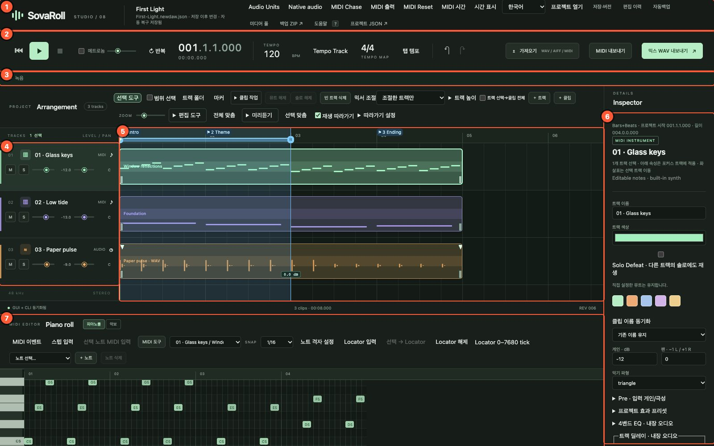
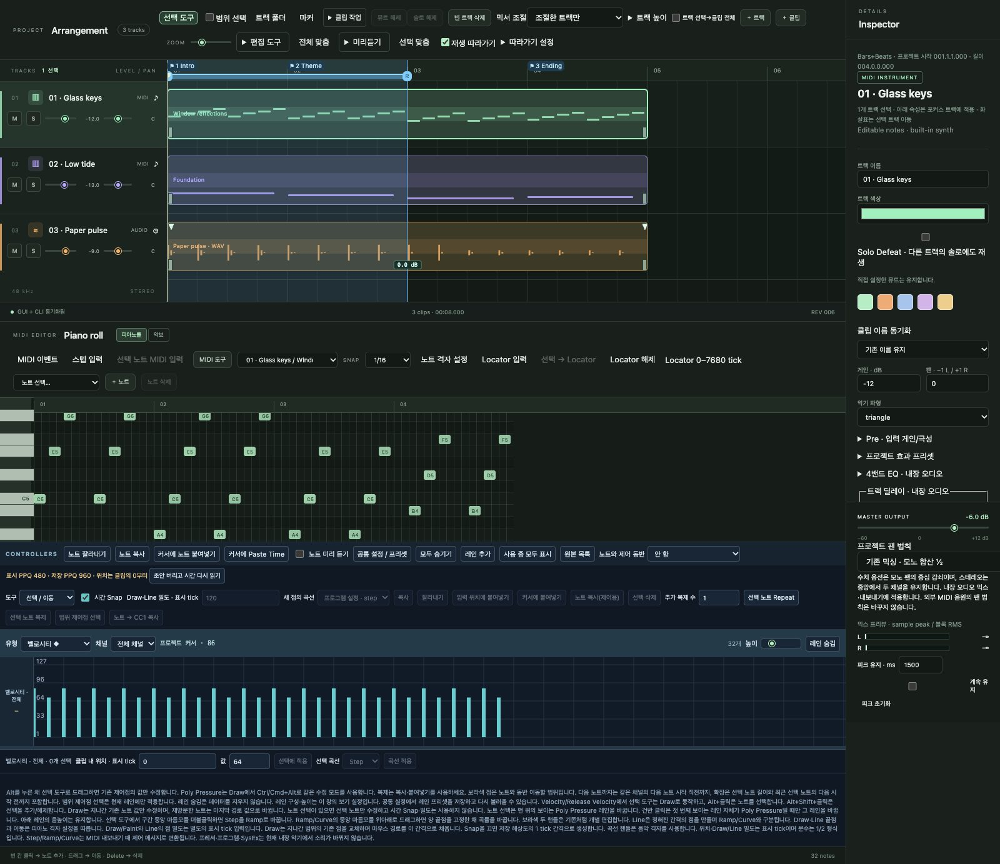
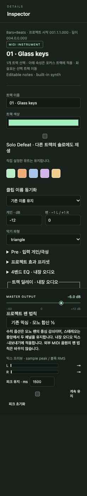
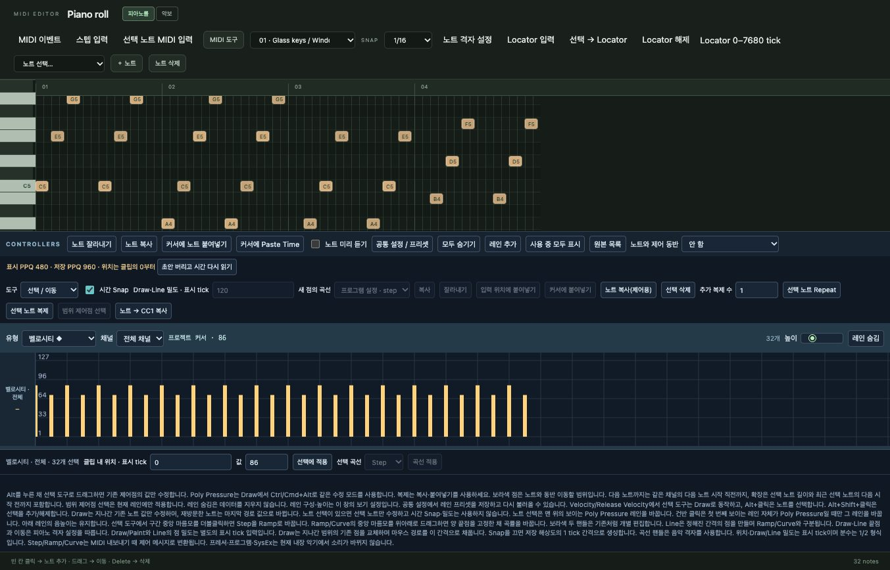
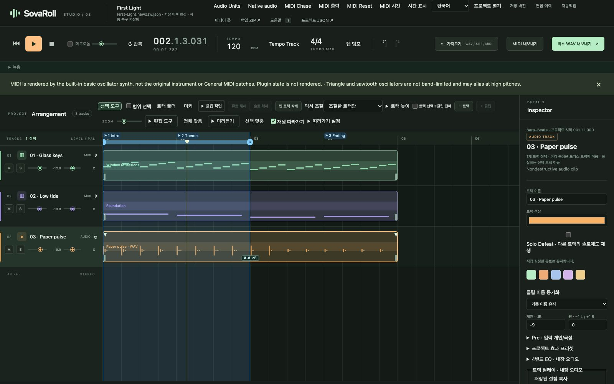

# 2. 화면 둘러보기

[← 차례](README.md) · [English](../en/02-tour.md)

SovaRoll은 스튜디오 하나를 창 하나에 담았습니다. 일곱 영역만 익히면 뒤의 모든 장이 익숙해집니다.

| 번호 | 영역 | 하는 일 |
|---|---|---|
| 1 | **상단 바** | 프로젝트 이름과 파일, 언어, 프로젝트 창(프로젝트 열기, 저장·버전, 편집 이력, 자동백업, 미디어 풀, 백업 ZIP, 도움말)과 엔진 설정(MIDI 출력, MIDI Chase, MIDI Reset, MIDI 시간, 시간 표시, Audio Units, 네이티브 오디오) |
| 2 | **트랜스포트 바** | 처음으로, 재생, 정지, 메트로놈, 반복(사이클), 위치 표시, 템포, 박자, 실행 취소/다시 실행, 가져오기, MIDI 내보내기, 믹스 WAV 내보내기 |
| 3 | **녹음 패널** | 마이크와 MIDI 건반 녹음. 열기 전에는 접혀 있습니다(8장) |
| 4 | **트랙 헤더** | 트랙마다 한 줄: 번호, 이름, 종류, **M**(뮤트), **S**(솔로), 게인·팬 슬라이더 |
| 5 | **편곡 창(Arrangement)** | 타임라인: 마디·마커·Locator가 있는 눈금자, 트랙별 레인 위의 클립 |
| 6 | **인스펙터** | 선택한 대상(트랙, 클립, 노트)의 속성, 마스터 출력과 미터 |
| 7 | **편집기** | 선택한 MIDI 클립의 **피아노롤** 또는 **악보**, 그 아래 컨트롤러 레인 |

## 2.1 상단 바

왼쪽에는 프로젝트 이름(데모는 **First Light**)과 파일 이름, 저장 상태(예: "저장 이후 변경 · 자동 복구 저장됨")가 보입니다. 오른쪽은 프로젝트 창과 엔진 설정입니다. 각 창은 그것을 쓰는 장에서 설명합니다.

## 2.2 트랜스포트 바

왼쪽부터:

- **⏮ 처음으로**, **▶ 재생**, **■ 정지**. 입력칸에 글을 쓰는 중이 아니면 **Space**로 재생/정지합니다.
- **메트로놈** 체크와 음량. 클릭 소리는 재생과 카운트인 때 들리지만 내보내기 파일에는 들어가지 않습니다.
- **반복**: 두 Locator 사이 구간을 되풀이합니다(9장).
- **위치 표시**: 위는 마디.박.16분음표.틱(`001.1.1.000` = 1마디 1박), 아래는 시계 시간. 형식은 **시간 표시**에서 바꿉니다.
- **템포**(BPM)와 템포 트랙/고정 템포 방식, **박자**(4/4, 누르면 템포 맵), **탭 템포**.
- **↶ 실행 취소**, **↷ 다시 실행**.
- **가져오기**(WAV / AIFF / MIDI), **MIDI 내보내기**, **믹스 WAV 내보내기**.

## 2.3 편곡 창과 트랙 헤더

눈금자는 마디(01, 02, 03 …)를 셉니다. **1 Intro**, **2 Theme**, **3 Ending** 같은 깃발은 **마커**입니다. **L**, **R** 손잡이가 있는 파란 띠는 **Locator 구간**으로, 반복 재생과 구간 내보내기에 씁니다. 세로선은 **재생 헤드**입니다.

트랙 줄마다:

- 트랙 번호(끌어서 순서 변경), 종류 아이콘, 이름(눌러서 선택), 종류(**MIDI** 또는 **AUDIO**)
- **M**(뮤트), **S**(솔로, Shift+클릭은 이 트랙만 솔로)
- **게인** 슬라이더(dB)와 **팬** 슬라이더(L … C … R)

클립은 색깔 블록입니다. MIDI 클립은 노트를 작은 막대로, 오디오 클립은 파형으로 보여 줍니다. 눌러서 선택, 끌어서 이동, 가장자리를 끌어 길이를 바꿉니다.

편곡 창 위 도구 모음: **선택 도구**, **범위 선택**, **트랙 폴더**, **마커**, **클립 작업**, **뮤트 해제/솔로 해제**, **빈 트랙 삭제**, **믹서 조절** 방식, **트랙 높이**, **+ 트랙**, **+ 클립**, **ZOOM**, **편집 도구**, **전체 맞춤**, **미리 듣기**, **선택 맞춤**, **재생 따라가기**.

## 2.4 인스펙터

인스펙터는 언제나 **포커스된** 대상을 편집합니다. 트랙을 고르면 이름, 색, **Solo Defeat**, 게인, 팬, 내장 악기 파형, 그리고 **Pre**, **프로젝트 효과 프리셋**, **4밴드 EQ**, **트랙 지연** 같은 항목이 나옵니다. 클립을 고르면 클립 항목(시작, 길이, 게인, 페이드 …), 노트를 고르면 노트 항목(음높이, 벨로시티, 시작, 길이)이 나옵니다. 값을 입력하고 그 항목의 **적용** 버튼을 누릅니다.

인스펙터 아래에는 최종 음량인 **MASTER OUTPUT**, **프로젝트 팬 법칙**, 피크 유지가 있는 **믹스 프리뷰 미터**가 있습니다.

## 2.5 편집기: 피아노롤과 악보

편집기는 편곡 창에서 선택한 클립을 보여 줍니다. 제목 옆 두 버튼으로 **피아노롤**과 **악보**를 오갑니다. 왼쪽 건반에 음 이름이 있습니다(C5 = MIDI 72, C4 = 가온 다 = MIDI 60). 노트 아래에는 벨로시티, CC, 피치벤드 등을 다루는 **컨트롤러** 레인이 있습니다(6장).

## 2.6 상태 줄

편곡 창 아래에 연결 상태(**GUI + CLI 동기화됨**이면 브라우저와 엔진이 연결된 것), 클립 수와 길이, 편집할 때마다 하나씩 올라가는 프로젝트 **REV**(리비전) 번호가 보입니다.

## 2.7 재생 중

재생을 누르면 브라우저가 먼저 현재 곡을 렌더링하고(잠깐 대기) 재생합니다. 재생 헤드가 움직이고 미터가 음량을 보여 줍니다. 재생 중에 편집하면 재생이 멈춥니다. 예전 렌더를 지금 곡으로 착각하지 않게 하기 위해서입니다.

---
[← 1. 설치](01-install.md) · 다음: [3. 첫 곡 →](03-first-song.md)
