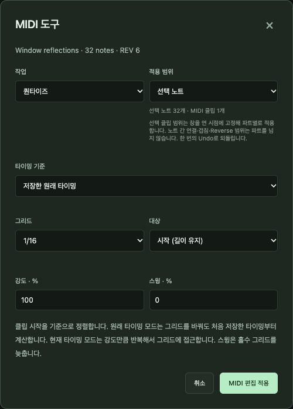

# 3. 30분 만에 첫 곡

[← 차례](README.md) · [English](../en/03-first-song.md)

이 장은 수업입니다. **화음**, **멜로디**, **베이스** 세 파트로 짧은 곡을 쓰고, 셈여림을 다듬고, 균형을 잡고, 내보냅니다. 단계마다 누를 버튼을 정확히 적었습니다. 한 번은 이 레시피대로, 다음엔 마음대로 바꿔 보세요.

**곡:** 4마디, 4/4박자, 96 BPM, 다장조. 대중음악에서 가장 유명한 진행 **C – Am – F – G**(I – vi – IV – V)를 씁니다.

| 마디 | 화음 | 구성음 | 베이스 |
|---|---|---|---|
| 1 | C 장3화음 (I) | 도 미 솔 (C E G) | C2 |
| 2 | A 단3화음 (vi) | 라 도 미 (A C E) | A1 |
| 3 | F 장3화음 (IV) | 파 라 도 (F A C) | F1 |
| 4 | G 장3화음 (V) | 솔 시 레 (G B D) | G1 |

## 1단계 — 빈 곡을 열고 템포 정하기

1. SovaRoll을 시작합니다(1장). 새 곡은 비어 있고 *첫 번째 아이디어를 놓아보세요*가 보입니다.
2. 트랜스포트 바의 템포 숫자(**120**)를 눌러 `96`을 입력하고 **Enter**.
3. 박자가 **4/4**인지 봅니다.

> **빠르기말.** 작곡가는 빠르기를 이탈리아어로 나타냅니다. 96 BPM은 *Andante*(걷는 빠르기, 약 76–108)와 *Moderato* 사이입니다. [12장](12-reference.md#음악-표)의 빠르기 표를 보세요.

## 2단계 — 화음 트랙 만들기

1. 빈 편곡 창의 **MIDI 트랙 만들기**를 누릅니다(또는 도구 모음 **+ 트랙** → 종류 *MIDI*, 이름 `Chords` → **추가**).
2. 트랙과 4마디짜리 빈 파트가 생기고 피아노롤에 열립니다.
3. 이름 바꾸기: 트랙을 선택하고 인스펙터 **트랙 이름**에 `Chords`를 입력한 뒤 적용합니다.

## 3단계 — 화음 쓰기

새 노트의 길이는 피아노롤 위 **SNAP** 값(기본 **1/16**)과 같습니다. 화음은 SNAP 메뉴에서 **1/2**(2분음표)를 골라, 클릭할 때마다 2분음표가 되게 합니다.

1. 피아노롤을 스크롤해 C3–C5가 보이게 합니다.
2. 1마디: 1박에 **C4**, **E4**, **G4**를 클릭하고, 3박에도 한 번 더. 한 마디에 C 화음이 두 번, 차분한 2분음표 박동이 됩니다.
3. 2마디: **A3**, **C4**, **E4**로 같게.
4. 3마디: **F3**, **A3**, **C4**. 4마디: **G3**, **B3**, **D4**.
5. **Space**로 듣고, 다시 **Space**로 멈춥니다.

한 마디에 긴 화음 하나가 좋다면 1박에만 넣고 전부 선택(**Ctrl/Cmd+A**)한 다음 **MIDI 도구 → 레가토**를 쓰세요. 각 화음이 다음 화음까지 이어집니다.

> **성부 진행.** 화음이 바뀔 때 움직이는 음이 얼마나 적은지 보세요. C→Am에서 도와 미가, Am→F에서 도가 그대로 남습니다. 공통음을 제자리에 두면 화음이 매끄럽게 들립니다. 좋은 화성의 첫 규칙입니다.

## 4단계 — 선택·복사·수정

- 노트를 누르면 선택, **Shift**+클릭으로 추가, **Ctrl/Cmd+A**로 파트 전체 선택.
- 선택한 노트를 위아래로 끌면 음높이, 좌우로 끌면 시간이 바뀝니다.
- **Delete**로 삭제.
- **Ctrl/Cmd+C**로 복사, 붙일 위치의 피아노롤 눈금자를 클릭, **Ctrl/Cmd+V**로 그 위치에 붙여넣기.
- 실수했으면 **Ctrl/Cmd+Z**(실행 취소), **Ctrl/Cmd+Shift+Z**(다시 실행). 명령줄에서 한 편집도 되돌릴 수 있습니다.

## 5단계 — 인스펙터로 정확한 길이와 벨로시티

노트를 선택하고 인스펙터에서:

- **벨로시티**(1–127)는 건반을 누르는 세기입니다. 화음은 `70` 정도(*메조 피아노*).
- **길이**는 표시 틱 단위(기본 4분음표 = 480, 4/4 한 마디 = `1920`).
- **노트 적용**을 누릅니다.

여러 노트를 한꺼번에 바꾸려면 **MIDI 도구** → **벨로시티**(8단계).

## 6단계 — 멜로디 넣기

1. `Melody`라는 MIDI 트랙을 하나 더 만듭니다(**+ 트랙**).
2. SNAP을 **1/8**(8분음표)로.
3. 화음 위에 강박마다 화음 구성음을 두는 간단한 선율을 씁니다. 예:
   - 1마디: E5 G5 E5 D5 · C5(2분음표)
   - 2마디: C5 E5 C5 B4 · A4
   - 3마디: A4 C5 F5 E5 · C5
   - 4마디: D5 B4 G4 B4 · D5(끝에 숨 쉴 자리 남기기)
4. 멜로디는 `90` 정도(*메조 포르테*)로 세게 해서 화음 위로 노래하게 합니다.

> **멜로디 요령.** 1박과 3박에 화음 구성음을 두고, 도약보다 순차 진행을 많이 쓰고, 프레이즈 끝은 긴 음으로 맺습니다. 쉼표도 멜로디의 일부입니다. 선율이 숨을 쉬게 해 줍니다.

## 7단계 — 베이스 넣기

1. `Bass` MIDI 트랙을 만듭니다.
2. 인스펙터 **악기 파형**을 **sawtooth**나 **triangle**로 바꾸면 낮은 소리가 더 꽉 찹니다.
3. 각 화음의 근음 C2, A1, F1, G1을 마디마다 하나씩(또는 1박과 3박에) 씁니다.
4. 베이스 게인을 조금(−3 dB) 낮춰, 지배하지 않고 받쳐 주게 합니다.

## 8단계 — 사람 손맛 주기

피아노롤 위 **MIDI 도구**를 엽니다.

- **퀀타이즈**: 노트를 격자에 맞춥니다. *강도*가 100% 미만이면 일부만 옮기고, *스윙*은 격자 두 칸 중 두 번째를 늦춰 셔플 느낌을 줍니다.
- **벨로시티**: 고정·비율·범위 안 무작위로 바꿉니다. 몇 단계 흔들림만 줘도 기계적인 느낌이 줄어듭니다.
- **레가토**: 각 노트를 다음 노트까지 잇습니다.
- **전조**: 반음 단위로 옮기고, 원하면 음계 안에서 옮깁니다.

MIDI 도구의 모든 작업은 실행 취소 한 번으로 되돌아갑니다.

## 9단계 — 균형 잡기

1. **Space**로 세 트랙을 함께 듣습니다.
2. **게인** 슬라이더: 멜로디가 가장 또렷하게, 화음은 뒤에, 베이스는 단단하게.
3. 화음은 살짝 왼쪽(`-0.2`)으로 팬, 멜로디와 베이스는 가운데.
4. **S**로 솔로, **M**으로 뮤트해 확인하고, 내보내기 전 **뮤트 해제/솔로 해제**.
5. 인스펙터 아래 **믹스 프리뷰** 미터를 봅니다. 끝까지 차면 **MASTER OUTPUT**을 낮춥니다.

## 10단계 — 저장·내보내기·백업

1. **Ctrl/Cmd+S**로 이 상태를 저장 기준으로 표시합니다.
2. **믹스 WAV 내보내기** → 기본값 → **WAV 렌더**. 끝나면 인스펙터에 **렌더된 WAV** 내려받기 링크가 생깁니다.
3. **MIDI 내보내기** → **SMF 파일 내보내기**로 편집 가능한 노트를 받습니다(Logic Pro 등 어떤 DAW에서도 열림).
4. 상단 **백업 ZIP**으로 오디오까지 프로젝트 전체를 보관합니다.

축하합니다. 곡을 쓰고, 편곡하고, 믹스하고, 내보냈습니다. 이 책의 나머지는 각 도구를 깊이 설명합니다.

---
[← 2. 화면](02-tour.md) · 다음: [4. 프로젝트·저장·안전장치 →](04-projects.md)
