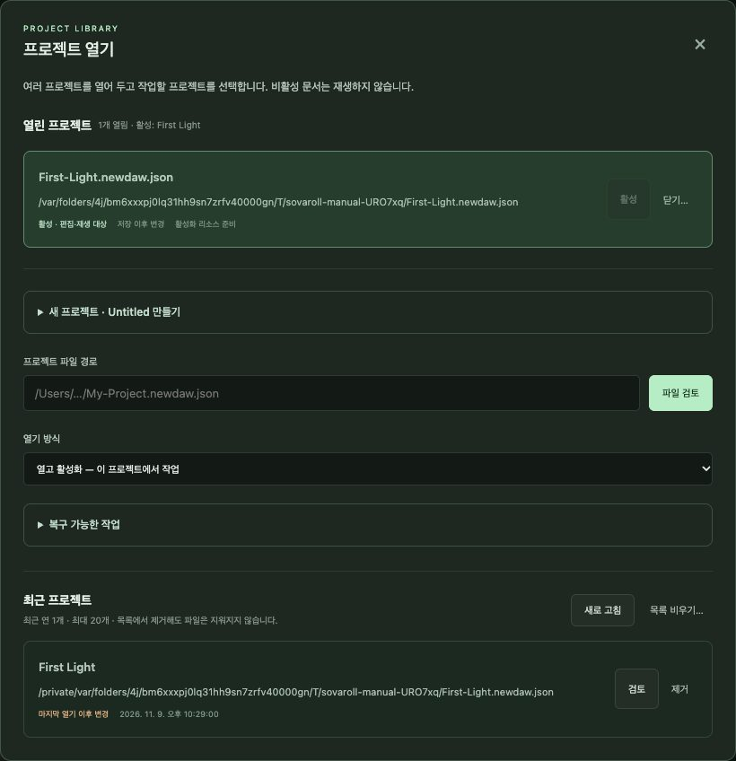
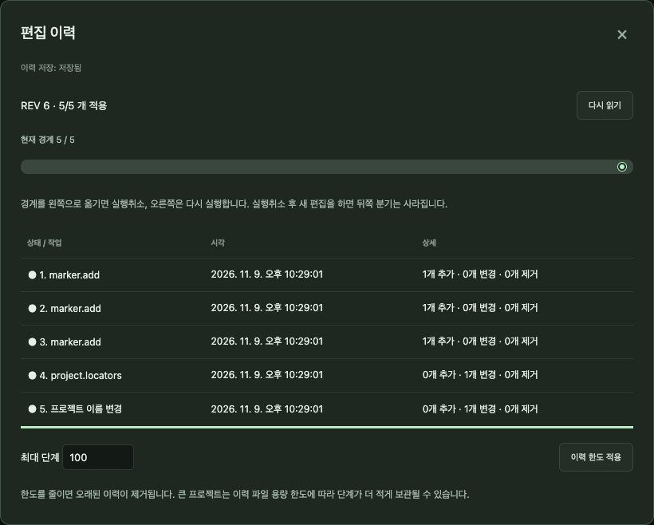
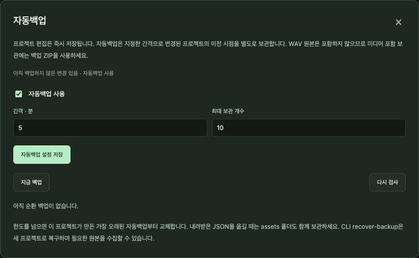
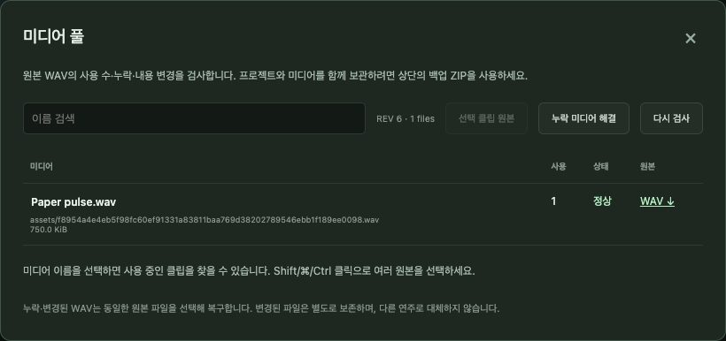

# 4. 프로젝트·저장·안전장치

[← 차례](README.md) · [English](../en/04-projects.md)

SovaRoll은 작업을 잃지 않도록 만들어졌습니다. 모든 편집은 즉시 저장되고, 모든 편집은 되돌릴 수 있으며, 원본 오디오 파일은 절대 바뀌지 않습니다. 이 장은 안전장치를 믿고 쓸 수 있도록 설명합니다.

## 4.1 세 가지 "저장"

| 종류 | 무슨 일이 일어나나 | 방법 |
|---|---|---|
| **자동** | 편집할 때마다 프로젝트 파일에 바로 기록(자동 복구) | 할 일 없음 |
| **명시 저장** | 지금 상태를 *기준점*으로 표시. **되돌리기(Revert)**는 여기로 돌아감 | **Ctrl/Cmd+S** 또는 **저장·버전 → 저장** |
| **버전** | 번호 붙은 사본(`Song-02.newdaw.json`)을 만들고 거기서 계속 | **저장·버전 → 새 버전 저장** |

상단 바에 상태가 보입니다. 예: *저장 이후 변경 · 자동 복구 저장됨*

## 4.2 프로젝트 열기: 곡 하나 또는 여러 개

**프로젝트 열기**는 열린 곡 목록을 보여 줍니다. 여러 곡을 열어 둘 수 있고, **활성** 곡 하나만 편집·재생됩니다. 이 창에서:

- **새 프로젝트 · Untitled 만들기** — 폴더를 고르고 빈 곡을 시작합니다. 첫 저장 때 파일 이름을 묻습니다.
- **프로젝트 파일 경로**를 붙여 넣고 **파일 검토** → **열기 방식**(열고 활성화 / 뒤에서 열기) 선택.
- **복구 가능한 작업** — Untitled 곡이나 비정상 종료된 작업을 이어 갑니다.
- **최근 프로젝트** — **검토**로 다시 열기. **제거**는 목록에서만 지우고 파일은 지우지 않습니다.
- 곡 **닫기…**(다른 곡이 자동으로 활성화되지 않음).

## 4.3 저장·버전과 되돌리기

- **저장** — 새 기준점.
- **다른 이름으로 저장** — 새 이름/폴더로 계속. 오디오도 함께 복사됩니다.
- **새 버전 저장** — 번호 붙은 사본. 큰 변경 전에 좋습니다.
- **되돌리기** — 마지막 저장으로 돌아갑니다. 버려질 내용을 보여 주고, 새로 녹음한 오디오를 남길지 되돌리기 휴지통으로 옮길지 고르게 합니다. 휴지통에서 다시 복원할 수 있습니다.

## 4.4 편집 이력(실행 취소 목록)

**편집 이력**은 *노트 추가*, *클립 이동* 같은 모든 작업을 설명과 함께 보여 줍니다. 항목을 누르면 그 시점으로 이동하고, 설명을 고치거나 보관할 최대 단계를 정할 수 있습니다. 이력은 앱을 다시 켜도 남습니다(곡 옆 `.history.json`). 명령줄 편집도 여기에 나옵니다.

## 4.5 자동백업

**자동백업**은 바뀐 프로젝트를 일정 간격으로 사본 보관합니다. **사용**, **간격**(분), **보관 개수**를 정하거나 **지금 백업**을 누릅니다. 어떤 백업이든 내려받거나 *새* 프로젝트 폴더로 복구할 수 있고, 원본은 덮어쓰지 않습니다.

## 4.6 미디어 풀: 오디오가 사는 곳

가져오거나 녹음한 오디오는 곡의 `assets/` 폴더에 내용으로 만든 이름(SHA-256)으로 저장됩니다. 같은 파일은 한 번만 저장되고, 손상되면 알아낼 수 있습니다. **미디어 풀**은 원본마다 어떤 클립이 쓰는지, 파일이 있고 온전한지 보여 줍니다. 파일이 없으면(예: `.json`만 복사) 폴더를 검색해 똑같은 원본을 찾거나, 다른 파일로 다시 연결하거나, 없는 원본과 그 클립을 지울 수 있습니다. 모두 실행 취소가 됩니다.

## 4.7 백업 ZIP과 프로젝트 JSON

- **백업 ZIP**은 프로젝트와 모든 오디오를 *함께* 내려받습니다. 곡을 보관하거나 옮기는 가장 좋은 방법입니다.
- **프로젝트 JSON**은 설명만 받습니다. 오디오는 참조만 하고 들어 있지 않습니다.

## 4.8 좋은 습관

1. 곡마다 앱 밖의 자기 폴더에 둡니다(실행 파일이 그렇게 합니다).
2. 실험 전에는 **새 버전 저장**, SovaRoll 업데이트 전에는 **백업 ZIP**.
3. `.json`만이 아니라 **폴더 통째로** 옮기거나 복사합니다.
4. 믹스를 나눌 때는 MIDI와 원본 오디오도 함께 남깁니다.
5. 이상해 보이면 파일을 지우지 말고 **미디어 풀**과 **편집 이력**부터 엽니다.

---
[← 3. 첫 곡](03-first-song.md) · 다음: [5. 트랙·클립·편곡 →](05-arrangement.md)
