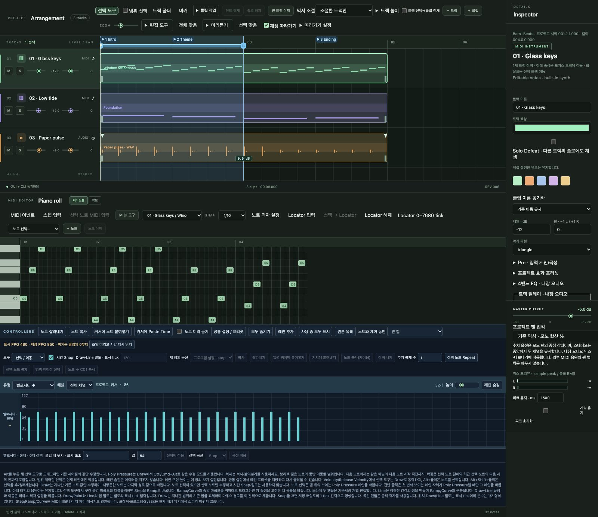
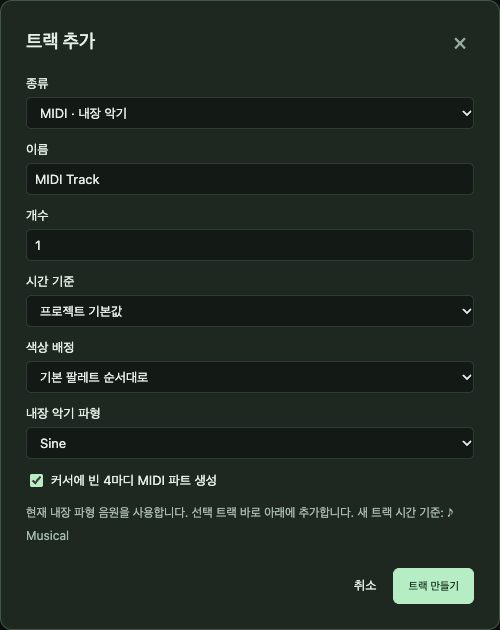
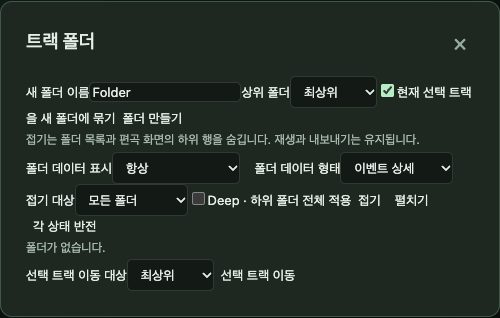
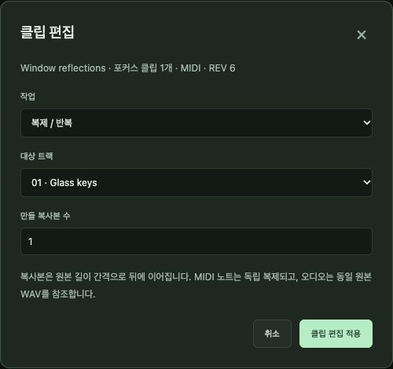
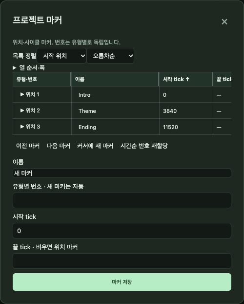
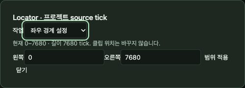

# 5. 트랙·클립·편곡

[← 차례](README.md) · [English](../en/05-arrangement.md)

편곡은 *무엇이 언제 연주될지* 정하는 일입니다. SovaRoll의 곡은 **트랙**(악기나 오디오 레인)들의 묶음이고, 각 트랙에는 마디로 잰 타임라인 위에 **클립**(MIDI 파트나 오디오 이벤트)이 놓입니다.

## 5.1 트랙

**+ 트랙**으로 트랙을 추가합니다.

종류(**MIDI** 또는 **오디오**), 이름, 개수, 색, 시간 기준(음악적/선형), MIDI라면 내장 악기와 빈 파트 생성 여부를 고릅니다. 여러 트랙을 한 번에 만들 수 있습니다.

트랙 헤더에서: 번호를 끌어 순서 변경(방향키도 가능), 이름을 눌러 선택(Shift/Ctrl/Cmd로 여러 개), **M** 뮤트, **S** 솔로(Shift+클릭 = 이 트랙만), 게인·팬 슬라이더. **믹서 조절**은 슬라이더 변경을 조절한 트랙에만 줄지, 선택한 모든 트랙에(상대값/같은 값) 줄지 정합니다.

**빈 트랙 삭제**는 클립 없는 트랙을 지우고, **뮤트 해제** / **솔로 해제**는 모든 상태를 풉니다.

## 5.2 트랙 폴더

*드럼*, *현악기*처럼 트랙을 폴더로 묶습니다. 폴더는 중첩·이름 변경·색 지정·접기가 됩니다(접으면 줄만 숨기고 데이터는 지우지 않음). 폴더의 **M/S**는 안의 모든 트랙을 뮤트·솔로합니다. 트랙을 폴더 헤더로 끌어 넣고, 맨 위로 끌면 밖으로 꺼냅니다. **폴더만 해제**는 트랙을 그대로 둡니다.

## 5.3 클립

- **선택**: 클릭. Shift/Ctrl/Cmd+클릭으로 추가, 빈 곳을 끌어 상자 선택, 타임라인에서 **Ctrl/Cmd+A**로 전체 선택.
- **이동**: 끌기. **Ctrl/Cmd**를 누르고 끌면 독립 사본, **Alt/Option**은 스냅 무시, **Shift**는 트랙이나 시간 축 고정. 방향키로 선택 클립을 조금씩 이동(Shift = 10칸).
- **길이**: 왼쪽·오른쪽 가장자리를 끌기. MIDI 파트는 노트를 지키고, 오디오 클립은 원본의 어느 부분이 들릴지 바뀝니다(**편집 도구 → 오디오 길이 조절 방식**에서 타임 스트레치 선택 가능).
- **삭제**: **Delete/Backspace**.
- **클립 뮤트**: 타임라인 포커스에서 **M**.
- **커서에서 분할**: **S**(Shift+S는 두 Locator에서 분할).
- **클립 복사/잘라내기/붙여넣기**: 타임라인 포커스에서 **Ctrl/Cmd+C / X / V**. 커서 위치로 붙고, Shift+V는 원래 위치로 붙습니다.

## 5.4 클립 작업·편집 도구 메뉴

**클립 작업**: 커서/Locator/반복 분할, 클립보드 복사·잘라내기·붙여넣기(대상 트랙, 없는 트랙 만들기 옵션), 클립보드 파일 내보내기/가져오기, 트랙으로 이동, 커서로 이동, 앞/뒤 자르기.

**편집 도구**: 오디오 길이 조절 방식, 선택 클립 뮤트, MIDI 붙이기 도구, 선택 오디오/MIDI 클립 붙이기, 영점 교차 분할, 루프 채우기, **선택 클립 반복**, 클립으로 Locator/사이클 설정, 프로젝트 맞춤.

## 5.5 클립 도구 창

정확한 작업은 **클립 작업 → 클립 도구**에서: 복제(개수와 대상 트랙), 정확한 위치에서 분할(노트·컨트롤러 분할 정책), 정확한 위치로 이동 — 마디/박, 초, 샘플, 틱 단위.

## 5.6 마커

마커는 곡의 자리(*Intro*, *Verse*, *Chorus*)에 이름을 붙입니다. 위치 마커는 한 점, 사이클 마커는 구간입니다. **마커** 창에서 추가, 이름 변경, 번호 다시 매기기, 열마다 정렬, 열 너비 조절, 마커 사이 이동(◀ ▶), 행에서 **Enter**로 그 위치로 이동합니다.

## 5.7 Locator와 반복

두 **Locator**(눈금자의 L, R)는 **반복** 재생, 구간 내보내기, Locator 분할에 쓰는 작업 구간입니다. 눈금자 손잡이를 끌거나, **Locator 입력**으로 정확한 경계·구간 이동·길이를 입력합니다. **선택 → Locator**는 선택한 노트나 클립에 맞춰 설정합니다.

## 5.8 확대와 보기

**ZOOM**은 가로 배율, **트랙 높이**는 줄 높이, **전체 맞춤**과 **선택 맞춤**은 화면 맞춤, **재생 따라가기**는 재생 헤드를 화면 안에 둡니다(일시 중지/재개 옵션).

---
[← 4. 프로젝트](04-projects.md) · 다음: [6. MIDI 편집 깊이 보기 →](06-midi.md)
