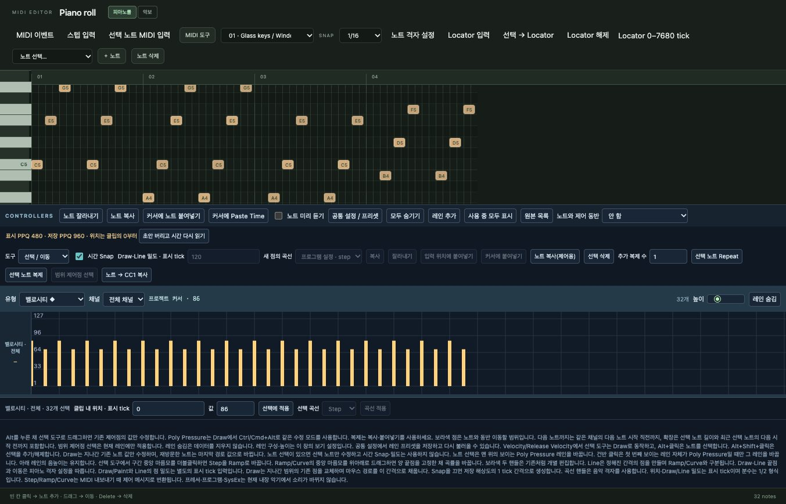
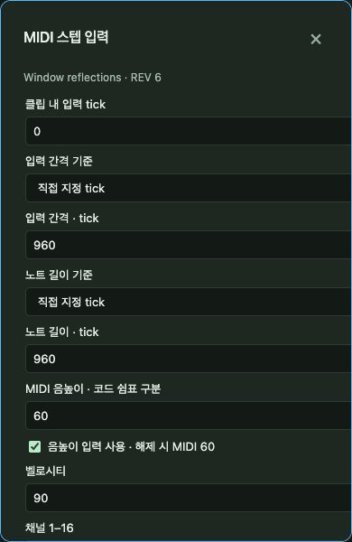
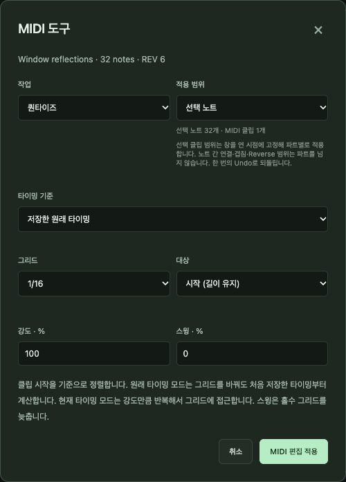
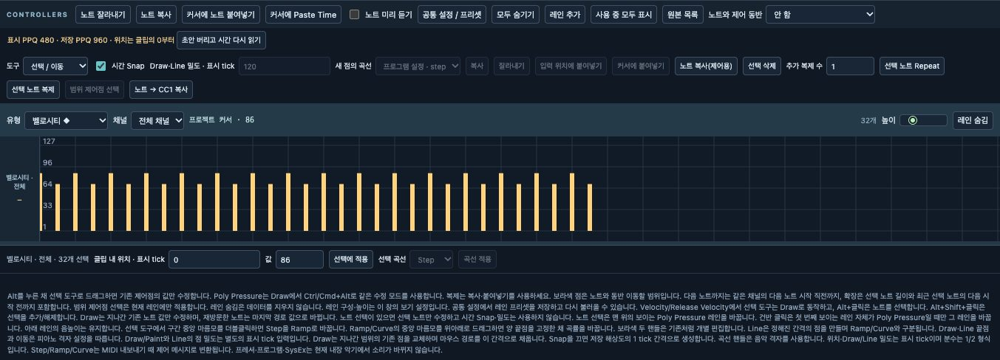
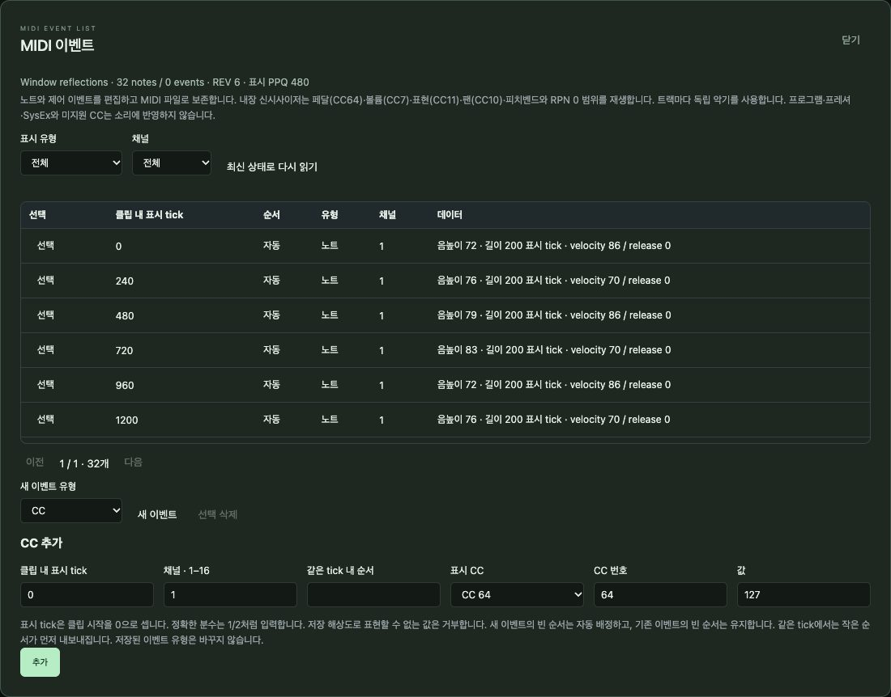
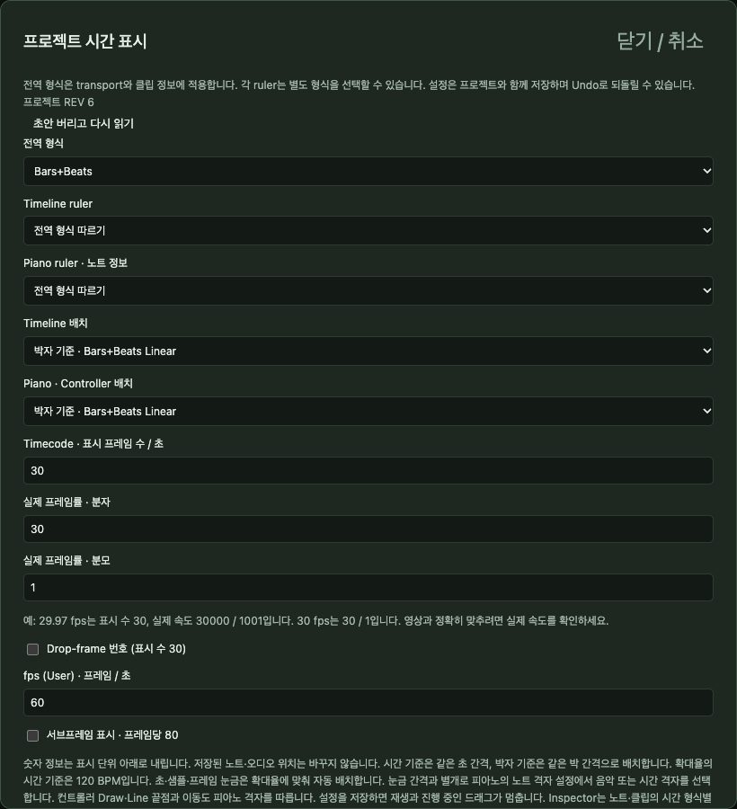
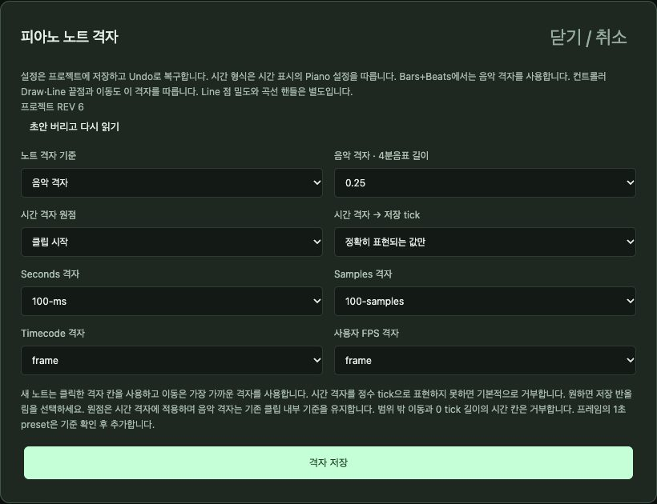

# 6. MIDI 편집 깊이 보기

[← 차례](README.md) · [English](../en/06-midi.md)

MIDI는 *지시문*으로 된 음악입니다. 어느 건반을, 언제, 얼마나 길게, 얼마나 세게. 소리가 아니라 지시문이라 언제든 모든 노트를 바꿀 수 있습니다. SovaRoll은 오디오를 내보낸 뒤에도 MIDI를 완전히 편집 가능한 상태로 지킵니다.

## 6.1 피아노롤

- **세로** = 음높이. 왼쪽 건반에 이름이 있고, 가온 다는 **C4** = MIDI 60. 건반을 누르면 그 음높이의 노트가 모두 선택됩니다.
- **가로** = 시간. 눈금자에 마디 번호가 있고, 눈금자를 누르면 커서가 놓입니다.
- **추가**: 빈 칸 클릭. 길이는 **SNAP** 값(1/16, 1/8, 1/4, 1/2)과 같습니다.
- **이동**: 끌기(시간과 음높이 함께). **길이**: 인스펙터나 MIDI 도구 → 길이.
- **선택**: 클릭, Shift/Ctrl/Cmd+클릭, **Ctrl/Cmd+A**. **노트 선택…** 메뉴로 음높이·구간 등 규칙 선택, 방향키로 노트 사이 이동.
- **삭제**: **Delete** 또는 **노트 삭제** 버튼.
- **복사/붙여넣기**: **Ctrl/Cmd+C**, 눈금자 클릭, **Ctrl/Cmd+V**(Shift+V는 시간 삽입).
- **노트 격자 설정**: 음악적 격자 또는 시간 격자(초, 샘플, 프레임)와 기준점.
- **Locator 입력**, **선택 → Locator**, **Locator 해제**는 Locator 구간을 다룹니다.

### 노트 인스펙터

**음높이**, **벨로시티**(1–127), 표시 틱 단위의 **클립 내 시작**과 **길이**(기본 4분음표 480, **MIDI 시간**에서 설정), 선택적 시간 형식 입력. **노트 적용**으로 확정, 실행 취소 한 번이면 되돌아갑니다.

## 6.2 스텝 입력

스텝 입력은 실시간으로 연주하지 않고 노트를 차례로 씁니다. 정확한 리듬에 좋습니다. 음표 값(점음표·셋잇단 포함), 음높이, 벨로시티, 채널을 정하고 **입력**을 누르면 쓰고 커서가 다음으로 갑니다. **쉼표**는 소리 없이 넘어가고, ◀ ▶로 커서를 옮깁니다. 연결한 MIDI 건반으로 음높이를 넣을 수도 있습니다.

## 6.3 MIDI 도구

**작업**과 **범위**(선택 노트 / 클립 전체)를 고르고 **MIDI 편집 적용**. 모든 작업은 실행 취소 한 번으로 되돌아갑니다.

| 작업 | 하는 일 |
|---|---|
| 퀀타이즈 | 시작(또는 끝)을 격자 쪽으로 강도·스윙과 함께 옮김. 원래 타이밍을 보관해 다시 퀀타이즈하거나 되돌릴 수 있음 |
| 퀀타이즈 원복 / 기준 확정 | 원래 타이밍으로 되돌리기 / 지금 타이밍을 새 원래 타이밍으로 |
| 전조 | 반음 단위 이동, 한 음계에서 다른 음계로, 음역 제한 가능 |
| 벨로시티 | 고정·더하기·비율·범위 안 무작위 |
| 레가토 | 각 노트를 다음 노트까지(간격 지정 가능) |
| 길이 | 노트 길이 지정·비율 |
| Reverse / Mirror | 노트 시작 위치 반전 또는 음높이 반전 |
| 중복 노트 제거 | 같은 음높이·시간에 겹친 똑같은 노트 삭제 |
| 노트 겹침 정리 / 동시 발음 수 제한 | 겹친 노트 정리 |
| 페달을 노트 길이로 | 서스테인 페달(CC64) 유지를 실제 노트 길이로 |
| 노트 분할 / 채널·음높이별 트랙 분리 | 위치에서 노트 분할 / 파트를 채널이나 음높이별 트랙으로 |
| 루프를 파트 끝까지 반복 | 두 지점 사이를 파트 끝까지 반복 |
| 컨트롤러 줄이기 / CC 데이터 삭제 | 컨트롤러 데이터 줄이기·지우기 |

## 6.4 컨트롤러 레인

노트 아래 레인에서 **벨로시티**, **CC**(모듈레이션, 볼륨, 팬, 서스테인 페달 CC64 …), **피치벤드**, **채널 프레셔**, **폴리 프레셔**, **릴리스 벨로시티**를 다룹니다. 레인마다 **종류**, **채널**, 높이가 있습니다.

- **도구**: 선택/이동, Draw, Paint, Line과 곡선 모양(Line, Parabola, Sine, Triangle, Square), **시간 스냅**과 점 밀도.
- **Alt**+끌기는 기존 값만 수정. 램프 가운데 손잡이를 끌면 곡률이 바뀝니다.
- **복사 / 잘라내기 / 커서에 붙여넣기**, **선택 삭제**, **선택 노트 반복/복제**, **노트 → CC1 복사**는 노트 벨로시티를 컨트롤러로 바꿉니다.
- **노트와 함께 컨트롤 이동**: 노트를 끌 때 컨트롤러 데이터가 따라올지 정합니다.
- **공통 설정 / 프리셋**: 보여 줄 CC 레인을 고르고 레인 배치를 저장합니다.

컨트롤러 곡선은 프로젝트에서 편집 가능한 상태로 남고, MIDI로 내보낼 때 이벤트로 바뀝니다.

## 6.5 MIDI 이벤트 목록

**MIDI 이벤트**는 파트에 저장된 모든 메시지 — 페달, CC, 피치벤드, 프로그램 체인지, 프레셔, SysEx — 를 정확한 위치와 값으로 보여 주고 편집하게 합니다. 같은 틱의 순서도 지켜집니다.

## 6.6 시간·격자·표시

**시간 표시**는 위치를 어떻게 보일지 고릅니다: Bars+Beats, 초, 샘플, 타임코드, 사용자 fps. 타임라인과 피아노롤을 따로, 배치를 음악적/시간 선형으로.

**노트 격자 설정**은 클릭·끌기 때 쓰는 격자를 고릅니다. **MIDI 시간**은 표시 해상도(PPQ)와 Length Adjustment를 정합니다. 저장되는 데이터는 언제나 최대 정밀도(4분음표 960틱)를 유지합니다.

## 6.7 MIDI 트랙 재생 설정

MIDI 파트나 트랙의 인스펙터에서 **MIDI 재생 설정 / Freeze**는 전조, 벨로시티·길이 비율, 무작위, 지연, 프로그램/뱅크, 볼륨/팬을 노트를 바꾸지 않고 적용합니다. **Freeze**는 그 효과를 노트에 확정합니다. **Merge MIDI in Loop**는 Locator 구간의 파트들을 새 파트로 합칩니다.

## 6.8 MIDI 트랙의 소리

내장 악기는 간단한 오실레이터 — `sine`, `triangle`, `sawtooth` — 로, 트랙마다 인스펙터에서 고릅니다. 스케치용 소리이지 피아노 라이브러리가 아닙니다. 완성된 소리가 필요하면 MIDI를 다른 악기로 내보내거나, macOS에서 Audio Unit 악기로 선택 파트를 렌더링하거나(8장), 외부 악기로 MIDI를 보냅니다(9장).

---
[← 5. 편곡](05-arrangement.md) · 다음: [7. 악보 보기와 MusicXML →](07-score.md)
