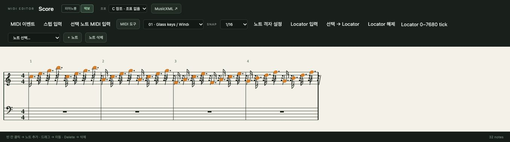

# 7. 악보 보기와 MusicXML

[← 차례](README.md) · [English](../en/07-score.md)

**악보** 보기는 같은 MIDI 파트를 큰보표 위 전통 기보로 보여 주고, 그 위에 노트를 쓰게 합니다. 피아노롤과 똑같은 노트를 편집하므로 언제든 둘을 오갈 수 있습니다.



## 7.1 악보 열기

MIDI 클립을 고르고 편집기 제목 옆 **악보**를 누릅니다. **피아노롤**을 누르면 돌아가고, 브라우저가 선택을 기억합니다.

- **높은음자리표 보표**에는 가온 다(C4)부터 위, **낮은음자리표 보표**에는 그 아래 음이 놓입니다.
- 위쪽에 마디 번호, 처음에 박자(4/4)가 보입니다.
- 임시표는 **조표** 메뉴를 따르고 마디마다 초기화됩니다. 마디줄을 넘는 음은 붙임줄로 씁니다.
- 소리 없는 박은 쉼표로 채웁니다.

## 7.2 보표에서 쓰고 고치기

| 작업 | 방법 |
|---|---|
| 노트 추가 | 보표의 빈 자리 클릭. 현재 격자에 맞고 그 줄/칸의 음계음이 됨 |
| 선택 | 노트 클릭(피아노롤과 선택 공유) |
| 삭제 | **Delete** |
| 음계 한 단계 이동 | **Alt+↑ / Alt+↓** |
| 옥타브 이동 | **Shift+Alt+↑ / ↓** |
| 조표 표기 바꾸기 | **조표** 메뉴(다장조 … ♯7개 / ♭7개) |

**조표** 메뉴는 노트를 *어떻게 적을지*(F♯ 또는 G♭)만 바꾸고 MIDI 노트는 바꾸지 않습니다.

## 7.3 그림 읽는 법

악보는 **시간 비례** 배치입니다. 피아노롤처럼 소리 나는 자리에 음을 놓으므로 긴 음은 자리를 더 차지합니다. 보표마다 리듬 층은 하나이고, 아직 빔과 잇단음표는 그리지 않습니다. 한 개의 음표 값으로 정확히 적을 수 없는 길이는 머리를 점선으로 그립니다. MIDI 타이밍이 기보보다 더 세밀하다는 표시입니다.

> **읽기 요령.** 악보와 피아노롤은 하나의 진실을 보는 두 창입니다. 화성과 성부 진행은 악보로 한눈에(세로로 쌓인 음 = 화음), 타이밍과 벨로시티는 피아노롤로 다듬으세요.

## 7.4 악보 프로그램용 MusicXML 내보내기

악보 도구 모음의 **MusicXML ↗**은 선택 파트의 트랙을 화면의 조표로 MusicXML 4.0 파일로 내보냅니다. MuseScore, Dorico, Sibelius, Finale, Logic 악보 편집기에서 열 수 있습니다.

명령줄로:

```sh
npm run cli -- export-musicxml score.musicxml                 # 모든 MIDI 트랙
npm run cli -- export-musicxml lead.musicxml --track-id TRACK_ID --key-fifths -1   # 트랙 하나, 바장조
```

들어가는 것: 노트, 붙임줄, 화음, 쉼표, 조표, 박자, 템포, 셈여림으로 바꾼 벨로시티. 겹친 리듬은 추가 성부가 되고, 뮤트한 클립은 빠집니다. 들어가지 않는 것: 악기 소리, 컨트롤러, 서스테인 페달, 빔, 잇단음표. 파일은 올바른 XML인지 검사했지만, MusicXML 스키마 검증이나 모든 악보 프로그램에서의 확인은 아직이므로 쓰시는 프로그램에서 결과를 확인하세요.

---
[← 6. MIDI](06-midi.md) · 다음: [8. 오디오 →](08-audio.md)
