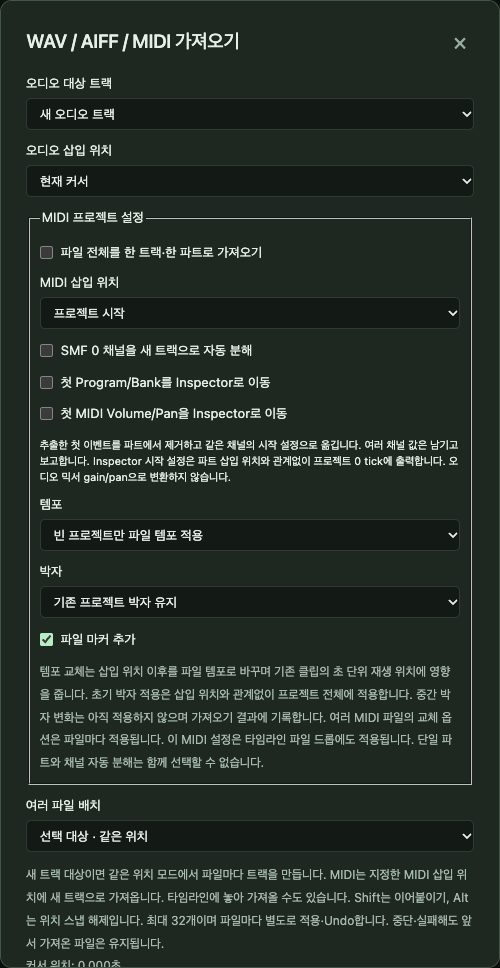
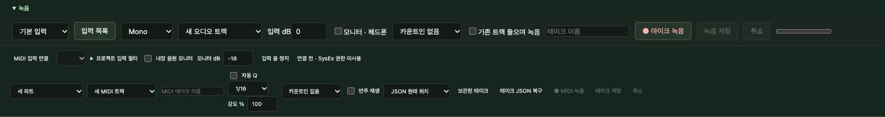
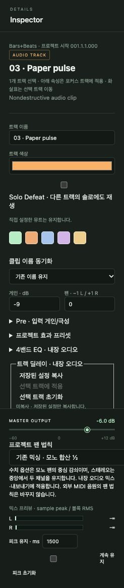

# 8. 오디오: 가져오기·녹음·편집

[← 차례](README.md) · [English](../en/08-audio.md)

오디오는 녹음된 소리입니다. 목소리, 기타, 드럼 루프. SovaRoll은 원본 오디오 파일을 절대 건드리지 않고 *어떻게* 재생할지(어느 부분을, 어디서, 얼마나 크게)만 편집합니다. 언제든 되돌릴 수 있습니다.

## 8.1 WAV, AIFF, MIDI 가져오기

트랜스포트 바의 **가져오기**를 누릅니다.

- **오디오 대상**: 새 오디오 트랙 또는 기존 트랙.
- **위치**: 커서 위치 또는 프로젝트 시작. 먼저 눈금자를 눌러 커서를 놓으세요.
- 여러 파일의 **배치**: 병렬(파일마다 트랙) 또는 직렬(이어 붙이기).
- **MIDI 설정**: 파트 하나로 합치기, 왼쪽 Locator에 넣기, format 0 채널을 트랙으로 나누기, 첫 패치·볼륨·팬을 인스펙터로 옮기기, 파일의 템포·박자·마커 처리 방법.
- **파일 선택…**으로 파일 창을 엽니다. 한 번에 최대 32개, 파일마다 결과(가져옴, 경고, 실패)를 보고합니다.

지원: WAV(정수 PCM 16/24/32비트 또는 32비트 float, 최대 8채널, 파일당 32 MiB 이하), AIFF, 표준 MIDI 파일(format 0/1).

## 8.2 마이크로 녹음

트랜스포트 바 아래 **녹음** 패널을 엽니다.

1. **입력**(목록을 새로 고치려면 **입력 목록**, Chrome에서 마이크 허용), **Mono/Stereo**, **대상**(새 오디오 트랙 또는 기존 트랙)을 고릅니다.
2. **입력 dB**로 게인을 맞춥니다. **모니터 · 헤드폰**은 헤드폰을 썼을 때만 켜세요(아니면 하울링).
3. 선택: 1·2마디 **카운트인**, **기존 트랙 들으며 녹음**(녹음하면서 곡 재생), **테이크 이름**.
4. 녹음을 시작할 곳에 커서를 두고 **● 마이크 녹음**. 레벨 미터가 입력을 보여 주고, 클리핑이면 경고합니다.
5. **녹음 저장**은 멈추고 커서 위치에 클립을 한 번에 놓습니다(실행 취소 한 번). **취소**는 버립니다.

녹음 중에 프로젝트가 바뀌면 SovaRoll은 테이크를 자동으로 넣지 않고 내려받을 수 있는 WAV로 남겨 잃지 않게 합니다.

> 실제 마이크의 지연과 음질 차이는 자동 테스트가 판단할 수 없습니다. 긴 녹음 전에 짧게 녹음해 들어 보세요.

## 8.3 MIDI 건반으로 녹음

녹음 패널 아래쪽은 **MIDI** 녹음입니다. **MIDI 입력 연결**, 대상(새 파트 / 새 MIDI 트랙), 테이크 이름, 선택적 **자동 Q**(퀀타이즈)와 격자·강도, 카운트인, **반주 재생**을 정하고 **● MIDI 녹음** → **테이크 저장**. 테이크는 보관되고, 저장이 실패하면 JSON에서 복구할 수 있습니다. Chrome이 MIDI 권한을 묻고, SysEx 권한은 쓰지 않습니다.

## 8.4 오디오 클립 편집

오디오 클립을 고르면 인스펙터에 트랙 항목과 그 아래 클립 항목이 나옵니다.

| 항목 | 뜻 |
|---|---|
| 시작(초) | 곡에서 클립이 시작하는 위치 |
| 소스 시작 / 길이(프레임) | 원본 파일의 어느 부분이 들릴지(트림) |
| 클립 게인(dB) | 이 클립만의 음량 |
| 페이드 인 / 페이드 아웃(초) | 서서히 시작·끝. 모양은 linear, equal-power, S-curve |
| 클립 음소거, 극성 반전, 역재생 | 소리 끄기, 파형 부호 뒤집기, 거꾸로 재생 |
| 노멀라이즈 dBFS → **클립 노멀라이즈** | 클립 피크가 목표에 닿도록 클립 게인을 맞춤. 파일은 바뀌지 않음 |

그 밖의 오디오 작업: 커서 분할(**S**)·영점 교차 분할, 클립 붙이기, 클립 안 내용 밀기(Ctrl/Cmd+Alt 끌기), 타임 스트레치(선택 프로그램 FFmpeg 필요), DC 오프셋 제거, 통계(피크, RMS), 겹친 클립 크로스페이드, 겹친 테이크 중 선택, 오디오 스크럽.

## 8.5 Audio Units (macOS, 선택)

상단 **Audio Units**는 Mac에 설치된 효과와 악기를 보여 줍니다. 선택 클립에 효과를 오프라인으로 적용하고(결과는 새 오디오 클립, 원본 유지), 미리 듣고, 선택 MIDI 파트를 Audio Unit 악기로 렌더링해 실행 취소 가능한 새 오디오 클립으로 만들 수 있습니다. 테스트 컴퓨터에 있는 구성 요소로만 검증했으므로 다른 회사 플러그인은 다르게 동작할 수 있고, 실시간 악기 호스팅은 아직 없습니다.

**네이티브 오디오**(macOS)는 렌더한 프리뷰를 브라우저 대신 네이티브 도우미로 재생합니다. 저지연 품질은 주장하지 않습니다.

---
[← 7. 악보](07-score.md) · 다음: [9. 재생·템포·믹싱 →](09-playback-mixing.md)
