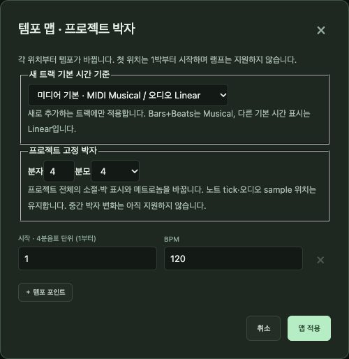
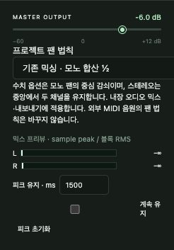

# 9. 재생·템포·믹싱

[← 차례](README.md) · [English](../en/09-playback-mixing.md)

## 9.1 재생의 원리

**재생**을 누르면 SovaRoll은 현재 곡을 오프라인으로 렌더링해 브라우저에서 재생합니다. 그래서 들리는 소리가 내보낼 소리와 정확히 같습니다. 대신 소리가 나기 전에 잠깐 준비 시간이 있고, 편집하면 재생이 멈춥니다(예전 렌더를 지금 곡으로 착각하지 않도록).

| 조작 | 동작 |
|---|---|
| **Space** | 재생/정지(입력칸에 쓰는 중이 아닐 때) |
| ⏮ | 처음으로 |
| 눈금자 클릭 | 재생 헤드 이동 |
| **반복** | Locator 사이 반복 |
| **미리 듣기** 메뉴 | 선택 클립 듣기, 선택 구간 재생, 미리 듣기 음량, 효과 우회, 스크럽 도구 |
| **재생 따라가기** | 재생 헤드를 화면에 유지 |

## 9.2 템포와 박자

- 템포 숫자를 눌러 BPM을 입력합니다.
- 템포 트랙 / 고정 템포: 템포 변화가 있는 템포 맵과 하나의 고정 템포 사이를 바꿉니다.
- 박자(4/4)를 누르면 템포 맵이 열립니다. 마디·박 위치에 템포 점을 추가하고, 프로젝트 박자와 새 트랙의 기본 시간 기준을 정합니다.
- **탭 템포**는 두드린 간격으로 BPM을 찾습니다.
- 오디오 트랙은 템포 변화를 따르거나(음악적 시간 기준) 초 단위로 고정됩니다(선형).

## 9.3 메트로놈과 카운트인

**메트로놈**을 켜고 음량을 정합니다. 클릭은 템포 맵을 따르고 마디 첫 박을 강조합니다. 재생과 녹음 카운트인 때 들리고, 내보내기에는 들어가지 않습니다.

## 9.4 믹싱

믹서는 트랙 헤더와 인스펙터에 있습니다.

1. 트랙마다 **게인**(−60 … +12 dB)과 **팬**, **M**/**S**. **Solo Defeat**는 다른 트랙을 솔로해도 이 트랙이 들리게 합니다.
2. 트랙 인스펙터 항목: **Pre**(입력 게인/극성), **4밴드 EQ**, **트랙 지연**, **프로젝트 효과 프리셋**(설정을 저장해 여러 트랙에 적용).
3. **MASTER OUTPUT**은 최종 음량, **프로젝트 팬 법칙**은 모노 팬의 감쇠 방식입니다.
4. **믹스 프리뷰** 미터는 L/R 샘플 피크와 RMS, 피크 유지를 보여 줍니다. 음량을 바꾸면 피크 유지를 초기화하세요.

> **잘 되는 믹싱 순서.** 먼저 페이더로 균형, 다음 팬, 그다음 EQ. 멜로디가 또렷한지, 베이스와 킥이 다투지 않는지, 믹스가 클리핑하지 않는지(마스터 미터가 끝까지 차지 않는지) 확인합니다. 그리고 잠깐 쉬었다가 작은 음량으로 다시 들어 보세요.

## 9.5 외부 MIDI (macOS, 선택)

MIDI 트랙을 하드웨어 신스나 다른 앱으로 연주하려면:

1. 도우미를 한 번 빌드합니다(Apple Swift 도구 필요): `node scripts/build-native-midi.mjs`
2. **MIDI 출력**: 트랙마다 대상 포트·채널과 재생 방식을 고릅니다.
3. **MIDI Chase**: 곡 중간에서 시작할 때 복원할 컨트롤러 종류.
4. **MIDI Reset**: All Notes Off / Reset All Controllers를 직접 또는 정지 때 보냅니다.

네이티브 MIDI 모드는 **MIDI만** 보내고 오디오 클립과 동기화하지 않습니다.

---
[← 8. 오디오](08-audio.md) · 다음: [10. 내보내기와 공유 →](10-export.md)
