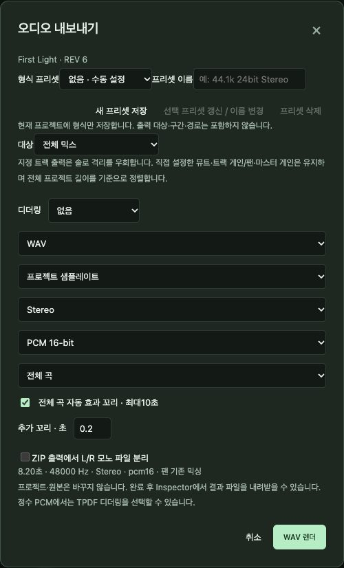
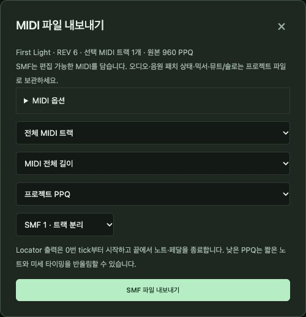

# 10. 내보내기와 공유

[← 차례](README.md) · [English](../en/10-export.md)

내보내기는 프로젝트를 다른 사람과 프로그램이 쓸 수 있는 파일로 바꿉니다. 프로젝트 자체도 꼭 남기세요. 내보낸 WAV는 사진이고, 프로젝트는 살아 있는 곡입니다.

| 원하는 것 | 사용 | 들어 있는 것 |
|---|---|---|
| 듣거나 발표할 오디오 파일 | **믹스 WAV 내보내기** | 믹스된 소리(WAV 또는 AIFF) |
| 다른 스튜디오용 트랙별 파일 | **믹스 WAV 내보내기** → 대상 *트랙별 개별 WAV · ZIP* | 트랙마다 정렬된 파일 |
| 다른 DAW용 편집 가능한 노트 | **MIDI 내보내기** | 노트, 템포, 박자, 트랙 이름, 마커 |
| 악보 | 악보 보기의 **MusicXML ↗** | 기보(7장) |
| 곡 전체 보관 | **백업 ZIP** | 프로젝트 + 모든 오디오 |

## 10.1 믹스 WAV 내보내기



1. **형식 프리셋**: *없음 · 수동 설정* 그대로 두거나, 자주 쓰는 설정을 프리셋으로 저장합니다.
2. **대상**: 전체 믹스, 지정 트랙 합산 WAV, 스템용 **트랙별 개별 WAV · ZIP**, 사이클 마커별 전체 믹스 · ZIP. 트랙 대상은 솔로를 우회하고, 직접 정한 뮤트와 게인은 유지합니다.
3. 정수 형식용 **디더링**(TPDF), **WAV/AIFF**, **샘플레이트**(프로젝트 또는 변환), **Stereo/Mono**, **PCM 16-bit / 24-bit / 32-bit float**.
4. **구간**: 전체 곡 또는 Locator 구간. 자동 효과 꼬리(최대 10초)와 추가 꼬리 초.
5. 스템 ZIP에서 **L/R 모노 파일 분리**.
6. **WAV 렌더**를 누릅니다. 끝나면 인스펙터에서 내려받습니다.

옵션 아래 요약 줄이 렌더 전에 정확한 길이·샘플레이트·형식을 알려 줍니다. 렌더는 꼬리 포함 10분까지입니다.

## 10.2 MIDI 내보내기



넣을 것(패치, 볼륨/팬, MIDI 수정자, 마커, 트랙 지연), 범위(모든 트랙 또는 선택), 구간(전체 또는 Locator), 해상도(PPQ), **format 0 또는 1**을 고르고 **SMF 파일 내보내기**. MIDI에는 노트와 컨트롤러가 들어 있고, 오디오·믹서 설정·내장 악기 소리는 들어 있지 않습니다.

## 10.3 백업 ZIP

상단 **백업 ZIP**은 프로젝트와 그것이 쓰는 모든 오디오 파일을 내용 검증 후 ZIP 하나로 모읍니다. 보관할 때, 다른 컴퓨터로 옮길 때, SovaRoll 업데이트 전에 쓰세요. 복원은 ZIP을 새 폴더에 풀고 **프로젝트 열기**로 `.newdaw.json` 파일을 엽니다.

## 10.4 Logic Pro 등 다른 DAW로 가져가기

1. **MIDI 내보내기**(format 1) — 편집 가능한 MIDI 리전으로 열립니다.
2. **믹스 WAV 내보내기** → 트랙별 개별 WAV — 모두 1마디에서 시작하는 정렬된 오디오 파일.
3. 템포와 함께 둘 다 보냅니다. 상대 DAW에서 같은 템포로 맞추고 MIDI와 스템을 처음 위치에 가져옵니다.

## 10.5 명령줄로 내보내기

```sh
npm run cli -- render mix.wav
npm run cli -- render mix24.wav --sample-format pcm24 --dither tpdf
npm run cli -- render loop.wav --locators
npm run cli -- render-stems stems.zip
npm run cli -- export-midi song.mid --midi-format 1
npm run cli -- export-musicxml score.musicxml
npm run cli -- export-bundle backup.zip
```

`--force`를 붙이지 않으면 기존 파일을 덮어쓰지 않습니다. 11장을 보세요.

---
[← 9. 재생과 믹싱](09-playback-mixing.md) · 다음: [11. 명령줄 →](11-cli.md)
