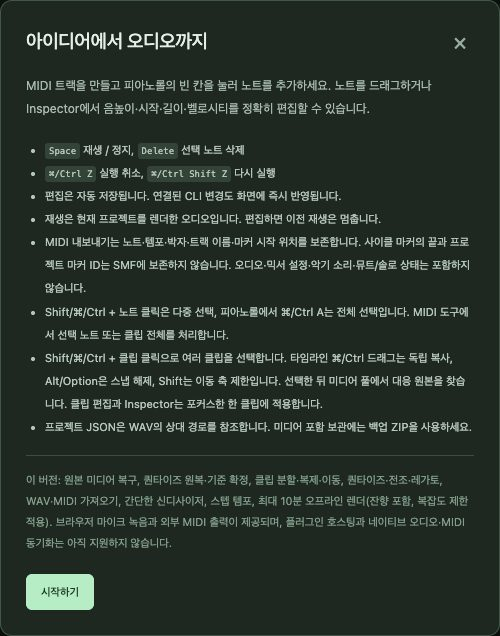

# 12. 참고 자료

[← 차례](README.md) · [English](../en/12-reference.md)

## 단축키

| 키 | 위치 | 동작 |
|---|---|---|
| **Space** | 입력칸 밖 어디서나 | 재생/정지 |
| **Ctrl/Cmd+Z** · **Ctrl/Cmd+Shift+Z** | 어디서나 | 실행 취소 · 다시 실행(CLI 편집 포함) |
| **Ctrl/Cmd+S** | 어디서나 | 명시 저장 |
| **?** | 어디서나 | 도움말 |
| **Ctrl/Cmd+A / C / X / V** | 피아노롤 | 노트 전체 선택 / 복사 / 잘라내기 / 커서에 붙여넣기(Shift+V는 시간 삽입) |
| **Delete** | 피아노롤 / 악보 | 선택 노트 삭제 |
| **← →** | 피아노롤 | 노트 선택 이동(Shift는 확장) |
| **Alt+↑↓**, **Shift+Alt+↑↓** | 악보 | 음계 한 단계 / 옥타브 이동 |
| **Ctrl/Cmd+A / C / X / V** | 타임라인 | 클립 전체 선택 / 복사 / 잘라내기 / 붙여넣기(Shift+V = 원래 위치) |
| **S** · **Shift+S** | 타임라인 | 선택 클립을 커서에서 · Locator에서 분할 |
| **M** | 타임라인 | 선택 클립 뮤트/해제 |
| **← →**(Shift = ×10) | 타임라인 | 선택 클립 조금씩 이동 |
| **Delete** | 타임라인 | 선택 클립 삭제 |
| **Esc** | 어디서나 | 선택 해제 / 끌기 취소 |
| **Ctrl/Cmd**+끌기 · **Alt**+끌기 · **Shift**+끌기 | 클립 | 복사 · 스냅 무시 · 축 고정 |
| **S** Shift+클릭 | 트랙 헤더 | 이 트랙만 솔로 |

## 음악 표

### 음표 값과 SNAP

| SNAP | 음표 | 틱(표시 PPQ 480) | 틱(저장 PPQ 960) |
|---|---|---:|---:|
| 1/2 | 2분음표 𝅗𝅥 | 960 | 1920 |
| 1/4 | 4분음표 ♩ | 480 | 960 |
| 1/8 | 8분음표 ♪ | 240 | 480 |
| 1/16 | 16분음표 𝅘𝅥𝅯 | 120 | 240 |

4/4 한 마디 = 4분음표 4개 = 표시 1920틱. 점음표는 1.5배, 셋잇단은 ⅔배.

### 벨로시티와 셈여림(일반적인 관례)

| 셈여림 | 뜻 | 벨로시티 |
|---|---|---:|
| *pp* | 피아니시모, 매우 여리게 | 20–35 |
| *p* | 피아노, 여리게 | 36–50 |
| *mp* | 메조 피아노, 조금 여리게 | 51–65 |
| *mf* | 메조 포르테, 조금 세게 | 66–80 |
| *f* | 포르테, 세게 | 81–100 |
| *ff* | 포르티시모, 매우 세게 | 101–127 |

### MIDI 노트 번호

| 음 | C1 | C2 | C3 | **C4(가온 다)** | A4(440 Hz) | C5 | C6 |
|---|---:|---:|---:|---:|---:|---:|---:|
| MIDI | 24 | 36 | 48 | **60** | 69 | 72 | 84 |

반음은 +1, 옥타브는 +12.

### 빠르기말(대략)

| 빠르기말 | BPM | 성격 |
|---|---|---|
| Largo 라르고 | 40–60 | 아주 느리고 폭넓게 |
| Adagio 아다지오 | 60–76 | 느리고 편안하게 |
| Andante 안단테 | 76–108 | 걷는 빠르기 |
| Moderato 모데라토 | 108–120 | 보통 빠르기 |
| Allegro 알레그로 | 120–156 | 빠르고 밝게 |
| Presto 프레스토 | 168–200 | 매우 빠르게 |

### 자주 쓰는 컨트롤러(CC)

| CC | 이름 | 주된 쓰임 |
|---:|---|---|
| 1 | 모듈레이션 | 비브라토, 필터 움직임 |
| 7 | 볼륨 | 채널 음량 |
| 10 | 팬 | 좌우 위치 |
| 11 | 익스프레션 | 볼륨 안에서 프레이즈의 강약 |
| 64 | 서스테인 페달 | 피아노 페달(64 이상 = 밟음) |
| 66 | 소스테누토 | 이미 누른 음만 유지 |

## 문제 해결

| 문제 | 확인할 것 |
|---|---|
| 브라우저에 "연결할 수 없음" | 터미널 창이 아직 열려 있나요? 다시 시작하고 터미널에 표시된 주소를 쓰세요 |
| 포트가 이미 사용 중 | 다른 SovaRoll이 실행 중 — 실행 파일이 그것을 엽니다. 또는 다른 포트로(`npm start -- --port 4318`) |
| 소리가 안 남 | 컴퓨터 음량과 출력 장치, 트랙/마스터 게인, 뮤트/솔로(**뮤트 해제/솔로 해제**), 렌더가 끝날 때까지 대기, 페이지를 한 번 클릭(브라우저는 상호작용 전 소리를 막음) |
| Logic이나 다른 DAW와 소리가 다름 | 내장 악기는 간단한 오실레이터입니다. MIDI를 내보내 그쪽의 실제 악기를 쓰세요 |
| "누락 미디어" 경고 | `assets/` 폴더가 함께 복사되지 않았습니다. 폴더 통째로 복사하거나 **미디어 풀**로 원본을 찾으세요 |
| "리비전 충돌" | 다른 창이나 CLI가 먼저 편집했습니다. 화면이 새로 고쳐지면 다시 편집하세요 |
| 녹음이 무음 | Chrome 마이크 권한(주소창 자물쇠), 입력 선택, 입력 dB, 케이블 |
| 녹음 중 하울링 | **모니터**를 끄거나 헤드폰 사용 |
| 타임 스트레치 불가 | FFmpeg를 설치해 PATH에 두거나 `NEWDAW_FFMPEG` 설정 |
| macOS가 실행 파일을 열 수 없다고 함 | 오른쪽 클릭 → **열기** → **열기**(한 번만) |
| 그 밖의 문제 | 앱의 **도움말**, **편집 이력**으로 한 단계씩 뒤로. 프로젝트 폴더를 보존하고 한 일을 순서대로 적어 문의하세요 |

## 용어집

| 용어 | 뜻 |
|---|---|
| BPM | 분당 박 수(템포) |
| 클립 / 파트 / 이벤트 | 트랙 위 블록: MIDI *파트* 또는 오디오 *이벤트* |
| 반복(사이클) | Locator 사이를 되풀이 재생 |
| dB, dBFS | 데시벨. dBFS는 디지털 최대치 기준(0 dBFS = 최대) |
| Locator | 눈금자의 왼쪽/오른쪽 구간 표시 |
| MIDI | 지시문으로 된 음악(음, 시간, 세기, 컨트롤러) |
| MusicXML | 악보 표준 파일 형식 |
| 팬 | 좌우 위치 |
| PPQ / 틱 | 4분음표당 펄스 수: MIDI의 시간 해상도 |
| 퀀타이즈 | 노트를 리듬 격자 쪽으로 옮기기 |
| 렌더 | 프로젝트로부터 최종 오디오를 계산 |
| 스냅(SNAP) | 편집할 때 위치와 길이가 따르는 격자 |
| 솔로 / 뮤트 | 솔로한 트랙만 듣기 / 트랙 소리 끄기 |
| 스템 | 트랙마다 내보낸 오디오 파일 |
| 벨로시티 | 음을 누르는 세기(1–127) |

## 현재 한계 (0.129)

- 내장 악기: 간단한 오실레이터. 샘플 악기 없음.
- 재생은 현재 곡의 오프라인 렌더(소리 나기 전 잠깐 대기). 저지연 실시간 엔진이 아님.
- 렌더 길이는 꼬리 포함 10분, WAV 가져오기는 파일당 32 MiB.
- VST/AU 악기 실시간 호스팅 없음. Audio Unit 효과·악기 렌더는 macOS 전용·실험 단계.
- 악보: 빔·잇단음표·인쇄 없음. 조표는 표시 전용.
- macOS + Chrome에서 검증. Windows/Linux 실행 파일은 제공하지만 검증이 적음.
- 접근성 작업 미완료. 번역은 원어민 편집자 검토 전.

---
[← 11. CLI](11-cli.md) · [차례](README.md)
