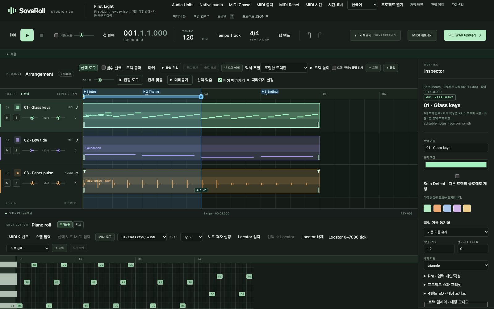

# SovaRoll 교본 — 사용 설명서

**Sovereign DAW / SovaRoll 0.129** · [English edition](../en/README.md) · [프로젝트 홈](../../../README.ko.md)

이 책은 처음 더블클릭하는 순간부터 완성된 믹스를 내보내기까지, 좋은 악기 교재처럼 한 번에 한 가지씩, 거의 모든 쪽에 **실제 프로그램 화면**을 곁들여 SovaRoll로 음악 만드는 법을 가르칩니다. 프로그래밍을 몰라도 됩니다. 1~3장만 읽어도 첫 곡을 만들어 내보낼 수 있고, 나머지는 필요할 때 펼쳐 보는 참고서입니다.

## 이 책을 읽는 법

- **굵은 글씨**는 화면에 보이는 이름입니다. 예: **믹스 WAV 내보내기**
- `코드 글씨`는 직접 입력하는 내용이나 파일 이름입니다.
- 모든 그림은 SovaRoll 0.129(macOS, Chrome)의 실제 화면으로, `scripts/manual/capture-screens.mjs`가 내장 데모 곡으로 촬영했습니다. 창 크기가 다르면 배치가 조금 달라 보일 수 있습니다.
- 화면 언어는 언제든 상단의 **English / 한국어**로 바꿀 수 있습니다. 이 한국어판은 한국어 화면을 보여 줍니다.
- 이 책에서 "검증"은 실제 프로그램 경로를 쓰는 자동 테스트로 확인했다는 뜻입니다. 소리의 품질과 실제 마이크는 언제나 여러분이 직접 듣고 판단합니다.

## 차례

| 장 | 배우는 내용 |
|---|---|
| [1. 설치·실행·업데이트·삭제](01-install.md) | Node.js 설치, SovaRoll 내려받기, 더블클릭 실행, 안전한 업데이트와 삭제 |
| [2. 화면 둘러보기](02-tour.md) | 창의 모든 영역을 번호 그림으로 |
| [3. 30분 만에 첫 곡](03-first-song.md) | 수업: 화음·멜로디·베이스·셈여림·믹스·내보내기 |
| [4. 프로젝트·저장·안전장치](04-projects.md) | 저장, 버전, 편집 이력, 자동백업, 복구, 미디어 풀 |
| [5. 트랙·클립·편곡](05-arrangement.md) | 트랙, 폴더, 마커, Locator, 분할·반복·이동, 클립 도구 |
| [6. MIDI 편집 깊이 보기](06-midi.md) | 피아노롤, 스텝 입력, MIDI 도구, 컨트롤러 레인, 이벤트 목록, 격자와 시간 |
| [7. 악보 보기와 MusicXML](07-score.md) | 큰보표에서 읽고 쓰기, 악보 프로그램으로 내보내기 |
| [8. 오디오: 가져오기·녹음·편집](08-audio.md) | WAV/AIFF/MIDI 가져오기, 마이크·MIDI 녹음, 클립 편집, Audio Units |
| [9. 재생·템포·믹싱](09-playback-mixing.md) | 트랜스포트, 템포와 박자, 메트로놈, 반복, 믹서, 미터, MIDI 출력 |
| [10. 내보내기와 공유](10-export.md) | WAV/AIFF 믹스, 스템, MIDI, MusicXML, 백업 ZIP |
| [11. 명령줄(CLI)](11-cli.md) | 터미널로 모든 작업 하기 — 같은 실행 취소 이력 |
| [12. 참고 자료](12-reference.md) | 단축키, 음악 표, 문제 해결, 용어집, 현재 한계 |

## 한 쪽 요약

1. **시작**: `Start SovaRoll.command`(Mac) 또는 `Start SovaRoll.bat`(Windows)를 더블클릭하면 브라우저가 `http://127.0.0.1:4317`로 열립니다.
2. **쓰기**: **+ 트랙** 또는 큰 **+**를 누르고, 피아노롤을 클릭해 노트를 넣고, 끌어서 옮깁니다.
3. **듣기**: **Space**. 고치고 다시 듣고, **Ctrl/Cmd+Z**로 비교합니다.
4. **안전 지점 저장**: **Ctrl/Cmd+S**. 모든 편집은 자동으로도 저장됩니다.
5. **내보내기**: 소리는 **믹스 WAV 내보내기**, 노트는 **MIDI 내보내기**, 전부 보관은 **백업 ZIP**.
6. **끝내기**: 재생을 멈추고 터미널 창을 닫습니다(또는 그 창에서 Ctrl+C).

곡은 홈 폴더의 `Music/SovaRoll`(음악/SovaRoll)에 앱과 따로 저장됩니다. 앱을 업데이트하거나 지워도 곡은 지워지지 않습니다.

## SovaRoll은 무엇인가 (그리고 아직 아닌 것)

SovaRoll은 내 컴퓨터에서 실행되는 독립 오픈소스 MIDI·오디오 작업 프로그램(DAW)입니다. 브라우저 창과 명령줄이 **같은 프로젝트를 같은 실행 취소 이력으로** 편집합니다. 전문가급 DAW를 목표로 개발 중입니다. 지금은 간단한 내장 신시사이저(샘플 악기 라이브러리 아님), 최대 10분 오프라인 렌더, 브라우저 마이크 녹음, 선택적 macOS MIDI 출력, 실험적 Audio Unit 효과를 제공합니다. VST/AU 악기의 실시간 호스팅이나 저지연 네이티브 녹음은 아직 없습니다. 이 책은 그런 한계를 항상 밝힙니다.

---
다음: [1. 설치·실행·업데이트·삭제 →](01-install.md)
